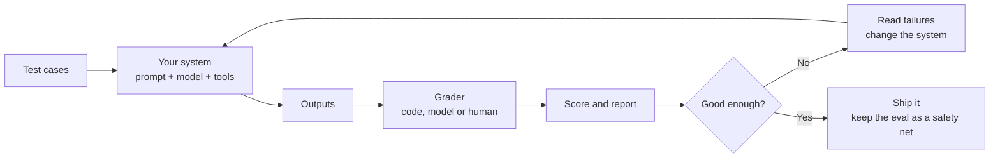

# 1. Why evaluate?

> **In one line:** An evaluation ("eval") is a repeatable test that tells you, with numbers, how good your LLM or LLM app is. Without it you are guessing.

## The problem

A normal program is easy to test. `2 + 2` must give `4`. Every time.

An LLM is different:

- **The output is open.** There are many good answers to "Summarise this email". There are also many bad ones.
- **The output can change.** Ask the same question twice and you may get two different answers. This is called **non-deterministic** behaviour.
- **Small changes have big effects.** You change one line in the prompt to fix one problem. Three other things break, and you do not notice.
- **The model sounds sure even when it is wrong.** So reading a few answers and saying "looks fine" is risky.

Reading a few answers by eye has a name: a **vibe check**. A vibe check is a fine first step. It is not enough to ship a product.

## What an eval is

An eval has four parts.

| Part | Meaning | Example |
|---|---|---|
| **Test cases** (dataset) | Inputs you will try, often with the expected result | "How long do refunds take?" → must say "5 days" |
| **System under test** | The thing you measure | Your prompt + model + retrieval + tools |
| **Grader** (scorer) | Code, a model, or a person that decides if an output is good | "Does the answer contain 5?" |
| **Metric** | One number that sums up many graded outputs | Pass rate = 10 of 12 = 83% |



The loop is the important part. You do not run an eval once. You run it after every change.

## What evals are used for

1. **Choosing.** Which model is best for my task? Is the cheaper model good enough?
2. **Improving.** Did my new prompt make things better or worse?
3. **Protecting.** Did today's change break something that worked yesterday? A drop like this is called a **regression**.
4. **Deciding to release.** Is the system safe and good enough for real users?
5. **Watching.** Is quality still fine after release, with real users?

## Two things people call "evaluation"

| | Model evaluation | Application evaluation |
|---|---|---|
| What is tested | The model alone | Your whole app: prompt, retrieval, tools, guardrails |
| Who does it | Research labs, model makers | You, the app builder |
| Typical test | Public **benchmark** (a shared, standard test set) such as MMLU | Your own test cases from your own users |
| Question answered | "How capable is this model in general?" | "Does my product do its job?" |

Both matter. But a high benchmark score does **not** mean the model will be good in *your* app. Most of this handbook is about the second column, because that is the work you will do yourself.

## Offline and online

- **Offline eval:** you run a fixed test set on your own machine before release. Fast, safe, repeatable.
- **Online eval:** you measure with real users after release. For example an **A/B test**, where half the users get version A and half get version B, and you compare.

Start offline. Add online checks when you have users.

## A tiny example

You do not need a framework. This is already an eval:

```python
test_cases = [
    {"question": "How long do refunds take?", "must_include": "5"},
    {"question": "What is the delivery fee?", "must_include": "40"},
]

passed = 0
for case in test_cases:
    answer = my_bot(case["question"])          # the system under test
    if case["must_include"] in answer:         # the grader
        passed += 1

print("pass rate:", passed / len(test_cases))  # the metric
```

A full version of this is in [chapter 11](11-build-your-first-eval.md).

## Key terms

- **Eval:** a repeatable test of an LLM system that produces a score.
- **Vibe check:** judging quality by reading a few outputs, with no fixed test.
- **Non-deterministic:** the same input can give different outputs.
- **Grader / scorer:** the thing that decides if one output is good.
- **Metric:** a number that sums up many results.
- **Regression:** something that worked before and is now broken.
- **Benchmark:** a public, standard test set used to compare models.

## Revision questions

1. Why is testing an LLM harder than testing a normal function?
2. Name the four parts of an eval.
3. What is a regression, and how does an eval help with it?
4. What is the difference between model evaluation and application evaluation?
5. Is a vibe check useless?

<details>
<summary>Show answers</summary>

1. The output is open-ended (many right answers), can change between runs, and small prompt changes can have large effects that are hard to see by eye.
2. Test cases, the system under test, a grader, and a metric.
3. A regression is when a change breaks something that used to work. If you re-run the same eval after every change, a lower score shows the regression at once.
4. Model evaluation tests the model alone, usually on public benchmarks. Application evaluation tests your whole product on your own task and data.
5. No. It is a good first look and helps you find what to test. But it is not repeatable and it covers few cases, so you cannot rely on it alone.

</details>

## Sources

- Anthropic, [Demystifying evals for AI agents](https://www.anthropic.com/engineering/demystifying-evals-for-ai-agents) (2026)
- Hamel Husain, [Your AI Product Needs Evals](https://hamel.dev/blog/posts/evals/) (2024)
- Anthropic docs, [Define success criteria and build evaluations](https://platform.claude.com/docs/en/test-and-evaluate/develop-tests)

---
Next: [2. Kinds of evals](02-kinds-of-evals.md) · [Back to contents](../README.md)
