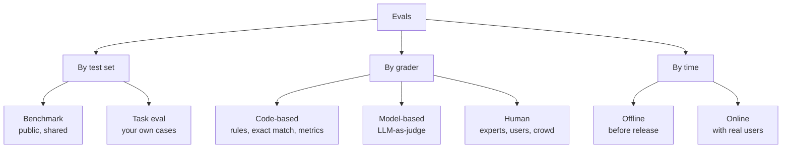
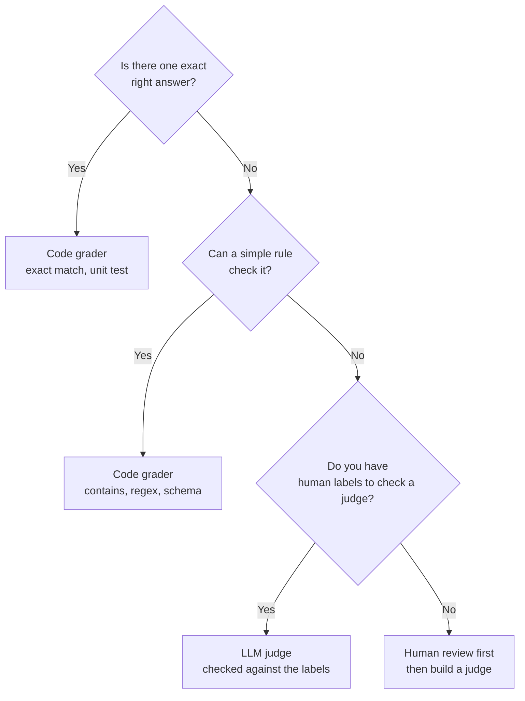

# 2. Kinds of evals

> **In one line:** Evals differ in *what test set* you use (public benchmark or your own cases) and *who grades* (code, a model, or a human). Each choice trades cost against quality.

## The big picture

## 1. Benchmarks

A **benchmark** is a public test set with a fixed way to score it. Everybody uses the same questions, so models can be compared.

Examples: MMLU (multiple-choice questions across 57 subjects), HumanEval (write Python functions that must pass unit tests), SWE-bench (fix real GitHub issues).

- Good for: comparing models in general, following progress in the field.
- Weak for: telling you if a model is good at *your* task. Benchmarks also get old and can leak into training data. See [chapter 9](09-benchmarks-and-their-limits.md).

## 2. Task evals (your own)

A **task eval** uses test cases that *you* wrote for *your* app. This is the most useful kind for builders. Several well-known practical guides give the same advice: generic benchmarks do not replace evals built for your own problem.

## 3. Three kinds of grader

This table follows the grouping used in Anthropic's guide on agent evals.

| Grader | How it works | Good | Bad |
|---|---|---|---|
| **Code-based** | A rule in code: exact match, "contains this word", valid JSON, unit test passes, a metric such as F1 | Fast, cheap, same result every time, easy to debug | Brittle. Fails on a correct answer written in different words. Weak on nuance |
| **Model-based** (LLM-as-judge) | Another LLM reads the output and grades it with a rubric | Flexible, handles open-ended text, scales | Not the same every run, costs more, must be checked against humans |
| **Human** | People read and grade | The "gold standard". Matches expert judgement | Slow, expensive, people disagree and get tired |

**A good habit:** use code where you can, a model judge where you must, and humans to check that the other two are right.

## 4. Reference-based and reference-free

- **Reference-based:** you have a correct answer (the **reference** or **gold answer**) and you compare the output to it. Example: BLEU, exact match.
- **Reference-free:** there is no gold answer. You check a property of the output instead. Example: "Is the answer polite?", "Is every claim supported by the document?"

Reference-free checks are useful after release, because real user questions do not come with gold answers.

## 5. Capability evals and regression evals

Anthropic's guide makes a helpful split:

- **Capability eval:** hard tasks the system cannot do well yet. The pass rate starts low. It gives you a hill to climb.
- **Regression eval:** tasks the system already does well. The pass rate should stay near 100%. It tells you when you break something.

When the system gets good at a capability eval, those tasks can move into the regression set.

## 6. Three levels in practice

Hamel Husain describes three levels for a product team. The cost goes up at each level, so you run the higher levels less often.

| Level | What | When to run |
|---|---|---|
| 1. Unit tests | Fast code checks on small, clear cases | On every change |
| 2. Human and model eval | Read logged conversations ("traces"); use an LLM judge that is checked against human labels | On a schedule, for example every week |
| 3. A/B testing | Compare versions with real users | Before big changes, in mature products |

## Which should I start with?

1. Write 20 to 50 test cases from real or realistic use.
2. Grade with code where possible.
3. Read the failures yourself.
4. Add an LLM judge only for what code cannot check.
5. Keep everything and re-run it on every change.

## Key terms

- **Benchmark:** shared public test set with fixed scoring.
- **Task eval:** test set made for one specific app.
- **LLM-as-judge:** using a model to grade outputs.
- **Reference / gold answer:** the known correct answer for a test case.
- **Trace:** the saved record of one run (inputs, steps, outputs).
- **A/B test:** show two versions to different users and compare results.

## Revision questions

1. Give one strength and one weakness of each grader type: code, model, human.
2. What is the difference between reference-based and reference-free evaluation?
3. Why is a regression eval expected to score near 100%, but a capability eval is not?
4. Why are public benchmarks not enough for an app builder?

Show answers

1. Code: fast and repeatable, but brittle. Model: flexible on open text, but varies between runs and must be checked against humans. Human: most trusted, but slow and costly.
2. Reference-based compares the output with a known correct answer. Reference-free checks a property of the output without a gold answer.
3. A regression eval holds tasks the system already does well, so any drop is a warning. A capability eval holds tasks that are still hard, so a low score is normal and shows room to improve.
4. They measure general skill on someone else's questions. They do not cover your users, your data or your rules, and their questions may already be in the model's training data.

## Sources

- Anthropic, [Demystifying evals for AI agents](https://www.anthropic.com/engineering/demystifying-evals-for-ai-agents) (2026)
- Hamel Husain, [Your AI Product Needs Evals](https://hamel.dev/blog/posts/evals/) (2024)
- Eugene Yan, [Patterns for Building LLM-based Systems & Products](https://eugeneyan.com/writing/llm-patterns/) (2023)

---
Previous: [1. Why evaluate?](01-why-evaluate.md) · Next: [3. Classic metrics](03-classic-metrics.md) · [Back to contents](../README.md)
