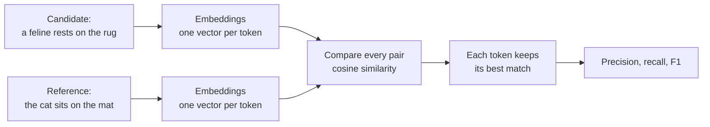

# 3. Classic metrics

> **In one line:** Classic metrics turn "how good is this output?" into a number by counting: right labels (accuracy, F1), shared words (BLEU, ROUGE), similar meaning (BERTScore), or how surprised the model is (perplexity).

All the numbers in this chapter come from the scripts in [`code/`](code/). Run them and change the examples.

## Which metric for which task?

| Task | Common metrics |
|---|---|
| Classification (spam / not spam) | Accuracy, precision, recall, F1 |
| Short factual answers | Exact match, token F1 |
| Translation | BLEU |
| Summarisation | ROUGE |
| Any text with a reference | BERTScore |
| A language model itself | Perplexity |

## 1. Accuracy, precision, recall, F1

Take a spam filter. For each message there are four cases. This table is called a **confusion matrix**.

| | Really spam | Really ok |
|---|---|---|
| **Model says spam** | True positive (TP) | False positive (FP) |
| **Model says ok** | False negative (FN) | True negative (TN) |

- **Accuracy** = (TP + TN) / all. "How often is the model right?"
- **Precision** = TP / (TP + FP). "When it says spam, how often is it really spam?"
- **Recall** = TP / (TP + FN). "Of all real spam, how much did it find?"
- **F1** = 2 × precision × recall / (precision + recall). One number that is high only when both are high.

**Worked example.** 10 messages. The model gives TP = 2, FP = 1, FN = 1, TN = 6.

- Accuracy = (2 + 6) / 10 = **0.80**
- Precision = 2 / (2 + 1) = **0.67**
- Recall = 2 / (2 + 1) = **0.67**
- F1 = 2 × 0.67 × 0.67 / (0.67 + 0.67) = **0.67**

**Why accuracy can fool you.** Take 100 messages: 95 ok, 5 spam. A lazy model that always says "ok" has accuracy 0.95. But its recall is 0. It never finds spam. When one class is rare (**imbalanced data**), look at precision, recall and F1.

Code: [`code/ch03_accuracy_f1.py`](code/ch03_accuracy_f1.py)

## 2. Exact match and token F1

For short answers:

- **Exact match (EM):** 1 if the answer equals the gold answer after simple cleaning, else 0.
- **Token F1:** F1 over the shared words. It gives part marks.

| Prediction | Gold | EM | Token F1 |
|---|---|---|---|
| Paris | Paris | 1 | 1.00 |
| The capital is Paris. | Paris | 0 | 0.40 |
| London | Paris | 0 | 0.00 |

Row 2 is correct for a human, but EM gives 0. This is the main weakness of strict matching.

## 3. BLEU

**BLEU** was made for machine translation (Papineni et al., 2002). It measures **n-gram precision**: how many word groups in the output also appear in the reference.

An **n-gram** is a group of n words in a row. "the cat" is a 2-gram (bigram).

BLEU has three ideas:

1. **Clipped precision.** A word group only counts as many times as it appears in the reference. So "the the the the" cannot cheat.
2. **Geometric mean** of the precisions for n = 1, 2, 3, 4.
3. **Brevity penalty (BP).** Very short outputs get punished, because short outputs get high precision too easily.

**Worked example.**

- Reference: `the cat is on the mat`
- Candidate: `the cat sat on the mat`

| n | Matching n-grams | Precision |
|---|---|---|
| 1 | the, cat, on, the, mat | 5/6 |
| 2 | "the cat", "on the", "the mat" | 3/5 |
| 3 | "on the mat" | 1/4 |
| 4 | none | 0/3 |

- Both have 6 words, so BP = 1.
- BLEU-2 = √(5/6 × 3/5) = √0.5 = **0.707**
- BLEU-4 = **0**, because the 4-gram precision is 0 and a geometric mean with a zero is zero.

That zero is why sentence-level BLEU needs **smoothing** (adding a small number so that one zero does not kill the score). With simple add-one smoothing our script gives 0.485. BLEU was designed to be averaged over a whole test set, not for one sentence.

**Weakness.** The candidate `a feline rests on the rug` means almost the same thing, but shares few words. Its BLEU-2 is only 0.258.

## 4. ROUGE

**ROUGE** was made for summarisation (Lin, 2004). It is mainly about **recall**: how much of the reference appears in the output.

- **ROUGE-1:** overlap of single words.
- **ROUGE-2:** overlap of bigrams.
- **ROUGE-L:** based on the **longest common subsequence (LCS)**: the longest list of words that appear in both texts in the same order, gaps allowed.

Same example as above:

- ROUGE-1 recall = 5/6 = **0.833**
- ROUGE-2 recall = 3/5 = **0.600**
- ROUGE-L: the LCS is "the cat on the mat" (5 words), so recall = 5/6 = **0.833**

A simple way to remember: **BLEU asks "is what I wrote in the reference?" (precision). ROUGE asks "is the reference in what I wrote?" (recall).**

Code: [`code/ch03_bleu_rouge.py`](code/ch03_bleu_rouge.py)

## 5. BERTScore

BLEU and ROUGE only see exact words. **BERTScore** (Zhang et al., 2019) compares *meaning*.

1. A BERT model turns each token into an **embedding**: a list of numbers that holds its meaning in context.
2. Each candidate token is compared with each reference token using **cosine similarity** (1 = same direction, 0 = unrelated).
3. Each token takes its best match. Averages give precision, recall and F1.

Our script uses tiny hand-made vectors so that it runs without a model download. It is a toy, but it shows the effect:

| Candidate | Exact word overlap | Toy BERTScore F1 |
|---|---|---|
| the cat sits on the mat | 1.00 | 1.000 |
| a feline rests on the rug | 0.33 | 0.998 |
| the dog runs on the mat | 0.67 | 0.940 |

Row 2: few shared words, but high score, because "feline" is near "cat". Good.
Row 3: the meaning changed (dog, runs), but the score is still high. So embedding metrics are better than word overlap, but they do not check facts.

Code: [`code/ch03_bertscore_idea.py`](code/ch03_bertscore_idea.py)

## 6. Perplexity

**Perplexity** measures how well a language model predicts a text. It is a property of the *model*, not of one answer.

Formula: perplexity = exp(− average of log p), where p is the probability the model gave to each real next token.

**Worked example.** The model gave the real next tokens these probabilities: 0.5, 0.25, 0.5, 0.25.

- Product = 0.5 × 0.25 × 0.5 × 0.25 = 1/64
- Perplexity = (64)^(1/4) = **2.83**

Meaning: on average the model was as unsure as if it had to choose among about 2.8 equally likely tokens.

- Always sure and right → perplexity 1 (the best possible).
- Guessing among 10 equal options → perplexity 10.

**Limits.** Low perplexity means "this text looks likely to the model". It does not mean the text is true or useful. You also cannot fairly compare perplexity between models with different tokenisers.

Code: [`code/ch03_perplexity.py`](code/ch03_perplexity.py)

## What all classic metrics miss

- They need a reference (except perplexity).
- They reward looking similar, not being correct. "Refunds take 5 days" and "Refunds take 50 days" share almost every word.
- They do not check tone, safety, or whether the user's problem was solved.

That is why modern LLM evals add LLM judges ([chapter 4](04-llm-as-judge.md)) and task-specific checks.

## Key terms

- **Confusion matrix:** table of TP, FP, FN, TN.
- **Precision / recall:** how right the positive calls are / how many positives were found.
- **n-gram:** n words in a row.
- **Brevity penalty:** BLEU's punishment for too-short outputs.
- **LCS:** longest common subsequence.
- **Embedding:** a vector (list of numbers) that represents meaning.
- **Perplexity:** exp of the average negative log-probability. Lower is better.

## Revision questions

1. A test has 990 healthy people and 10 sick people. A model says "healthy" for everyone. What are its accuracy and recall (for "sick")? What does this teach?
2. In one sentence each: what does BLEU measure, and what does ROUGE measure?
3. Why can BLEU-4 for one sentence be zero even when the sentence is nearly right?
4. What can BERTScore do that BLEU cannot? What can it still not do?
5. A model gives probabilities 0.25, 0.25, 0.25, 0.25 to the real next tokens. What is the perplexity?

Show answers

1. Accuracy = 990/1000 = 0.99. Recall = 0/10 = 0. Accuracy hides failure on a rare class, so use precision, recall and F1 with imbalanced data.
2. BLEU measures how many of the output's n-grams appear in the reference (precision, with a brevity penalty). ROUGE measures how many of the reference's n-grams (or its longest common subsequence) appear in the output (recall).
3. BLEU is a geometric mean of the 1- to 4-gram precisions. If no 4-gram matches, one factor is zero, so the whole score is zero. Smoothing or averaging over many sentences fixes this.
4. It gives credit to different words with similar meaning, because it compares embeddings. It still cannot check whether the facts are correct.
5. Perplexity = 1 / 0.25 = 4.

## Sources

- Papineni et al., [BLEU: a Method for Automatic Evaluation of Machine Translation](https://aclanthology.org/P02-1040/) (2002)
- Lin, [ROUGE: A Package for Automatic Evaluation of Summaries](https://aclanthology.org/W04-1013/) (2004)
- Zhang et al., [BERTScore: Evaluating Text Generation with BERT](https://arxiv.org/abs/1904.09675) (2019)
- Jurafsky and Martin, [Speech and Language Processing](https://web.stanford.edu/~jurafsky/slp3/) (free online textbook; see the chapter on n-gram language models for perplexity)

---
Previous: [2. Kinds of evals](02-kinds-of-evals.md) · Next: [4. LLM-as-judge](04-llm-as-judge.md) · [Back to contents](../README.md)
