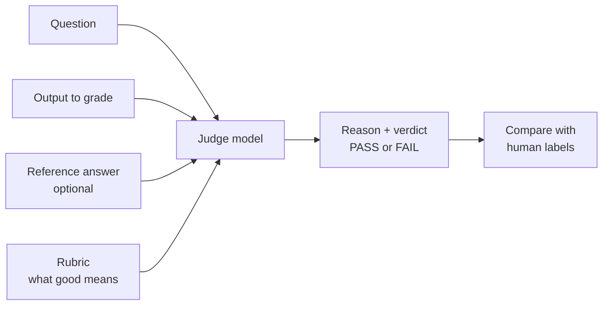

# 4. LLM-as-judge

> **In one line:** An LLM judge is a model that grades another model's output using a rubric you write. It is flexible and cheap, but you must check it against human labels before you trust it.

## Why use a model as a grader?

Code graders fail on open-ended text. "You will get your money back in five business days" is a correct answer, but it does not contain the string "5 working days".

Humans can grade this, but humans are slow and costly.

An **LLM judge** sits in the middle: it reads like a human and runs like code.



## Three ways to ask a judge

| Style | The judge sees | Output | Use when |
|---|---|---|---|
| **Pointwise** (single answer) | One output | PASS/FAIL or a score | Checking a clear rule |
| **Pairwise** | Two outputs, A and B | "A is better" / "B is better" / tie | Comparing two models or prompts |
| **Reference-guided** | One output + the gold answer | PASS/FAIL | You have gold answers but wording varies |

## How to write a good judge prompt

1. **One criterion at a time.** Do not ask for "quality". Ask "Does the answer agree with the reference on the refund time?"
2. **Prefer PASS/FAIL over a 1–5 scale.** People and models do not agree on what a "3" means. A binary choice forces a clear rule. Hamel Husain's guide strongly recommends this.
3. **Define the rubric in words.** Say exactly what counts as PASS and FAIL.
4. **Ask for a short reason before the verdict.** This makes the judge think first, and the reason helps you debug.
5. **Ask for a fixed format** such as JSON, so that code can read the result.
6. **Tell it what not to reward.** For example: "Do not reward long answers."
7. **Use temperature 0** to make results more stable.

Example prompt from [`code/ch04_llm_judge.py`](code/ch04_llm_judge.py):

```text
You are grading an answer from a customer support bot.

Question: {question}
Reference answer (correct): {reference}
Bot answer: {answer}

Rubric:
- PASS if the bot answer agrees with the reference answer on the key fact.
- FAIL if the key fact is missing, wrong, or contradicted.
- Do not reward long answers. Do not punish short answers.

First think in one short sentence. Then give the verdict.
Reply with JSON only, like this:
{"reason": "one short sentence", "verdict": "PASS"}
```

## Known problems (biases)

A **bias** here means a steady error in one direction. The paper *Judging LLM-as-a-Judge with MT-Bench and Chatbot Arena* (Zheng et al., 2023) studied these:

| Bias | What happens | A fix |
|---|---|---|
| **Position bias** | In pairwise grading, the judge prefers the answer shown first (or second) | Run twice with A and B swapped. Count a win only if both runs agree |
| **Verbosity bias** | Longer answers get better grades, even when they are not better | Say so in the rubric. Test with padded answers |
| **Self-enhancement bias** | A judge may prefer answers written by itself | Use a different model as judge, or check with humans |
| **Weak at maths and logic** | The judge can be fooled by a wrong but confident answer | Give the reference answer. Let the judge reason first |

The same paper found that a strong judge model can agree with human experts more than 80% of the time, which was about as often as the humans agreed with each other. So judges can work. But "can work" is not "works on your task". You have to check.

## G-Eval in two sentences

**G-Eval** (Liu et al., 2023) is a well-known judge method. It asks the model to first write its own evaluation steps (chain-of-thought), then fill in a score form, and it weights the score by the model's probabilities to get finer scores. It showed better agreement with humans on summarisation than older metrics such as BLEU and ROUGE.

## Check your judge against humans

This step is not optional. The process:

1. Take 30 to 100 real outputs.
2. A person who knows the domain labels each PASS or FAIL and writes one line on why.
3. Run the judge on the same outputs.
4. Compare.
5. Read every disagreement. Fix the rubric. Repeat.

**What to measure:**

- **Agreement:** share of cases where judge = human.
- **Cohen's kappa (κ):** agreement corrected for luck. 1 = perfect, 0 = no better than chance.
- **True positive rate and true negative rate:** how often the judge is right on the real PASS cases and on the real FAIL cases, separately. This matters when failures are rare: a judge that says PASS every time has high agreement but catches nothing.

**Worked kappa example.** 8 answers. Humans: 4 PASS, 4 FAIL. Judge: 4 PASS, 4 FAIL. They agree on 6 of 8.

- Observed agreement = 6/8 = 0.75
- Agreement by luck = (0.5 × 0.5) + (0.5 × 0.5) = 0.50
- κ = (0.75 − 0.50) / (1 − 0.50) = **0.50**

This is exactly what the script prints with the mock judge. The two cases it gets wrong are worth reading:

```text
7. judge=FAIL human=PASS  answer: It needs five business days.
8. judge=PASS human=FAIL  answer: Refunds never take 5 working days. Refunds take 10 ...
```

Case 7: a paraphrase the weak judge did not understand. Case 8: the right number is present, but the meaning is opposite.

## Criteria drift

The paper *Who Validates the Validators?* (Shankar et al., 2024) found something practical: people often change their grading rules *while* they grade. You only learn what "good" means after seeing many outputs. The authors call this **criteria drift**. So expect to rewrite your rubric a few times. That is normal.

## When not to use a judge

- When a code check can do the job. It is cheaper and exact.
- When no human has looked at the data yet. Look first.
- When the judge needs knowledge it does not have (private facts, fresh news), unless you give it that knowledge.

## Key terms

- **LLM-as-judge:** a model that grades outputs.
- **Rubric:** written rules for grading.
- **Pointwise / pairwise:** grade one output / choose between two.
- **Position, verbosity, self-enhancement bias:** judge errors linked to order, length, and its own style.
- **Cohen's kappa:** agreement between two graders, corrected for chance.
- **Criteria drift:** grading rules that change as you see more outputs.

## Revision questions

1. Why is PASS/FAIL often better than a 1–5 score for a judge?
2. What is position bias and how do you reduce it?
3. A judge agrees with humans on 95% of cases. 95% of the cases are PASS. Why might this judge still be useless?
4. Humans and a judge agree on 9 of 10 cases. Both label 5 PASS and 5 FAIL. What is Cohen's kappa?
5. Why should the judge write its reason before the verdict?

<details>
<summary>Show answers</summary>

1. A binary choice needs a clear rule, so people and models apply it the same way. Middle scores like "3" mean different things to different graders.
2. The judge prefers an answer because of where it appears (first or second). Run the comparison twice with the order swapped and only count results that agree.
3. A judge that always says PASS would also score 95%. Check the true negative rate: how many real FAIL cases it catches.
4. Observed = 0.9. Chance = 0.5 × 0.5 + 0.5 × 0.5 = 0.5. κ = (0.9 − 0.5) / (1 − 0.5) = 0.8.
5. Writing the reason first makes the model think before deciding, and gives you text to read when the verdict is wrong.

</details>

## Sources

- Zheng et al., [Judging LLM-as-a-Judge with MT-Bench and Chatbot Arena](https://arxiv.org/abs/2306.05685) (2023)
- Liu et al., [G-Eval: NLG Evaluation using GPT-4 with Better Human Alignment](https://arxiv.org/abs/2303.16634) (2023)
- Shankar et al., [Who Validates the Validators?](https://arxiv.org/abs/2404.12272) (2024)
- Gu et al., [A Survey on LLM-as-a-Judge](https://arxiv.org/abs/2411.15594) (2024)
- Hamel Husain, [Using LLM-as-a-Judge For Evaluation: A Complete Guide](https://hamel.dev/blog/posts/llm-judge/) (2024)
- Eugene Yan, [Evaluating the Effectiveness of LLM-Evaluators](https://eugeneyan.com/writing/llm-evaluators/)

---
Previous: [3. Classic metrics](03-classic-metrics.md) · Next: [5. Evaluating RAG](05-evaluating-rag.md) · [Back to contents](../README.md)
