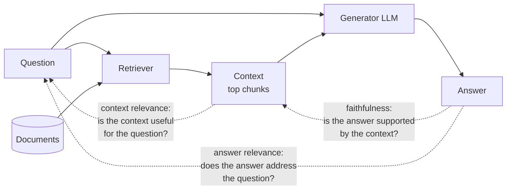

# 5. Evaluating RAG

> **In one line:** A RAG app has two parts, a retriever and a generator. Test each part alone and both together, using three questions: Did we fetch the right text? Did the answer stick to that text? Did the answer address the question?

## What RAG is

**RAG** means **retrieval-augmented generation** (Lewis et al., 2020). Instead of answering from memory, the app first looks up text, then writes the answer from it.

1. **Retriever:** finds pieces of text (**chunks**) that match the question. The retrieved chunks are called the **context**.
2. **Generator:** the LLM writes an answer using the question and the context.

## The three core questions

The Ragas paper (Es et al., 2023) proposed these three, and the ARES paper (Saad-Falcon et al., 2023) uses the same three. People sometimes call them the "RAG triad".

| Metric | Question it asks | Which part it tests | Needs a gold answer? |
|---|---|---|---|
| **Context relevance** | Is the retrieved text about the question, with little noise? | Retriever | No |
| **Faithfulness** (groundedness) | Is every claim in the answer supported by the context? | Generator | No |
| **Answer relevance** | Does the answer actually address the question? | Generator | No |

None of the three needs a gold answer. That is why they are popular: you can run them on real user traffic.

### Faithfulness, step by step

The Ragas documentation defines it like this:

1. Split the answer into small **claims** (single statements).
2. For each claim, check if it can be inferred from the context.
3. Faithfulness = supported claims / all claims. Range 0 to 1.

**Worked example.**

Context: "Refunds are sent to the original payment method within 5 working days."

Answer: "Refunds are sent to the original payment method. Refunds take 2 working days. You also get a 100 rupees gift card."

| Claim | Supported? |
|---|---|
| Refunds are sent to the original payment method. | Yes |
| Refunds take 2 working days. | No (context says 5) |
| You also get a 100 rupees gift card. | No (not in context) |

Faithfulness = 1 / 3 = **0.33**

Real tools use an LLM for steps 1 and 2. Our script uses simple word and number rules so it runs anywhere: [`code/ch05_rag_metrics.py`](code/ch05_rag_metrics.py).

A low faithfulness score is the usual sign of **hallucination** in a RAG app: the model added things that are not in the source.

### Answer relevance

An answer can be 100% faithful and still useless.

- Question: "How long does a refund take?"
- Answer: "Our company was started in 2015." (Maybe true and in the context. Not what was asked.)

Ragas (where the metric is now named *Response Relevancy*) measures this with a trick: an LLM writes questions that the answer would fit, and these are compared with the real question using embeddings. If they are close, the answer was on topic.

### Context relevance, precision and recall

Tools split retrieval quality into parts:

- **Context precision:** of the chunks we fetched, how many are useful, and are the useful ones ranked at the top?
- **Context recall:** of the facts needed for the correct answer, how many are in the fetched chunks? (This one needs a gold answer.)

## Classic retrieval metrics

If you have labels that say which chunks are relevant for each question, you can test the retriever alone with code. No LLM needed.

| Metric | Meaning |
|---|---|
| **Precision@k** | Of the top k results, what share is relevant? |
| **Recall@k** | Of all relevant chunks, what share is in the top k? |
| **MRR** (mean reciprocal rank) | 1 / position of the first relevant result, averaged over questions |

**Worked example.** Retrieved (best first): doc7, doc2, doc9, doc4, doc1. Relevant: doc2, doc4, doc8.

- Precision@3 = 1/3 = 0.33 (only doc2 is in the top 3)
- Recall@3 = 1/3 = 0.33
- Recall@5 = 2/3 = 0.67 (doc2 and doc4; doc8 was never found)
- Reciprocal rank = 1/2 = 0.50 (first relevant result is at position 2)

## Finding the broken part

This table is the most useful thing in the chapter. Use it when the app gives a bad answer.

| Context relevance | Faithfulness | Answer relevance | Likely problem | Fix |
|---|---|---|---|---|
| Low | High | Low | Retriever fetched the wrong text; the model honestly used it | Better chunking, search, or embeddings |
| High | Low | High | Model ignored the context and made things up | Stronger prompt, grounding check, better model |
| High | High | Low | Model copied context but did not answer the question | Prompt: "answer the question directly" |
| Low | Low | High | Model answered from memory. May be right by luck | Fix retrieval. Do not trust these answers |

## End-to-end correctness

The three metrics above do not ask "is the final answer correct?". If the documents themselves are wrong, a faithful answer is wrong too. So also keep a small set of questions with gold answers and check **answer correctness** with code or a judge.

## A note on automatic RAG judges

These metrics are usually computed by LLM judges, so everything in [chapter 4](04-llm-as-judge.md) applies: check them against human labels. ARES is interesting here: it trains small judge models and then uses a small set of human-labelled examples to correct the judges' errors and give confidence intervals.

## Key terms

- **RAG:** retrieve text first, then generate the answer from it.
- **Chunk:** a piece of a document stored for retrieval.
- **Context:** the chunks given to the model for one question.
- **Faithfulness / groundedness:** every claim in the answer is supported by the context.
- **Answer relevance:** the answer addresses the question.
- **Context relevance:** the retrieved text is useful for the question.
- **Precision@k, recall@k, MRR:** ranking metrics for the retriever.

## Revision questions

1. Name the three core RAG metrics and say which part of the pipeline each tests.
2. An answer has 4 claims. 3 are supported by the context. What is the faithfulness score?
3. Give an example of an answer that is faithful but not relevant.
4. Faithfulness is high but users still get wrong answers. Give two possible reasons.
5. The retriever returns [d5, d1, d3]. The relevant chunks are {d3, d9}. Compute precision@3, recall@3 and the reciprocal rank.

Show answers

1. Context relevance tests the retriever. Faithfulness and answer relevance test the generator.
2. 3 / 4 = 0.75.
3. Question: "What is the delivery fee?" Answer: "Support is open from 9 am to 6 pm." The claim is in the documents, so it is faithful, but it does not answer the question.
4. (a) The retriever fetched the wrong or outdated text and the model used it faithfully. (b) The source documents themselves contain wrong information. (Also possible: the judge that measures faithfulness is not accurate.)
5. Precision@3 = 1/3 ≈ 0.33. Recall@3 = 1/2 = 0.5. The first relevant result (d3) is at position 3, so the reciprocal rank is 1/3 ≈ 0.33.

## Sources

- Lewis et al., [Retrieval-Augmented Generation for Knowledge-Intensive NLP Tasks](https://arxiv.org/abs/2005.11401) (2020)
- Es et al., [Ragas: Automated Evaluation of Retrieval Augmented Generation](https://arxiv.org/abs/2309.15217) (2023)
- Saad-Falcon et al., [ARES: An Automated Evaluation Framework for Retrieval-Augmented Generation Systems](https://arxiv.org/abs/2311.09476) (2023)
- Ragas docs, [List of available metrics](https://docs.ragas.io/en/stable/concepts/metrics/available_metrics/) and [Faithfulness](https://docs.ragas.io/en/stable/concepts/metrics/available_metrics/faithfulness/)

---
Previous: [4. LLM-as-judge](04-llm-as-judge.md) · Next: [6. Evaluating agents](06-evaluating-agents.md) · [Back to contents](../README.md)
