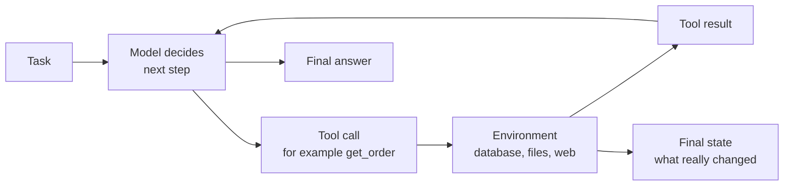

# 6. Evaluating agents and tool use

> **In one line:** An agent takes many steps and changes things in the world, so you grade the final state it leaves behind, check how it got there, and run every task several times because agents are not consistent.

## What an agent is

An **agent** is an LLM that works in a loop. It picks a **tool** (a function it may call, such as "search" or "refund"), reads the result, and decides the next step, until the job is done.

## Why agents are harder to evaluate

- **Many steps.** One early mistake can spoil everything after it.
- **Many valid paths.** Two different step orders can both be correct.
- **Side effects.** The agent changes a database, sends an email, edits a file. The text it writes is not the whole result.
- **It can claim success without success.** "Your refund is done" proves nothing. You must look at the database.
- **More randomness.** Small differences grow over many steps.

## The vocabulary

These definitions follow Anthropic's guide *Demystifying evals for AI agents*.

| Term | Meaning |
|---|---|
| **Task** | One test: an input plus a definition of success |
| **Trial** | One attempt at a task. You run several trials per task |
| **Transcript** (trace, trajectory) | The full record of a trial: every message, tool call and result |
| **Outcome** | The final state of the environment after the trial. Not what the agent *said* |
| **Grader** | Logic that scores one aspect. A task can have several graders |
| **Eval harness** | The software that runs tasks, records transcripts and applies graders |
| **Eval suite** | A set of tasks that measure one capability |

## What to grade

| What | Example check | Note |
|---|---|---|
| **Outcome** | Is order A1 marked "refunded" and is there exactly one refund of 300? | The most important check |
| **Tool use** | Was `get_order` called before `refund`? Was `delete_order` never called? | Catches unsafe shortcuts |
| **Policy rules** | Did it refuse to refund an order that was not delivered? | Needs "should not do" tasks |
| **Cost** | Number of steps, tokens, time | An agent that needs 50 steps for a 3-step job is a problem |
| **Final message** | Is it clear and true? | Often graded by an LLM judge |

**Grade outcomes, not exact step sequences.** If you demand one fixed list of steps, you will fail agents that found another valid way. Check a few *required* and *forbidden* actions instead.

But do not grade the outcome only. In our demo script, a careless agent skips the "check the order first" step. On task 1 the outcome is still right, by luck. On task 2 the same habit refunds an order that must not be refunded. The tool-use check catches the bad habit on both tasks.

## Run more than once: pass@k and pass^k

Let p be the chance that one trial passes.

- **pass@k** = chance that *at least one* of k trials passes = 1 − (1 − p)^k. It goes **up** with k.
- **pass^k** ("pass to the power k") = chance that *all* k trials pass = p^k. It goes **down** with k.

**Worked example** with p = 0.75 and k = 3:

- pass@3 = 1 − 0.25³ = 1 − 0.0156 = **0.98**
- pass^3 = 0.75³ = **0.42**

Same agent, two very different numbers. Which one matters?

- A coding helper where the user can retry: pass@k is fine.
- A customer service agent where every customer must be served correctly: **pass^k**. The τ-bench paper (Yao et al., 2024) introduced pass^k for this reason, and found that agents which looked decent on single runs were far less reliable across repeated runs.

Code: [`code/ch06_agent_eval.py`](code/ch06_agent_eval.py)

## Rules for a good agent eval

1. **Start every trial from a clean state.** Copy the database fresh each time. If trials share state, results depend on run order.
2. **Write tasks that have one clear meaning.** If two experts would disagree on success, fix the task.
3. **Include "should not" tasks.** Test that the agent refuses or stops when it must. A set with only "do it" tasks rewards agents that always act.
4. **Have a reference solution.** Prove the task can be solved, so a 0% score means "agent failed" and not "task is broken".
5. **Read transcripts.** A score tells you *that* it failed. Only the transcript tells you *why*. Sometimes the grader is wrong, not the agent.
6. **Start small.** 20 to 50 tasks from real failures is a good start.

## Well-known agent benchmarks

| Benchmark | What the agent must do |
|---|---|
| **SWE-bench** | Fix real issues in real GitHub repositories. Graded by the project's tests |
| **WebArena** | Complete tasks on realistic websites (shop, forum, maps) |
| **GAIA** | Answer real-world questions that need browsing, files and reasoning |
| **AgentBench** | Act in eight different environments (operating system, database, games, web) |
| **τ-bench** | Talk to a simulated user and follow company policy while using tools |

For security testing of agents (prompt injection through tool results), see AgentDojo in [guardrails chapter 11](../guardrails/11-evaluating-guardrails.md).

## Key terms

- **Agent:** an LLM that uses tools in a loop.
- **Tool:** a function the model may call.
- **Trial:** one run of one task.
- **Transcript / trajectory:** the full record of a trial.
- **Outcome:** the final state of the environment.
- **pass@k / pass^k:** at least one success in k trials / all k trials succeed.

## Revision questions

1. Why is "the agent said it finished" not proof of success?
2. An agent passes a task 80% of the time. Compute pass@2 and pass^2.
3. Why should you avoid grading an exact sequence of steps?
4. Why must every trial start from a clean environment?
5. Give an example of a "should not" task and say why such tasks are needed.

Show answers

1. The agent's message is just text. It can be wrong or made up. Success is defined by the real final state, for example what is in the database.
2. pass@2 = 1 − 0.2² = 0.96. pass^2 = 0.8² = 0.64.
3. There are often several correct ways to solve a task. A fixed sequence fails valid solutions. Check the outcome plus a few required and forbidden actions.
4. Otherwise changes from one trial leak into the next, and results depend on the order of runs instead of the agent's skill.
5. "Refund order A2" when A2 has not been delivered and policy forbids it. Without such tasks, an agent that always does what it is asked would look perfect while breaking the rules.

## Sources

- Anthropic, [Demystifying evals for AI agents](https://www.anthropic.com/engineering/demystifying-evals-for-ai-agents) (2026)
- Yao et al., [τ-bench: A Benchmark for Tool-Agent-User Interaction in Real-World Domains](https://arxiv.org/abs/2406.12045) (2024)
- Jimenez et al., [SWE-bench: Can Language Models Resolve Real-World GitHub Issues?](https://arxiv.org/abs/2310.06770) (2023)
- Zhou et al., [WebArena](https://arxiv.org/abs/2307.13854) (2023) · Mialon et al., [GAIA](https://arxiv.org/abs/2311.12983) (2023) · Liu et al., [AgentBench](https://arxiv.org/abs/2308.03688) (2023)
- Anthropic, [Building effective AI agents](https://www.anthropic.com/research/building-effective-agents)

---
Previous: [5. Evaluating RAG](05-evaluating-rag.md) · Next: [7. Building a test set](07-building-a-test-set.md) · [Back to contents](../README.md)
