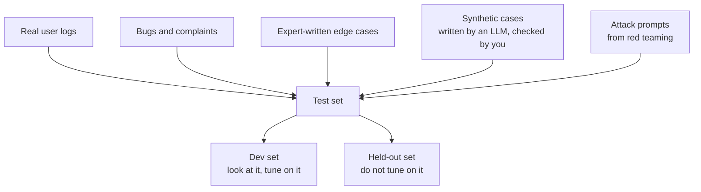

# 7. Building a test set

> **In one line:** A good test set is small at first, taken from real use, covers normal, hard and "should refuse" cases, has clear labels, and is big enough that your score is not just luck.

## Why the test set matters most

An eval can only find problems that its test cases contain. A strong grader on weak test cases gives you a nice number that means nothing.

## Where test cases come from



| Source | Good | Watch out |
|---|---|---|
| **Real logs** | Shows what users really ask | Remove personal data first |
| **Past failures** | Every bug becomes a permanent test | Covers only known problems |
| **Expert-written** | Covers rare but important cases | Experts imagine different things than users do |
| **Synthetic** (LLM-written) | Fast way to get many cases | Can be too easy and too similar. A human must check them |

If you have no users yet, write 20 cases by hand, ask an LLM for more in the same style, and delete the bad ones.

## What to cover

Think in groups. Give each case a **tag** so you can see the pass rate per group.

1. **Common cases.** The 10 questions that make up most of the traffic.
2. **Paraphrases.** The same question in other words, with typos, in another language mix.
3. **Edge cases.** Empty input, very long input, two questions in one, unclear questions.
4. **Should-not-answer cases.** Questions outside the bot's job, or with no answer in the documents. The right behaviour is "I do not know".
5. **Safety cases.** Prompt injection, rude input, requests for private data.

Balance matters. Anthropic's guide warns about one-sided sets: if you only test "should do X", you reward a system that always does X.

### An idea from CheckList

The CheckList paper (Ribeiro et al., 2020) borrowed ideas from software testing. Three test types are easy to reuse:

| Test type | Idea | Example |
|---|---|---|
| **Minimum functionality test** | A simple case that must work | "What is the delivery fee?" → contains 40 |
| **Invariance test** | A change that should *not* change the answer | Change the name "Asha" to "Ravi"; add a typo |
| **Directional test** | A change that *should* change the answer in a known way | Order total 400 → pays delivery; 600 → free delivery |

## How big should it be?

Start with 20 to 50 cases. That is enough to find the big problems.

But know the limit of a small set. A score from few cases has a wide **confidence interval** (the range where the true score probably lies).

For a pass rate p on n cases, a rough 95% interval is p ± 1.96 × √(p(1−p)/n).

| Result | 95% interval |
|---|---|
| 16 / 20 = 80% | about 62% to 98% |
| 80 / 100 = 80% | about 72% to 88% |
| 400 / 500 = 80% | about 77% to 84% |
| 1600 / 2000 = 80% | about 78% to 82% |

So with 20 cases, "we improved from 80% to 85%" means nothing. It is one extra case. The paper *Adding Error Bars to Evals* (Miller, 2024) asks everyone to report such intervals.

**Compare on the same questions.** When you compare two versions, run both on the same cases and look at the difference per case (a **paired** comparison). This removes a lot of noise. The script shows this with the **bootstrap**: it re-draws the test set many times to see how much the result moves.

Code: [`code/ch07_error_bars.py`](code/ch07_error_bars.py)

## Good labels

- Write a short **labelling guide**: what counts as correct, with examples.
- For each case, store what a grader needs: a gold answer, or facts that must appear, or facts that must not appear.
- Let two people label a sample. If they disagree often, the guide is unclear. Fix the guide first.
- Store a **reason** with each label. You will need it in six months.

A simple format is **JSONL**: one JSON object per line.

```json
{"id": "refund-time", "tag": "facts", "question": "How long do refunds take?", "must_include": ["5"], "must_not_include": ["instant"]}
```

## Dev set and held-out set

If you tune your prompt on the test set again and again, you slowly fit the prompt to those exact cases. The score goes up, real quality does not. This is **overfitting** to the test set.

- **Dev set:** you look at it, debug with it, tune on it.
- **Held-out set:** you run it rarely and never tune on it. It tells you the honest score.

## Keep it alive

- **Version it.** Put the test set in git. A score is only meaningful together with the test set version.
- **Add every new failure.** A bug found in production becomes a test case.
- **Remove or fix broken cases.** Wrong labels and unclear questions punish good systems.
- **Retire saturated cases.** If everything passes for months, the set no longer teaches you anything. Add harder cases.
- **Keep it private** if you can. Public test data can end up in training data. See [chapter 9](09-benchmarks-and-their-limits.md).

## Key terms

- **Test set / dataset:** the collection of test cases.
- **Tag / slice:** a label that groups cases so you can score each group.
- **Synthetic data:** test cases written by a model.
- **Confidence interval:** range where the true score probably lies.
- **Bootstrap:** estimating that range by re-sampling the results many times.
- **Paired comparison:** comparing two systems case by case on the same cases.
- **Overfitting to the test set:** tuning until you pass these cases, without real improvement.
- **Held-out set:** cases you never tune on.

## Revision questions

1. Name four sources of test cases and one risk of synthetic cases.
2. Why do you need "should-not-answer" cases?
3. You have 50 test cases. Version A passes 40, version B passes 42. Can you say B is better? Why?
4. What is the difference between an invariance test and a directional test?
5. Why keep a held-out set?

<details>
<summary>Show answers</summary>

1. Real logs, past failures, expert-written cases, synthetic cases. Synthetic cases can be too easy or too alike, and may contain errors, so a human must review them.
2. Without them, a system that always answers looks perfect, even when it makes things up for questions it cannot answer.
3. Not safely. The difference is 2 cases. The 95% interval for 80% on 50 cases is roughly ±11 points. Compare case by case (paired) and add more cases.
4. Invariance: a change to the input that should not change the output (for example a different name). Directional: a change that should move the output in a known direction (for example a larger order total leads to free delivery).
5. To get an honest score. Repeated tuning on the dev set overfits to it; the held-out set shows whether quality really improved.

</details>

## Sources

- Ribeiro et al., [Beyond Accuracy: Behavioral Testing of NLP Models with CheckList](https://arxiv.org/abs/2005.04118) (2020)
- Miller, [Adding Error Bars to Evals: A Statistical Approach to Language Model Evaluations](https://arxiv.org/abs/2411.00640) (2024)
- Anthropic, [Demystifying evals for AI agents](https://www.anthropic.com/engineering/demystifying-evals-for-ai-agents) (2026)
- Hamel Husain, [Your AI Product Needs Evals](https://hamel.dev/blog/posts/evals/) (2024)

---
Previous: [6. Evaluating agents](06-evaluating-agents.md) · Next: [8. Safety and red-team evals](08-safety-and-red-team-evals.md) · [Back to contents](../README.md)
