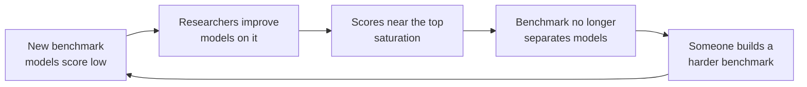

# 9. Common benchmarks and their limits

> **In one line:** Benchmarks let everyone compare models on the same questions, but scores get inflated when test data leaks into training (contamination), stop being useful when models reach the top (saturation), and never tell you how a model will do on your own task.

## A short map of well-known benchmarks

| Benchmark | Year | What it tests | How it is scored |
|---|---|---|---|
| **GLUE** | 2018 | A group of language understanding tasks | Accuracy / F1 per task |
| **SuperGLUE** | 2019 | Harder version, made after GLUE got too easy | Accuracy / F1 per task |
| **MMLU** | 2020 | Multiple-choice questions on 57 subjects | Accuracy |
| **HumanEval** | 2021 | Write Python functions from a description | Unit tests must pass |
| **TruthfulQA** | 2021 | Questions where a popular answer is false | Truthfulness of answers |
| **BIG-bench** | 2022 | More than 200 varied tasks from many authors | Per-task metrics |
| **HELM** | 2022 | Many scenarios, many metrics (not only accuracy) | A table of metrics per model |
| **SWE-bench** | 2023 | Fix real GitHub issues | The project's tests must pass |
| **GAIA** | 2023 | Assistant tasks needing tools and browsing | Exact final answer |
| **Chatbot Arena** | 2023–24 | People chat with two hidden models and vote | Ranking from votes |
| **LiveBench** | 2024 | Questions that are refreshed often | Automatic scoring against gold answers |

**HELM** (Liang et al., 2022) deserves a note. Its main idea is that one accuracy number is not enough. It reports several things per model, such as accuracy, calibration, robustness, fairness, bias, toxicity and efficiency, so that trade-offs are visible.

**Chatbot Arena** is different from the rest: there is no fixed answer key. Real users vote on which of two anonymous answers is better.

## Limit 1: Saturation

A benchmark is **saturated** when top models score near the maximum. Then it cannot tell good models from better ones.

GLUE came out in 2018. One year later the SuperGLUE authors wrote that progress had already removed most of GLUE's headroom, and they built a harder benchmark. This cycle keeps repeating.



## Limit 2: Contamination

**Contamination** (data leakage) means test questions were in the model's training data. LLMs are trained on huge parts of the internet, and benchmarks are published on the internet. So the model may have "seen the exam".

A contaminated model can score high by memory, without the skill.

How researchers detect it:

- **Ask the model to complete a test item.** If it can continue the exact text of a benchmark example, it has probably seen it. This is the idea in *Time Travel in LLMs* (Golchin and Surdeanu, 2023).
- **Change the questions.** GSM-Symbolic (Mirzadeh et al., 2024) took school maths problems and changed only names and numbers. Scores went down. Adding one sentence that looked relevant but was not caused large drops, up to about 65% for some models. Real reasoning should not break from such changes.
- **Rephrased samples.** Yang et al. (2023) showed that simple filters miss leaked data that has been reworded or translated, and that training on such reworded test data still inflates scores.

Our toy script makes the idea visible. A "memorising model" and a "reasoning model" both get 100% on the public test. On fresh questions with new numbers, the first drops to 0%.

```text
model               public test  fresh test   drop
memorising model           100%          0%   100%
reasoning model            100%        100%     0%
```

Code: [`code/ch09_contamination_check.py`](code/ch09_contamination_check.py)

What helps:

- **Fresh benchmarks.** LiveBench adds new questions regularly from recent sources.
- **Dynamic benchmarks.** Dynabench lets humans keep writing examples that fool current models.
- **Private test sets.** Keep the questions off the internet.
- **Your own eval.** Your private test set cannot be in anyone's training data.

## Limit 3: Small details change the score

Benchmark scores depend on details that reports often leave out:

- The exact prompt and answer format.
- How many examples are shown in the prompt (**few-shot** examples).
- How the answer is pulled out of the model's text.

Anthropic reported that simple formatting changes, such as changing the option labels from (A) to (1), can move MMLU accuracy by about 5%. So two papers that both report "MMLU" may not be comparable. The paper *Lessons from the Trenches* (Biderman et al., 2024), from the team behind the lm-evaluation-harness, is about exactly this reproducibility problem.

## Limit 4: Errors in the benchmark

Benchmarks are made by people. They contain wrong labels, unclear questions, and tasks that cannot be solved as written. Anthropic's write-up notes mislabelled items in MMLU. Near the top of the scale, the remaining "errors" of a model may partly be errors of the benchmark.

## Limit 5: Goodhart's law

> When a measure becomes a target, it stops being a good measure.

When everyone tunes models to win one leaderboard, the leaderboard score goes up faster than real ability.

## Limit 6: It is not your task

A benchmark tells you about general skill on its own questions. Your app has its own users, documents, rules and tone. A model that is 2 points higher on MMLU may be worse at your support bot.

## How to read a benchmark score

Ask these questions:

1. What exactly does it test? Read a few real items.
2. Is it saturated? Are the top models all within a point or two?
3. Could the test data be in the training data? How old and how public is it?
4. Were all models run in the same way (prompt, shots, scoring)?
5. Is there an error bar? ([Chapter 7](07-building-a-test-set.md))
6. Does it look like my task? If not, run my own eval.

Use public benchmarks to make a short list of models. Use your own eval to choose.

## Key terms

- **Saturation:** top models score near the maximum; the benchmark no longer separates them.
- **Contamination / leakage:** test data was in the training data.
- **Few-shot:** giving a few solved examples in the prompt.
- **Dynamic benchmark:** a benchmark that keeps getting new items.
- **Goodhart's law:** a measure that becomes a target stops measuring well.

## Revision questions

1. What is benchmark saturation? Give a historical example.
2. What is contamination, and why is it a bigger problem for LLMs than for older models?
3. Describe one method to detect contamination.
4. Two papers report different MMLU scores for the same model. Give two harmless reasons.
5. How should an app builder use public benchmarks?

<details>
<summary>Show answers</summary>

1. Top models reach near-maximum scores, so the benchmark cannot rank them. GLUE (2018) lost most of its headroom within about a year, which led to SuperGLUE (2019).
2. Test items appear in training data, so the model can answer from memory. LLMs train on very large web crawls, and benchmarks are published on the web, so leaks are likely.
3. Any one of: ask the model to complete the exact text of a test item; change names and numbers in the questions and see if the score drops; compare scores on old public items and fresh items.
4. Different prompt format or answer labels; a different number of few-shot examples; a different way of extracting the answer from the output.
5. To make a short list of candidate models. The final choice should come from the builder's own eval on their own task.

</details>

## Sources

- Wang et al., [GLUE](https://arxiv.org/abs/1804.07461) (2018) and [SuperGLUE](https://arxiv.org/abs/1905.00537) (2019)
- Hendrycks et al., [Measuring Massive Multitask Language Understanding (MMLU)](https://arxiv.org/abs/2009.03300) (2020)
- Chen et al., [Evaluating Large Language Models Trained on Code (HumanEval)](https://arxiv.org/abs/2107.03374) (2021)
- Srivastava et al., [BIG-bench](https://arxiv.org/abs/2206.04615) (2022) · Liang et al., [HELM](https://arxiv.org/abs/2211.09110) (2022)
- Chiang et al., [Chatbot Arena](https://arxiv.org/abs/2403.04132) (2024) · White et al., [LiveBench](https://arxiv.org/abs/2406.19314) (2024) · Kiela et al., [Dynabench](https://arxiv.org/abs/2104.14337) (2021)
- Golchin and Surdeanu, [Time Travel in LLMs](https://arxiv.org/abs/2308.08493) (2023) · Mirzadeh et al., [GSM-Symbolic](https://arxiv.org/abs/2410.05229) (2024) · Yang et al., [Rethinking Benchmark and Contamination](https://arxiv.org/abs/2311.04850) (2023)
- Biderman et al., [Lessons from the Trenches on Reproducible Evaluation of Language Models](https://arxiv.org/abs/2405.14782) (2024)
- Anthropic, [Challenges in evaluating AI systems](https://www.anthropic.com/research/evaluating-ai-systems) (2023)

---
Previous: [8. Safety and red-team evals](08-safety-and-red-team-evals.md) · Next: [10. Eval tools and frameworks](10-eval-tools-and-frameworks.md) · [Back to contents](../README.md)
