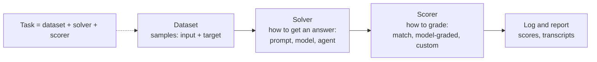

# 10. Eval tools and frameworks

> **In one line:** Frameworks save you from rewriting the same eval plumbing (run cases, call models, grade, store results, show reports), but the thinking, the test cases and the graders are still your job.

## Do you need a framework?

Not at the start. A Python script and a JSONL file are a real eval (see [chapter 11](11-build-your-first-eval.md)). Many experienced people recommend starting that way, because it forces you to look at your data.

A framework starts to help when you need:

- many models or prompts compared side by side,
- runs in parallel, with retries and caching,
- stored results and history over time,
- a screen to browse transcripts,
- ready-made graders and benchmarks,
- evals running automatically on every code change (**CI**, continuous integration).

## What every framework has inside

The names differ, but the parts are the same. Inspect names them clearly:

Learn these three ideas (dataset, solver, scorer) and you can read the docs of almost any tool.

## Open-source tools

All of the tools in this table are free and open source. They still call models, and model calls may cost money or use up your free quota.

| Tool | Made by | Best known for | Link |
|---|---|---|---|
| **Inspect** | UK AI Security Institute | General eval framework. Tasks are built from a dataset, a solver and a scorer. Ships with many ready-made evals, including agent and safety evals | [inspect.aisi.org.uk](https://inspect.aisi.org.uk/) |
| **promptfoo** | promptfoo | Command-line tool and library for testing prompts, models and RAG, plus automated red teaming. Tests are written in a config file | [promptfoo.dev/docs/intro](https://www.promptfoo.dev/docs/intro/) |
| **DeepEval** | Confident AI | "Unit tests for LLM apps" in Python, with many built-in metrics (for example G-Eval and task completion) | [deepeval.com](https://deepeval.com/docs/getting-started) |
| **Ragas** | Ragas team | Metrics for RAG: faithfulness, response relevancy, context precision and recall, and more | [docs.ragas.io](https://docs.ragas.io/en/stable/) |
| **lm-evaluation-harness** | EleutherAI | Running standard academic benchmarks on language models in a reproducible way | [GitHub](https://github.com/EleutherAI/lm-evaluation-harness) |
| **HELM** | Stanford CRFM | Broad, multi-metric benchmarking of many models | [crfm.stanford.edu/helm](https://crfm.stanford.edu/helm/) |
| **OpenAI Evals** | OpenAI | An open-source framework and registry of evals | [GitHub](https://github.com/openai/evals) |
| **Hugging Face Evaluate** | Hugging Face | A library of classic metrics (BLEU, ROUGE, and many more) | [GitHub](https://github.com/huggingface/evaluate) |
| **Langfuse** | Langfuse | Open-source tracing and observability: record what your app did, then score it | [langfuse.com/docs](https://langfuse.com/docs) |

For safety testing, see garak, PyRIT and promptfoo's red-team mode in [chapter 8](08-safety-and-red-team-evals.md).

There are also commercial platforms. Anthropic's agent-eval guide lists Braintrust, LangSmith, Langfuse, Arize Phoenix and Harbor as examples of the ecosystem. This handbook does not need any of them.

> **A note on dates.** Tools change fast. When this handbook was written (November 2026), OpenAI's documentation said that its hosted Evals platform was being shut down and pointed new users to a different product. The open-source `openai/evals` repository is a separate thing. Always check the current docs.

## Which tool for which job?

| You want to... | Look at |
|---|---|
| Learn how evals work | Plain Python (chapter 11) |
| Compare prompts and models quickly from the command line | promptfoo |
| Write evals as Python tests | DeepEval, Inspect |
| Evaluate agents and tools, or run safety evals | Inspect |
| Evaluate a RAG pipeline | Ragas |
| Run MMLU-style academic benchmarks on an open model | lm-evaluation-harness |
| Compute BLEU or ROUGE correctly | Hugging Face Evaluate |
| Record and browse traces from a running app | Langfuse |

## Tracing and observability

**Tracing** means saving every step your app takes for a request: the prompt, the retrieved chunks, tool calls, the model's answer, timing and cost. A saved record is a **trace**.

Why it matters for evals:

- You cannot grade what you did not record.
- Real traces are the best source of new test cases.
- When a score drops, you open the traces to find out why.

The simplest tracing is `json.dump` to a file. That is what [`run_eval.py`](code/ch11_first_eval/run_eval.py) does with `last_run.json`.

## Evals in CI

When your eval is a script that exits with an error if the pass rate is too low, you can run it automatically on every code change. Hamel Husain calls these fast checks "level 1" evals.

Tips:

- Keep the CI eval small and cheap. Use code graders.
- Do not demand 100% on everything. Set a threshold per group of cases.
- Run the slow, expensive evals (LLM judges, agents) on a schedule instead.
- With a tiny free quota, run CI on a mock or on cached outputs.

## How to choose

1. **Start with no framework.** Learn what you need.
2. **Pick by your main need**, not by popularity.
3. **Check that you can read the raw data.** A tool that hides transcripts is dangerous.
4. **Check that you can write your own grader.** Built-in metrics never fit perfectly.
5. **Do not trust a built-in LLM-judge metric blindly.** Compare it with human labels on your data ([chapter 4](04-llm-as-judge.md)).
6. **Mind the cost.** Many metrics call a model several times per test case.

## Key terms

- **Framework / harness:** software that runs evals end to end.
- **Dataset, solver, scorer:** the test cases, the way to produce an answer, and the grader.
- **Trace / tracing:** a saved record of one request / the act of saving it.
- **Observability:** being able to see what your running system is doing.
- **CI:** automatic checks that run on every code change.

## Revision questions

1. What three parts make up a task in most eval frameworks?
2. Give two signs that it is time to move from a script to a framework.
3. Why is tracing important for evals?
4. Why should you not trust a built-in "faithfulness" score without checking?
5. Which evals belong in CI and which belong on a schedule?

Show answers

1. A dataset (inputs and targets), a solver (how the answer is produced) and a scorer (how it is graded).
2. Any two of: you compare many models or prompts; you need parallel runs and caching; you need history of results; you need to browse transcripts; you want ready-made benchmarks; you want evals in CI.
3. You can only grade and debug what was recorded. Traces also supply realistic new test cases.
4. It is usually computed by an LLM judge with a generic prompt. It may not match human judgement on your data, so compare it with human labels first.
5. CI: small, fast, cheap code-graded checks. Schedule: slow or costly evals such as LLM judges, agent runs and large test sets.

## Sources

- UK AI Security Institute, [Inspect documentation](https://inspect.aisi.org.uk/)
- [promptfoo documentation](https://www.promptfoo.dev/docs/intro/) · [DeepEval documentation](https://deepeval.com/docs/getting-started) · [Ragas documentation](https://docs.ragas.io/en/stable/)
- EleutherAI, [lm-evaluation-harness](https://github.com/EleutherAI/lm-evaluation-harness) and Biderman et al., [Lessons from the Trenches](https://arxiv.org/abs/2405.14782) (2024)
- OpenAI, [Working with evals](https://developers.openai.com/api/docs/guides/evals) and [openai/evals](https://github.com/openai/evals)
- Anthropic, [Demystifying evals for AI agents](https://www.anthropic.com/engineering/demystifying-evals-for-ai-agents) (2026)
- Hamel Husain, [Your AI Product Needs Evals](https://hamel.dev/blog/posts/evals/) (2024)

---
Previous: [9. Benchmarks and their limits](09-benchmarks-and-their-limits.md) · Next: [11. Build your first eval](11-build-your-first-eval.md) · [Back to contents](../README.md)
