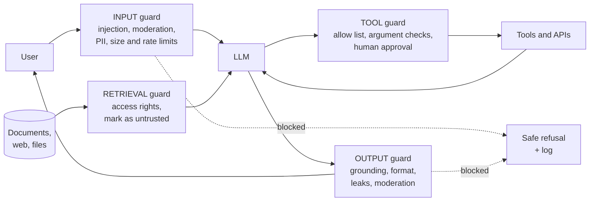

# 1. What guardrails are and where they sit

> **In one line:** Guardrails are checks that your own code runs around an LLM: on what goes in, on what is retrieved, on what tools it wants to call, and on what comes out. They catch problems the model cannot be trusted to avoid by itself.

## Why a prompt is not enough

You can write "Never reveal personal data" in the system prompt. This helps. But:

- An LLM is **probabilistic**. It follows instructions most of the time, not every time.
- Users, web pages and files can contain text that pushes the model to ignore your instructions.
- The model can be confidently wrong.
- The model does not know your budget, your laws, or which user may see which data.

A **guardrail** is a control that sits *outside* the model. It is normal code (or a second model) that you run and that the main model cannot talk its way past.

A road guardrail is a good picture. It does not drive the car. It stops the car from going off the cliff when the driver makes a mistake.

## Where guardrails sit



| Position | It checks | Example problems it stops |
|---|---|---|
| **Input** | The user's message, before the model sees it | Prompt injection, abuse, personal data, huge inputs |
| **Retrieval** | Documents and web pages added to the prompt | Hidden instructions in a page, documents this user may not see |
| **Tool call** (execution) | Actions the model wants to take | Deleting data, large payments, sending email to outsiders |
| **Output** | The model's answer, before the user sees it | Made-up facts, leaked secrets, broken JSON, harmful text |

Around all of them sit **system limits**: rate limits, cost limits and step limits ([chapter 7](07-rate-limits-and-cost-limits.md)).

The NVIDIA NeMo Guardrails toolkit uses nearly the same list. It names input, dialog, retrieval, execution and output rails. A **dialog rail** controls the flow of the conversation, for example "if the user asks about politics, give this fixed reply".

## What a guardrail can do

Each guardrail returns a decision.

| Decision | Meaning | Example |
|---|---|---|
| **Allow** | Pass the text on unchanged | Normal question |
| **Modify** | Fix the text and continue | Replace an email address with `<EMAIL_1>` |
| **Block** | Stop and give a safe reply | "I cannot help with that request." |
| **Re-ask** | Ask the model to try again | The JSON was broken |
| **Escalate** | Send to a human | Refund above a limit |

Always **log** the decision. Logs are how you find out whether the guardrail works ([chapter 11](11-evaluating-guardrails.md)).

## How guardrails are built

| Kind | How it works | Speed and cost | Strength | Weakness |
|---|---|---|---|---|
| **Rules** | Regular expressions, word lists, length checks, schemas | Instant, free | Clear, testable, never "forgets" | Easy to get around with rephrasing |
| **Small classifier** | A small trained model gives a score, for example "toxic: 0.93" | Fast, cheap | Understands more than rules | Needs training data; makes mistakes |
| **LLM-based** | A second LLM is asked "Is this safe?" | Slow, costs a call | Understands meaning and context | Can itself be fooled; adds delay |
| **Design choices** | Give the model fewer permissions and less data | Free | Works even when everything else fails | Limits what the app can do |

Good systems use several kinds, cheapest first.

## The smallest example

```python
def guarded_chat(user_text):
    decision, text = input_guard(user_text)       # 1. check what goes in
    if decision == "block":
        return text

    answer = model(text)                           # 2. call the model

    decision, answer = output_guard(answer)        # 3. check what comes out
    return answer
```

Runnable version: [`code/ch01_guard_pipeline.py`](code/ch01_guard_pipeline.py). The last chapter builds the full pipeline: [`code/ch12_guarded_app/`](code/ch12_guarded_app/).

## Defence in depth

No single guardrail is perfect. Each one has holes. If you stack several different ones, an attack must pass through the holes in all of them. Security people call this **defence in depth**. Some call it the "Swiss cheese" picture: many slices, and the holes rarely line up.

It also means: plan for failure. Ask "if this guard fails, what is the worst that can happen?" and reduce that damage with permissions and limits.

## The costs of guardrails

Guardrails are not free. Every chapter after this one deals with these trade-offs.

- **False positives.** The guard blocks a harmless request. Users get annoyed and leave.
- **False negatives.** The guard misses a real problem.
- **Latency.** Each check adds waiting time. An LLM-based check can double it.
- **Money.** LLM-based checks are extra model calls.
- **Maintenance.** Rules and test sets must be kept up to date.

## Guardrails, model safety and evals

Three different things that work together:

| | What it is | Who controls it |
|---|---|---|
| **Model safety training** | The model was trained to refuse harmful requests | The model maker |
| **Guardrails** | Checks around the model at run time | You |
| **Evals** | Tests that measure how well the model and the guardrails work | You |

Guardrails act while the app runs. Evals measure before and after. You need evals to know whether your guardrails are any good.

## Key terms

- **Guardrail:** a run-time check outside the model that allows, changes or blocks text or actions.
- **Input / output / retrieval / tool guard:** guardrails at the four positions.
- **Rail:** another word for guardrail (used by NeMo Guardrails).
- **False positive / false negative:** a wrong block / a missed problem.
- **Latency:** waiting time added to each request.
- **Defence in depth:** several different layers of protection.

## Revision questions

1. Why is a rule in the system prompt not a guardrail?
2. Name the four positions where guardrails sit, with one example each.
3. List four decisions a guardrail can return.
4. Compare rule-based and LLM-based guardrails: one strength and one weakness each.
5. What is defence in depth, and why is it needed?

<details>
<summary>Show answers</summary>

1. The model may ignore it, and injected text can override it. A guardrail is enforced by separate code outside the model.
2. Input (block a prompt injection), retrieval (mark a web page as untrusted data), tool call (ask a human before a large refund), output (remove a claim that is not supported by the source).
3. Any four of: allow, modify, block, re-ask, escalate to a human.
4. Rules: instant and predictable, but easy to bypass by rephrasing. LLM-based: understands meaning, but is slow, costs money and can be fooled.
5. Stacking several different protections so that one failure is not enough for harm. It is needed because every single guardrail has gaps.

</details>

## Sources

- Dong et al., [Building Guardrails for Large Language Models](https://arxiv.org/abs/2402.01822) (2024)
- Rebedea et al., [NeMo Guardrails: A Toolkit for Controllable and Safe LLM Applications with Programmable Rails](https://arxiv.org/abs/2310.10501) (2023) and the [NeMo Guardrails docs](https://docs.nvidia.com/nemo/guardrails/latest/index.html)
- Eugene Yan, [Patterns for Building LLM-based Systems & Products](https://eugeneyan.com/writing/llm-patterns/) (2023), section on guardrails
- OWASP, [Top 10 for LLM Applications 2025](https://genai.owasp.org/llm-top-10/)

---
Next: [2. Prompt injection and jailbreaks](02-prompt-injection-and-jailbreaks.md) · [Back to contents](../README.md)
