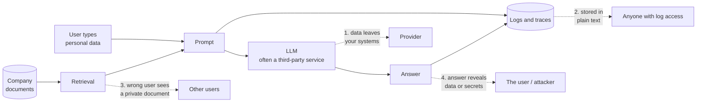
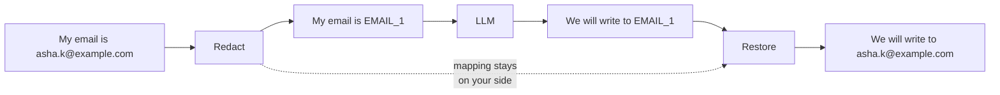

# 3. PII and sensitive data

> **In one line:** Personal and secret data can leak into an LLM app (through prompts, logs and retrieval) and out of it (through answers). Guardrails find such data, hide it before it travels, and control who may see what.

## What counts as sensitive

**PII** means **personally identifiable information**: data that points to a real person.

| Type | Examples |
|---|---|
| Direct identifiers | Name, email, phone number, home address, government ID number |
| Financial | Card number, bank account |
| Sensitive personal data | Health, religion, exact location, passwords |
| Company secrets | API keys, source code, contracts, the system prompt |

OWASP lists this risk as **LLM02:2025 Sensitive Information Disclosure**.

## Where data leaks



1. **Into the provider.** The prompt is sent to a model service outside your systems.
2. **Into logs.** Prompts and answers are saved for debugging, often with no protection.
3. **Through retrieval.** The RAG search returns a document that this user should not see.
4. **Out through the answer.** The model repeats private data from its context, or reveals its system prompt.
5. **Out of the model's memory.** Carlini et al. (2020) showed that large language models can memorise pieces of their training data and that an attacker can extract them, including personal details. So do not train or fine-tune on raw personal data.

## How to detect PII

Presidio, a well-known open-source tool (started at Microsoft, now a community project), combines several methods. They are worth knowing by name:

| Method | Finds | Example | Weak point |
|---|---|---|---|
| **Regular expression** (regex) | Data with a fixed shape | Email, phone, card number | Cannot find names; many false matches on plain numbers |
| **Checksum** | Numbers with a built-in check digit | Card numbers (Luhn check) | Only works for such numbers |
| **NER** (named entity recognition) | Names, places, organisations, using a language model | "Asha lives in Pune" | Needs a model; makes mistakes |
| **Context words** | Raises confidence when helpful words are near | "phone:" before a number | Needs tuning per language |

**Luhn check in one paragraph.** Card numbers are built so that a simple sum over the digits ends in 0. Starting from the right, double every second digit (subtract 9 if the result is above 9), add everything up, and check that the total is a multiple of 10. A random 16-digit number passes only about one time in ten. So the check removes most false alarms, such as order numbers.

Presidio's own documentation warns that automatic detection cannot promise to find everything. Treat PII detection as a strong filter, not as a guarantee.

## What to do with PII once found

| Action | Result | Use when |
|---|---|---|
| **Redact** | `My email is <EMAIL>` | The model does not need the value |
| **Mask** | `card ending 1111` | A human needs a hint |
| **Pseudonymise** | `<EMAIL_1>`, with a private table to map it back | The answer must refer to the value again |
| **Block** | Refuse the request | The data must never be processed |
| **Do not collect** | Never ask for it | Always the best option |

### Redact, call, restore

The pseudonymise pattern is very useful with third-party models:



The model never sees the real value. The user still gets a natural answer.

From [`code/ch03_pii_redaction.py`](code/ch03_pii_redaction.py) (all data is fake):

```text
SENT TO THE MODEL:
  Hi, I am Asha. My email is <EMAIL_1> and my phone is <PHONE_1>. I paid with card <CARD_1>
  for order 1234567890123456. My test key is <API_KEY_1> and I logged in from <IP_1>.
```

Two things to notice:

- The order number has 16 digits but fails the Luhn check, so it was correctly left alone.
- The name "Asha" was **not** found. Rules cannot find names. This is exactly where NER-based tools help.

## Beyond detection: design rules

Detection is only one part. These rules prevent more leaks than any filter.

1. **Data minimisation.** Send the model only what the task needs. If the task is "classify this complaint", the customer's phone number is not needed.
2. **Access control in retrieval.** Check the user's rights *in code, before* documents reach the prompt. Never put a document in the prompt and then ask the model to keep it secret from this user. OWASP lists this problem under LLM08 (Vector and Embedding Weaknesses).
3. **No secrets in the system prompt.** Users can often extract the system prompt (OWASP LLM07, System Prompt Leakage). Keep API keys and passwords in your code's configuration, never in a prompt.
4. **Clean logs.** Redact before you log, limit who can read logs, and delete old logs.
5. **Output check.** Scan answers for PII and secrets before they leave, especially PII that did not come from this user.
6. **Know your provider's terms.** Check if the provider stores prompts or trains on them. Free tiers often have weaker privacy terms than paid ones.
7. **Know the law.** Many countries have data protection laws. If you handle real personal data, ask someone who knows the rules where you live.

## A note on your own keys

An API key is sensitive data too. Keep it in an environment variable, never in code, and add `.env` to `.gitignore`. This repository does exactly that. If a key is ever committed or pasted somewhere public, delete it at the provider and make a new one.

## Key terms

- **PII:** personally identifiable information.
- **Redact / mask / pseudonymise:** remove / partly hide / replace with a placeholder that can be mapped back.
- **NER:** named entity recognition, a model that finds names, places and similar items in text.
- **Luhn check:** the checksum used by card numbers.
- **Data minimisation:** use and send only the data that is needed.
- **Access control:** rules about which user may see which data.
- **Memorisation:** a model storing exact pieces of its training data.

## Revision questions

1. Name four places where sensitive data can leak in an LLM app.
2. Why can a regular expression find an email address but not a person's name?
3. What does the Luhn check do, and why is it useful in a PII filter?
4. Explain the "redact, call, restore" pattern. What is kept on your side?
5. Why is "tell the model not to show document X to user Y" a bad access control?

<details>
<summary>Show answers</summary>

1. Any four of: the prompt sent to an outside provider, logs and traces, retrieval returning a document the user may not see, the model's answer, the model's memory of training data, the system prompt.
2. An email has a fixed shape (text, @, domain) that a pattern can describe. A name has no fixed shape; it looks like any other word, so you need a language model (NER) or a list.
3. It tests whether a digit string is a valid card number using a simple sum over its digits. It removes most false alarms, because random digit strings usually fail it.
4. Replace each PII value with a placeholder, send the safe text to the model, then put the real values back into the answer. The table that maps placeholders to real values stays on your side and is never sent.
5. The model may ignore the instruction or be tricked by a prompt injection. Access must be enforced in code before the document enters the prompt.

</details>

## Sources

- OWASP, [Top 10 for LLM Applications 2025](https://genai.owasp.org/llm-top-10/) (LLM02, LLM07, LLM08)
- [Presidio documentation](https://presidio.dataprivacystack.org/) and [source code](https://github.com/data-privacy-stack/presidio)
- Carlini et al., [Extracting Training Data from Large Language Models](https://arxiv.org/abs/2012.07805) (2020)
- [LLM Guard](https://github.com/protectai/llm-guard) (open-source scanners, including an anonymise step)

---
Previous: [2. Prompt injection and jailbreaks](02-prompt-injection-and-jailbreaks.md) · Next: [4. Toxicity and content moderation](04-toxicity-and-content-moderation.md) · [Back to contents](../README.md)
