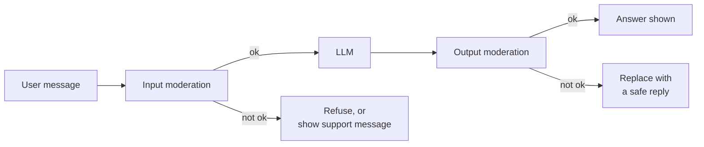

# 4. Toxicity and content moderation

> **In one line:** Content moderation checks user messages and model answers against a written policy of what is not allowed (hate, threats, self-harm and so on), using word rules, classifier models, or an LLM, and then decides what to do.

## Start with a policy, not with a tool

**Moderation** means deciding whether a piece of content breaks your rules. So first you need rules.

A **policy** (also called a **taxonomy**) is a list of categories with clear definitions. Common categories:

| Category | Short meaning |
|---|---|
| Hate | Attacks on people for who they are (religion, caste, race, gender ...) |
| Harassment | Insults or threats aimed at a person |
| Violence | Threats, or praise and instructions for violence |
| Sexual content | Explicit material; anything involving minors is always forbidden |
| Self-harm | Content about hurting oneself |
| Dangerous or illegal activity | Help with weapons, serious crime, and similar |

Your app adds its own rules. A children's homework helper and a tool for doctors need different limits. The Llama Guard paper is built around this idea: the safety model is given the policy as text, so that you can change the categories.

## Moderate both directions



- **Input moderation** protects the model and your staff from abuse, and stops harmful requests early.
- **Output moderation** protects the user and your reputation. A model can produce bad content from an innocent prompt. *RealToxicityPrompts* (Gehman et al., 2020) showed that even harmless-looking sentence beginnings can lead language models to write toxic text.

## Three ways to detect

| Method | How | Good | Bad |
|---|---|---|---|
| **Word lists and rules** | Match banned words and phrases | Instant, free, easy to explain | No sense of context. Easy to dodge with spelling tricks. Many false alarms |
| **Classifier models** | A trained model returns a score per category | Fast, understands some context | Makes mistakes on slang, sarcasm, other languages |
| **LLM as moderator** | Ask an LLM with your policy in the prompt | Flexible, follows custom policies | Slower, costs a call, can be talked around |

### Tools you will hear about

| Tool | What it is |
|---|---|
| **OpenAI Moderation endpoint** | An API that classifies text and images into harm categories. OpenAI's docs say it is free to use |
| **Perspective API** | A well-known Jigsaw (Google) service that scores comments for toxicity. You will see it in many papers. Its website says the service ends after 2026, so do not build new work on it |
| **Llama Guard** | An open LLM from Meta trained to classify prompts and responses as safe or unsafe against a policy |
| **ShieldGemma** | Open safety classifier models from Google, based on Gemma |
| **Detoxify** | A small open-source Python library with toxicity classifiers |
| **WildGuard** | An open moderation model covering harmful prompts, harmful responses and refusals |
| **Azure AI Content Safety**, **Amazon Bedrock Guardrails** | Cloud services from Microsoft and Amazon |

Open models such as Llama Guard and ShieldGemma are free to download, but they are large. They will not run well on a small laptop without a graphics card. The hosted APIs need an account. For learning, the rule-based script in this chapter is enough.

## Scores and thresholds

A classifier returns a **score**, for example `harassment: 0.82`. You choose a **threshold**: block when the score is above it.

- Low threshold → catches more bad content, blocks more good content.
- High threshold → fewer false alarms, more misses.

There is no perfect threshold. You pick it per category and per app, and you measure the result on a labelled test set ([chapter 11](11-evaluating-guardrails.md)). A common setup uses two thresholds:

| Score | Action |
|---|---|
| Very high | Block automatically |
| Middle | Send to a second check (an LLM or a human) |
| Low | Allow |

## Why this is hard: context

The same word can be fine or harmful.

| Text | Problem for a word filter |
|---|---|
| "How do I kill a process on Linux?" | "kill" is a normal technical word |
| "My grandfather had a heart attack." | "attack" is medical |
| "The class passed the assessment." | A banned word can hide *inside* innocent words. This is known as the Scunthorpe problem, after an English town whose name was blocked by early filters |
| "I felt stupid when I forgot my keys." | An insult word, but aimed at nobody |
| "You are such an idiot." | The same kind of word, aimed at a person |

Chat with an AI is also different from social media. The ToxicChat paper (Lin et al., 2023) collected real user-to-chatbot messages and found that moderation models trained on social media data did poorly on them. Jailbreak attempts, for example, look nothing like a rude tweet.

## The example script

[`code/ch04_moderation_filter.py`](code/ch04_moderation_filter.py) uses two layers:

1. **Layer 1, rules:** patterns with word boundaries, an allow list for safe phrases, and a severity per category.
2. **Layer 2, classifier:** only for unclear cases. It is a mock by default, and a real free model if you set a key.

```text
[allow  ] How do I kill a process on Linux?        layer 1: nothing found
[block  ] You are such an idiot.                   layer 2 said UNSAFE (insult)
[allow  ] I felt stupid when I forgot my keys.     layer 2 said SAFE (insult)
[block  ] I will find you and you will regret this.   layer 1: threat
[support] Sometimes I want to end my life.         layer 1: self-harm -> show a caring message
[allow  ] The class passed the assessment.         layer 1: nothing found
```

Using the cheap layer first and the expensive layer only when needed is a standard design. It saves time and money.

## Self-harm needs care, not a block

When a user writes about hurting themselves, a cold "I cannot help with that" is the wrong reply. The usual practice is a kind message that points to real help, such as a trusted person or a local helpline. Treat this category separately in your code, as the script does.

## What to do when content is flagged

- **Refuse clearly and politely.** Do not lecture.
- **Do not reveal the rule.** "Blocked: matched pattern 14" teaches attackers how to get around it.
- **Offer a way forward** when the request may be innocent: "I can help with X instead."
- **Log** the event (without storing more personal data than needed).
- **Give people a way to appeal** in a real product. Filters make mistakes.
- **Watch repeat offenders.** Anthropic's docs suggest warning or limiting users who trigger refusals again and again.

## Fairness

Moderation models can be unfair. They may flag harmless text more often when it is written in a dialect, in another language, or when it simply mentions a group (for example a religion) without any hate. Test your filter on text from the people who will really use your app.

## Key terms

- **Moderation:** checking content against a policy.
- **Policy / taxonomy:** the written list of categories that are not allowed.
- **Toxicity:** rude, hateful or harmful language.
- **Classifier:** a model that puts text into categories, usually with a score.
- **Threshold:** the score above which you act.
- **Scunthorpe problem:** blocking innocent text because a banned word appears inside it.
- **Allow list / block list:** phrases always allowed / always blocked.

## Revision questions

1. Why should you write a policy before choosing a moderation tool?
2. Give two reasons to moderate the model's *output* as well as the user's input.
3. What happens to false positives and false negatives when you lower the threshold?
4. What is the Scunthorpe problem? Name one technique that reduces it.
5. How should an app respond to a message about self-harm?

<details>
<summary>Show answers</summary>

1. Tools detect categories. Without your own clear definitions you cannot choose categories or thresholds, or judge whether the tool is right.
2. A model can produce harmful text from a harmless prompt, and an attack may get past the input check. Output moderation is the last check before the user sees the text.
3. False positives go up (more good content is blocked). False negatives go down (fewer bad items get through).
4. Innocent text is blocked because a banned word appears inside another word. Matching whole words (word boundaries) and using an allow list reduce it.
5. With a kind, supportive message that points to real help such as a trusted person or a helpline. Not with a plain refusal.

</details>

## Sources

- Inan et al., [Llama Guard: LLM-based Input-Output Safeguard for Human-AI Conversations](https://arxiv.org/abs/2312.06674) (2023)
- Markov et al., [A Holistic Approach to Undesired Content Detection in the Real World](https://arxiv.org/abs/2208.03274) (2022)
- Lin et al., [ToxicChat](https://arxiv.org/abs/2310.17389) (2023)
- Gehman et al., [RealToxicityPrompts](https://arxiv.org/abs/2009.11462) (2020)
- Zeng et al., [ShieldGemma](https://arxiv.org/abs/2407.21772) (2024) · Han et al., [WildGuard](https://arxiv.org/abs/2406.18495) (2024)
- OpenAI, [Moderation guide](https://developers.openai.com/api/docs/guides/moderation) · [Perspective API](https://perspectiveapi.com/) · [Detoxify](https://github.com/unitaryai/detoxify)
- Anthropic, [Mitigate jailbreaks and prompt injections](https://platform.claude.com/docs/en/test-and-evaluate/strengthen-guardrails/mitigate-jailbreaks)

---
Previous: [3. PII and sensitive data](03-pii-and-sensitive-data.md) · Next: [5. Hallucination checks and grounding](05-hallucination-and-grounding.md) · [Back to contents](../README.md)
