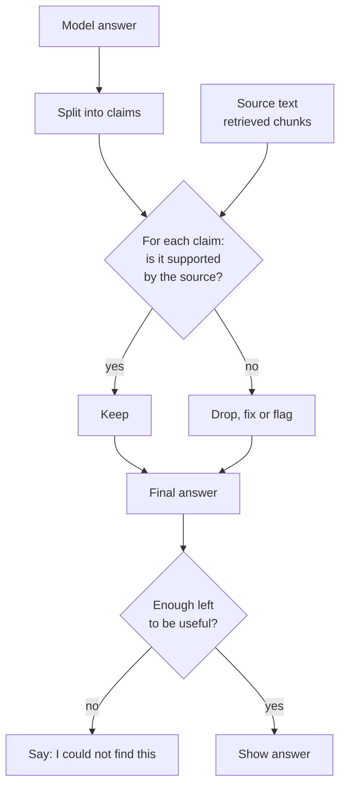

# 5. Hallucination checks and grounding

> **In one line:** A hallucination is an answer that sounds right but is not supported by facts. You reduce it by giving the model sources and permission to say "I do not know", and you catch it by checking each claim against the source before the user sees it.

## What a hallucination is

An LLM writes the most likely next words. Likely is not the same as true. When the model has no real knowledge of something, it can still produce fluent, confident text. That text is a **hallucination**.

The survey by Ji et al. (2022) separates two kinds, for tasks that have a source text:

| Kind | Meaning | Example (source says "refunds take 5 days") |
|---|---|---|
| **Intrinsic** | The answer contradicts the source | "Refunds take 2 days." |
| **Extrinsic** | The answer adds something the source cannot confirm | "You also get a gift card." |

Two more words you will meet:

- **Faithfulness:** the answer agrees with the given source.
- **Factuality:** the answer agrees with the real world.

An answer can be faithful to a wrong document. Guardrails usually check faithfulness, because your source is something you can actually check against.

OWASP lists this risk as **LLM09:2025 Misinformation**. It also warns about **over-reliance**: people trusting the model's output without checking.

## Why it happens

- The model learned patterns of language, not a table of facts.
- The question is about something rare, new or private that was not in training.
- The prompt pushes for an answer ("Answer in detail") and gives no room to say "I do not know".
- In RAG: the retriever returned nothing useful, so the model filled the gap from memory.

## Part 1: Reduce hallucinations

Prevention comes first. These are standard techniques.

1. **Ground the model in sources.** Use RAG: fetch the relevant text and tell the model to answer only from it. **Grounding** means tying the answer to given evidence.
2. **Allow "I do not know".** Say it in the prompt: "If the answer is not in the text, say you could not find it."
3. **Ask for quotes or citations.** Have the model point to the sentence that supports each claim. Claims with no supporting quote can be removed.
4. **Do not answer when retrieval finds nothing.** Skip the model call and return an honest "not found". (The app in chapter 12 does this.)
5. **Keep temperature low** for factual tasks.
6. **Ask a narrower question.** "What is the refund time according to the policy below?" is safer than "Tell me about refunds."

## Part 2: Detect hallucinations



### Method A: Check claims against the source (grounding check)

This is the main method when you have source text.

1. Split the answer into small claims.
2. For each claim, ask: does the source support it?
3. Act on unsupported claims.

FActScore (Min et al., 2023) made this "split into atomic facts, verify each one" recipe popular. Who does step 2?

| Checker | Note |
|---|---|
| Word and number overlap | Free, instant, crude. Our demo uses this |
| **NLI model** | NLI means natural language inference: a model that says if text A *supports*, *contradicts* or is *neutral* to text B |
| Small fact-check model | MiniCheck (Tang et al., 2024) trains small models for exactly this job, at much lower cost than a large LLM |
| LLM judge | Flexible, costs a call per answer. This is what Ragas faithfulness does |

### Method B: Ask several times and compare (self-consistency)

No source text? SelfCheckGPT (Manakul et al., 2023) uses a simple idea. If the model really knows a fact, it gives the same fact each time. If it is inventing, the details change between samples.

1. Ask the same question several times with some randomness.
2. Compare the answers.
3. Sentences that the other samples do not support are suspicious.

It needs no documents, but several model calls. That is costly on a small free quota.

### Method C: Let the model verify itself

Chain-of-Verification (Dhuliawala et al., 2023): the model drafts an answer, writes checking questions about its own draft, answers them separately, and then writes a corrected final answer. It reduced hallucinations in the authors' tests. It also costs several calls.

## The example script

[`code/ch05_grounding_check.py`](code/ch05_grounding_check.py) implements Method A with simple rules: a sentence is supported if most of its content words, and **all of its numbers**, appear in one source sentence.

```text
--- one made-up claim ---
  [keep] support=1.00  Students can borrow up to 4 books for 14 days.
  [DROP] support=0.00  The late fee is 10 rupees per day for each book.
  [DROP] support=0.14  The library also has a free coffee machine on every floor.
  FINAL: Students can borrow up to 4 books for 14 days. (Some parts were removed because I could not verify them.)
```

Look at the second line. It shares almost every word with the source ("The late fee is 2 rupees per day for each book"). Only the number is different. A pure word-overlap check would pass it. Checking numbers separately catches it. Wrong numbers, dates and names are the most common and most harmful hallucinations, so check them with extra care.

**Limits of the rule-based check:** it fails on paraphrases ("costs nothing" versus "free") and on claims that need two source sentences. That is why real systems use NLI models or LLM judges for this step.

## What to do with an unsupported claim

| Action | When |
|---|---|
| **Remove the sentence** | The rest of the answer still makes sense |
| **Re-ask the model** with the problem pointed out | You can afford another call |
| **Replace with "I could not find this"** | Little or nothing is supported |
| **Show it with a warning** | Low-risk settings, drafts |
| **Send to a human** | High-risk settings: medical, legal, money |

Tell users when something was removed or is uncertain. Hiding uncertainty feeds over-reliance.

## What a grounding check cannot do

- It cannot fix a **wrong source**. Faithful to a wrong document is still wrong.
- It cannot judge **missing** information. An answer can be fully supported and still leave out the key point.
- It adds **latency and cost**.
- It makes **mistakes**. Measure it on labelled examples ([chapter 11](11-evaluating-guardrails.md)).

## Key terms

- **Hallucination:** fluent output that is not supported by the source or by facts.
- **Intrinsic / extrinsic:** contradicts the source / adds unverifiable content.
- **Grounding:** tying an answer to given evidence.
- **Faithfulness / factuality:** agrees with the source / agrees with the world.
- **Claim (atomic fact):** one small statement that can be checked.
- **NLI:** a model that decides whether one text supports or contradicts another.
- **Self-consistency:** comparing several samples of the same answer.
- **Over-reliance:** trusting model output without checking.

## Revision questions

1. What is the difference between an intrinsic and an extrinsic hallucination?
2. Name three ways to reduce hallucinations before any checking happens.
3. Describe the three steps of a grounding check.
4. How does SelfCheckGPT detect hallucinations without any source documents?
5. The source says "The fee is 2 rupees." The answer says "The fee is 20 rupees." Why might a word-overlap check miss this, and what fixes it?

<details>
<summary>Show answers</summary>

1. Intrinsic: the answer contradicts the source. Extrinsic: the answer adds information that the source cannot confirm.
2. Any three of: ground the model in retrieved sources; allow it to say "I do not know"; ask for quotes or citations; skip the model call when retrieval finds nothing; use a low temperature; ask narrower questions.
3. Split the answer into claims; check each claim against the source; act on unsupported claims (remove, re-ask, replace or escalate).
4. It samples several answers to the same question and compares them. Facts the model knows stay the same; invented details change between samples.
5. Nearly all the words match, so the overlap score is high. Checking that every number in the claim also appears in the supporting source sentence catches it.

</details>

## Sources

- Ji et al., [Survey of Hallucination in Natural Language Generation](https://arxiv.org/abs/2202.03629) (2022)
- Min et al., [FActScore](https://arxiv.org/abs/2305.14251) (2023)
- Manakul et al., [SelfCheckGPT](https://arxiv.org/abs/2303.08896) (2023)
- Dhuliawala et al., [Chain-of-Verification Reduces Hallucination in Large Language Models](https://arxiv.org/abs/2309.11495) (2023)
- Tang et al., [MiniCheck: Efficient Fact-Checking of LLMs on Grounding Documents](https://arxiv.org/abs/2404.10774) (2024)
- Lewis et al., [Retrieval-Augmented Generation for Knowledge-Intensive NLP Tasks](https://arxiv.org/abs/2005.11401) (2020)
- Anthropic docs, [Reduce hallucinations](https://platform.claude.com/docs/en/test-and-evaluate/strengthen-guardrails/reduce-hallucinations)
- OWASP, [Top 10 for LLM Applications 2025](https://genai.owasp.org/llm-top-10/) (LLM09 Misinformation)
- Vectara, [Hallucination leaderboard](https://github.com/vectara/hallucination-leaderboard) (compares how often models add unsupported content when summarising)

---
Previous: [4. Toxicity and content moderation](04-toxicity-and-content-moderation.md) · Next: [6. Structured-output validation](06-structured-output-validation.md) · [Back to contents](../README.md)
