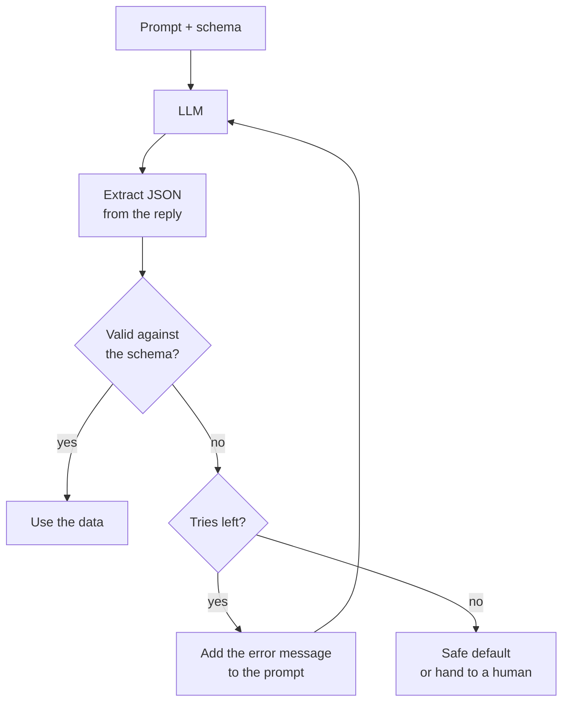

# 6. Structured-output validation

> **In one line:** When code reads the model's output, treat that output like data from a stranger: check its shape and its values against a schema, ask again if it is wrong, and never run or display it without care.

## Why structure matters

People can read messy text. Programs cannot. An app often needs the model to answer in a fixed shape:

```json
{"category": "billing", "priority": 4, "summary": "Charged twice.", "needs_human": true}
```

**JSON** is the usual format. **Structured output** means output that follows a fixed format which code can read.

What goes wrong:

| Problem | Example |
|---|---|
| Not JSON at all | "Sure! Here is the JSON you asked for: ..." |
| Wrapped in a code fence | The JSON sits between ` ```json ` and ` ``` ` |
| Broken syntax | A trailing comma, a missing bracket, text cut off at the token limit |
| Missing field | No `priority` |
| Wrong type | `"priority": "high"` instead of a number |
| Value not allowed | `"category": "payments"` when only four categories exist |
| Extra field | The model adds `"confidence": 0.9` that nobody asked for |
| Right shape, wrong meaning | `"needs_human": false` for an angry legal threat |

## Schema validation

A **schema** describes what valid data looks like: which fields, which types, which values.

**Validation** means checking data against the schema.

Two common tools:

- **JSON Schema:** a standard way to write a schema as JSON. Many model APIs accept one.
- **Pydantic:** a popular free Python library. You write the schema as a Python class.

```python
from typing import Literal
from pydantic import BaseModel, Field

class Ticket(BaseModel):
    model_config = {"extra": "forbid"}                     # reject unknown fields
    category: Literal["billing", "delivery", "account", "other"]
    priority: int = Field(ge=1, le=5)                      # between 1 and 5
    summary: str = Field(max_length=80)
    needs_human: bool

ticket = Ticket.model_validate_json(model_reply)           # raises an error if invalid
```

Full file: [`code/ch06_structured_output_pydantic.py`](code/ch06_structured_output_pydantic.py) (needs `pip install pydantic`). The same check with **no install** is in [`code/ch06_structured_output.py`](code/ch06_structured_output.py).

## The validate and re-ask loop

When validation fails, do not crash and do not guess. Send the error back to the model and ask again. This is called **re-asking**. Libraries such as Guardrails AI and Instructor are built around this loop.



Output from the script, with a mock model that fails twice:

```text
try 1: rejected -> invalid JSON: Illegal trailing comma before end of object ...
try 2: rejected -> 'category' must be one of ['billing', 'delivery', 'account', 'other'], got 'payments'; 'priority' must be int, got str
try 3: valid
```

Rules for the loop:

1. **Limit the tries** (2 or 3). Each try costs a call. An endless loop is a cost risk ([chapter 7](07-rate-limits-and-cost-limits.md)).
2. **Give the exact error back.** "Field 'priority' must be an integer from 1 to 5" works better than "try again".
3. **Have a safe default.** In the script, a ticket that cannot be read becomes `needs_human: true`. When unsure, fail towards the safe side.
4. **Log failures.** Many failures on one field mean your prompt or schema is unclear.

## Constrained decoding

There is a stronger approach: stop the model from *writing* invalid output in the first place.

A model produces text one **token** (word piece) at a time. With **constrained decoding** (also called guided or structured generation), the system removes, at each step, every token that would break the format. So the result always fits.

- Willard and Louf (2023) showed how to do this efficiently for regular expressions and grammars. The open-source library Outlines grew from that work.
- Some model APIs offer this as a feature. OpenAI's is called "Structured Outputs": you pass a JSON Schema and the reply is made to match it.

**Still validate.** Constrained decoding guarantees the *shape*. It does not guarantee the *meaning*. `"priority": 1` is valid JSON even when the customer is furious. And not every provider or free model supports the feature, so your code needs the plain check anyway.

## Two levels of checks

| Level | Question | Example | Done by |
|---|---|---|---|
| **Syntactic** (shape) | Is it valid JSON with the right fields and types? | `priority` is an integer 1–5 | Schema validator |
| **Semantic** (meaning) | Do the values make sense? | End date is after start date; the product ID exists; the quoted price matches the database | Your own code |

Write semantic checks as normal code. They are often the most valuable guardrails you have, because they use facts the model does not have.

## Never trust output as code

OWASP lists **LLM05:2025 Improper Output Handling**: the app passes model output to another system without checking it. The model's output can be influenced by an attacker (through prompt injection), so treat it like untrusted user input.

| If the output goes into... | The risk | Do this |
|---|---|---|
| A web page | Script injection (XSS) | Escape the text before display |
| A database query | SQL injection | Use parameterised queries; never build SQL from the text |
| A shell or `eval()` | Running the attacker's commands | Do not do it. If you must run generated code, use a locked-down sandbox |
| A file path or URL | Reading or calling something it should not | Check against an allow list |
| A tool call | A harmful action | Validate arguments; see [chapter 8](08-human-in-the-loop.md) |

A short rule: **parse it, validate it, then use the parsed values. Never execute the raw text.**

## Tips for getting good structured output

- Show the exact format with one short example in the prompt.
- Say "Reply with JSON only."
- Keep the schema small and flat. Deep nesting causes more errors.
- Use fixed choice lists (enums) instead of free text where you can.
- Set the output token limit high enough, or the JSON will be cut off.
- Let the model write its reasoning in a separate field *before* the answer field if you want it to think first.

## Key terms

- **Structured output:** output in a fixed, machine-readable format.
- **Schema:** the description of valid data.
- **Validation:** checking data against a schema.
- **Re-ask:** sending the validation error back to the model for another try.
- **Constrained decoding:** blocking tokens that would break the format while the model writes.
- **Syntactic / semantic check:** shape / meaning.
- **Improper output handling:** using model output in another system without checking it.

## Revision questions

1. List four ways a model's JSON output can be wrong.
2. What is the difference between a syntactic check and a semantic check? Give one example of each.
3. Describe the validate and re-ask loop. Why must the number of tries be limited?
4. If constrained decoding guarantees valid JSON, why validate at all?
5. The model returns a file name, and your code opens that file. What is the risk and what is the fix?

<details>
<summary>Show answers</summary>

1. Any four of: not JSON at all; wrapped in a code fence or extra words; broken syntax; a missing field; a wrong type; a value that is not allowed; an extra field; correct shape but wrong meaning.
2. Syntactic: the shape is right, for example `priority` is an integer between 1 and 5. Semantic: the values make sense, for example the order ID exists in the database.
3. Call the model, extract and validate the JSON; if invalid, add the error to the prompt and call again; after a fixed number of tries, use a safe default or a human. The limit prevents endless loops that waste money and time.
4. It guarantees the format only. Values can still be wrong or unsafe, and not every model or provider supports it.
5. The model (possibly steered by an attacker) could name a file it should not read. Check the name against an allow list or a fixed folder before opening anything.

</details>

## Sources

- OWASP, [Top 10 for LLM Applications 2025](https://genai.owasp.org/llm-top-10/) (LLM05 Improper Output Handling)
- [Pydantic documentation](https://docs.pydantic.dev/latest/) · [JSON Schema](https://json-schema.org/)
- Willard and Louf, [Efficient Guided Generation for Large Language Models](https://arxiv.org/abs/2307.09702) (2023) and the [Outlines library](https://github.com/dottxt-ai/outlines)
- OpenAI, [Structured model outputs](https://developers.openai.com/api/docs/guides/structured-outputs)
- [Guardrails AI](https://github.com/guardrails-ai/guardrails) · [Instructor](https://python.useinstructor.com/)

---
Previous: [5. Hallucination checks and grounding](05-hallucination-and-grounding.md) · Next: [7. Rate limits and cost limits](07-rate-limits-and-cost-limits.md) · [Back to contents](../README.md)
