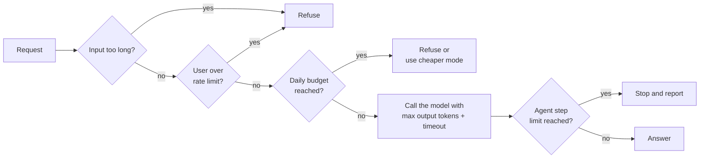

# 7. Rate limits and cost limits

> **In one line:** Every model call costs money and time, so you cap how much one user, one request and one day can use. This protects your budget from attackers, from heavy users and from your own bugs.

## The risk

With a normal website, one more page view costs almost nothing. With an LLM app, each request costs real money, and the cost grows with the length of the input and output.

OWASP lists this as **LLM10:2025 Unbounded Consumption**: the app lets users run excessive and uncontrolled model calls. The results:

| Result | Meaning |
|---|---|
| **Denial of service** | The app becomes slow or stops for everyone |
| **Denial of wallet** | An attacker (or a bug) runs up a huge bill |
| **Model theft** | Someone sends huge numbers of queries to copy your model's behaviour |
| **Worse service** | Honest users wait while one user takes all the capacity |

The attacker is not always a person. A very common cause is your own code: an agent stuck in a loop, or a retry that never stops.

## How LLM cost works

Models charge per **token**. A token is a piece of a word. A rough rule for English is about 4 characters per token.

Cost of one call ≈ (input tokens × input price) + (output tokens × output price)

Three facts follow:

1. **Long inputs cost more.** A long chat history or a big document is paid for on every call.
2. **Long outputs cost more**, and output tokens are usually priced higher.
3. **Agents multiply everything.** One user request can cause many model calls.

## The limits



| Limit | What it caps | Typical setting |
|---|---|---|
| **Input size** | Characters or tokens per message | A few thousand characters for a chat |
| **Max output tokens** | Length of one answer | Set on every call |
| **Rate limit** | Requests per user per minute | 3 to 20 per minute |
| **Quota** | Requests or tokens per user per day | By plan |
| **Budget** | Total spend per day or month | A hard stop plus an alert before it |
| **Timeout** | Seconds for one call | Then cancel |
| **Step limit** | Model or tool calls in one agent task | 5 to 30 |
| **Retry limit** | Automatic retries after an error | 2 or 3, with growing waits |
| **Concurrency limit** | Calls running at the same time | Small |

Order them **cheapest first**. A length check costs nothing, so do it before anything that costs money.

## The token bucket

The classic rate limiter is the **token bucket**. (Here "token" means a permission slip, not a word piece.)

- A bucket holds up to N tokens.
- Each request takes one token.
- Tokens refill at a steady rate.
- Empty bucket → the request is refused.

It allows short bursts (up to N at once) and still enforces the average rate.

```python
class TokenBucket:
    def __init__(self, capacity, refill_per_second, clock):
        self.capacity = capacity
        self.refill_per_second = refill_per_second
        self.clock = clock
        self.tokens = float(capacity)
        self.last_time = clock.time()

    def allow(self):
        now = self.clock.time()
        self.tokens = min(self.capacity, self.tokens + (now - self.last_time) * self.refill_per_second)
        self.last_time = now
        if self.tokens >= 1:
            self.tokens -= 1
            return True
        return False
```

From [`code/ch07_rate_and_cost_limits.py`](code/ch07_rate_and_cost_limits.py), with 3 requests per minute:

```text
t=   0s asha request 3: OK
t=   0s asha request 4: REFUSED: too many requests, please wait
t=   0s ravi request 1: OK      <- other users are not affected
t=  20s asha request 6: OK      <- one token came back after 20s
```

Keep one bucket **per user** (or per API key or IP address). A single shared bucket lets one user block everyone.

## Budgets

A rate limit controls speed. A **budget** controls total spend.

Before each call, estimate the worst-case cost: input tokens plus the *maximum* output tokens. If that would pass the daily cap, refuse. The script does this and stops at the ninth request:

```text
request 8: OK (cost about 0.0043, spent today 0.0498)
request 9: REFUSED: daily budget reached
```

Good habits:

- Set a **hard limit** at the provider too, if they offer one. Your own code can have bugs.
- Send yourself an **alert** at 50% and 80% of the budget.
- Track cost **per user and per feature**, so you can see where the money goes.

## Step limits for agents

An agent decides by itself when it is finished. Sometimes it never decides. Always give the loop a maximum:

```python
for step in range(MAX_STEPS):
    action = model_decides_next_step()
    if action == "finish":
        break
    run(action)
else:
    report("Stopped: step limit reached")
```

Also watch for the same tool call with the same arguments again and again. That is a loop. Stop it early.

## A real example: free model limits

Limits are something you meet as a *user* of an API as well. When this handbook was written, OpenRouter's documentation gave these limits for free models (model names ending in `:free`):

| Account | Per minute | Per day |
|---|---|---|
| Less than 10 credits ever purchased | 20 requests | 50 requests |
| At least 10 credits purchased | 20 requests | 1000 requests |

When you go over, the API answers with HTTP error **429** ("Too Many Requests"). This shapes how you write code:

- **Do not test in a loop against the real model.** 50 requests are gone in one eval run of 50 cases.
- **Develop against a mock**, then run the real model once.
- **Cache answers** while developing: save each (prompt → answer) pair in a file and reuse it.
- **Handle 429 politely:** wait, then retry a small number of times. Never retry forever.

This is why every example in this handbook runs with a mock model by default.

## Making limits kind to users

- Say clearly what happened: "You have reached today's limit. It resets at midnight."
- **Degrade gracefully** where you can: switch to a cheaper model, a shorter answer or a cached answer instead of an error.
- Do not punish everyone for one user's behaviour.

## Other ways to save cost

- **Cache** repeated questions.
- **Shorten the context.** Summarise old chat turns. Send only the chunks that matter.
- **Use a small model for easy steps** (routing, classification) and a large one only where needed.
- **Put cheap guardrails first**, so blocked requests never reach the model.

## Key terms

- **Token (cost):** a piece of a word; the unit models charge for.
- **Rate limit:** maximum requests in a time window.
- **Quota:** maximum use per day or month.
- **Budget:** maximum spend.
- **Token bucket:** a rate limiter that allows bursts and refills steadily.
- **Denial of wallet:** an attack or bug that creates a huge bill.
- **429:** the HTTP status code for "too many requests".
- **Graceful degradation:** giving a reduced service instead of failing.

## Revision questions

1. What is "unbounded consumption" and why is it special to LLM apps?
2. Explain how a token bucket works. Why keep one per user?
3. What is the difference between a rate limit and a budget?
4. Why does an agent need a step limit even if all users are honest?
5. You have 50 free requests per day. Name three habits that stop you from wasting them.

<details>
<summary>Show answers</summary>

1. It is when an app allows excessive, uncontrolled model use. Each call costs real money and compute, so heavy use causes outages and large bills (denial of service and denial of wallet).
2. A bucket holds a fixed number of permission tokens. Each request takes one; they refill at a steady rate; an empty bucket refuses the request. One bucket per user stops a single user from using up everyone's allowance.
3. A rate limit caps how fast requests come (per minute). A budget caps the total amount spent (per day or month).
4. An agent can get stuck repeating actions by mistake. Without a limit it would keep calling the model and spending money.
5. Any three of: develop against a mock; cache model answers; run the real model once instead of in a loop; keep test sets small; retry only a few times on error 429.

</details>

## Sources

- OWASP, [LLM10:2025 Unbounded Consumption](https://genai.owasp.org/llmrisk/llm102025-unbounded-consumption/)
- OpenRouter, [API rate limits](https://openrouter.ai/docs/api-reference/limits) (free-model limits as documented in November 2026; check the page for current numbers)
- Anthropic, [Building effective AI agents](https://www.anthropic.com/research/building-effective-agents)

---
Previous: [6. Structured-output validation](06-structured-output-validation.md) · Next: [8. Human-in-the-loop](08-human-in-the-loop.md) · [Back to contents](../README.md)
