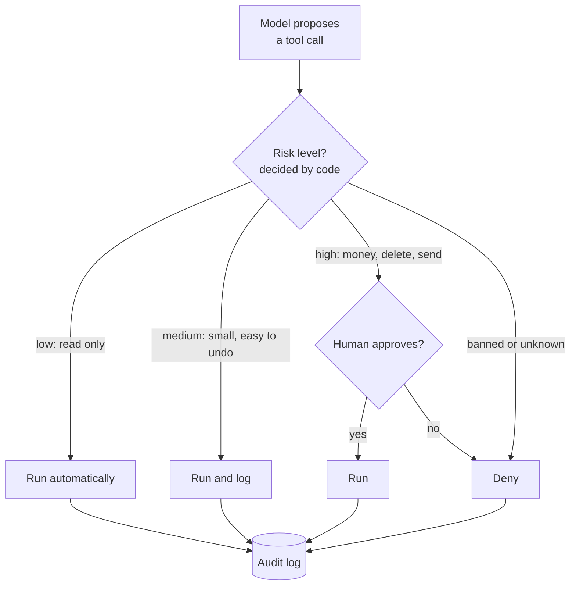

# 8. Human-in-the-loop

> **In one line:** For actions that are risky or hard to undo, the model only proposes and a person decides. Your code sorts every action by risk, so that people are asked rarely, and only when it matters.

## Why a human at all?

Guardrails make mistakes. Models make mistakes. For most answers, a mistake is a small problem: the user sees a poor reply. For **actions**, a mistake can be large and permanent: money sent, data deleted, an email sent to every customer.

**Human-in-the-loop (HITL)** means a person checks or approves at chosen points before the system continues.

OWASP's risk **LLM06:2025 Excessive Agency** is about exactly this. It describes damaging actions performed because of unexpected, unclear or manipulated model output. It names three root causes:

| Root cause | Meaning | Example |
|---|---|---|
| **Excessive functionality** | The agent has tools it does not need | A "read my mail" assistant that can also delete mail |
| **Excessive permissions** | The tools have more rights than needed | A database tool with write access when reading is enough |
| **Excessive autonomy** | High-impact actions run with no check | Refunds of any size without approval |

Human approval fixes the third cause. The first two are fixed by removing tools and rights. Do those first: an action the agent *cannot* take needs no approval.

## The key design rule

**The model proposes. Your code disposes.**

The model never runs a tool by itself. It outputs a *request* such as `refund(order="A2", amount=900)`. Your code receives the request, decides what to do with it, and only then runs it. This gate is ordinary code, so a prompt injection cannot talk its way through it.



## Sorting actions by risk

Ask three questions about each tool:

1. **Can it be undone?** Reading is safe. A draft can be deleted. A sent email cannot be unsent.
2. **How big is the effect?** One record or all records? 50 rupees or 50,000?
3. **Who is affected?** Only this user, or other people too?

| Risk | Kind of action | Examples | Rule |
|---|---|---|---|
| **Low** | Read only | Look up an order, search documents | Run automatically |
| **Medium** | Small change, easy to undo | Add a note, save a draft, small refund | Run and log |
| **High** | Hard to undo, or large | Large refund, send email, delete data, change settings | Ask a human first |
| **Banned** | Never acceptable here | Delete an account, run any shell command | Always deny |

Two details from the example script are worth copying:

- **Risk can depend on the arguments.** A refund of 150 is medium. A refund of 50,000 is high.
- **Unknown tools are banned.** This is **deny by default**. If the model invents a tool name, the answer is no.

```python
def risk_of(tool, arguments):
    risk = TOOL_RISK.get(tool, "banned")        # unknown tool = banned
    if tool == "refund" and arguments.get("amount", 0) <= REFUND_AUTO_LIMIT:
        risk = "medium"
    return risk
```

Output of [`code/ch08_human_approval.py`](code/ch08_human_approval.py):

```text
get_order       {'order_id': 'A1'}                  -> auto (low risk)
refund          {'order_id': 'A1', 'amount': 150}   -> auto (medium risk)
refund          {'order_id': 'A2', 'amount': 900}   -> approved by human
refund          {'order_id': 'A3', 'amount': 50000} -> rejected by human
delete_account  {'user': 'asha'}                    -> denied (banned tool)
launch_rocket   {}                                  -> denied (banned tool)
```

Run it with `--interactive` to be the human yourself.

## Four patterns of human involvement

| Pattern | When the human acts | Good for |
|---|---|---|
| **Approve before** | Before the action runs | Irreversible or costly actions |
| **Review after** | After, on a sample of cases | High-volume, low-risk work; quality checks |
| **Escalate** | When the system is unsure or the user asks | Customer support: "let me connect you to a person" |
| **Edit a draft** | The model writes, the human edits and sends | Emails, reports, code changes |

"Edit a draft" is the easiest safe design. The model never sends anything. A person always presses the button.

### When should the system escalate by itself?

- A guardrail flagged the input or output but was not sure.
- Retrieval found nothing and the question matters.
- The user is upset, or asks for a human.
- The topic is high-stakes: health, law, money, safety.
- The agent hit its step limit without finishing.

## What a good approval request looks like

A person can only approve well if they can see what they are approving.

Show:

- **The exact action and arguments**, in plain words: "Refund 900 rupees to order A2 (lamp, delivered 3 May)."
- **Why** the agent wants to do it.
- **What it is based on**, for example the customer's message.
- **Whether it can be undone.**
- Clear buttons: approve, reject, edit.

Never show only "The assistant wants to continue. OK?" That trains people to click OK.

One more warning. The *reason* text is written by the model, and the model may have been manipulated. So the approval screen must show the real action and arguments from your code, not only the model's description of them.

## Approval fatigue

If you ask too often, people stop reading and approve everything. This is **approval fatigue**, and it makes the whole control worthless.

How to avoid it:

- Ask only for the high-risk tier. Let low and medium run.
- Remove tools the agent does not need, so there is less to approve.
- Batch similar approvals: "Approve these 5 refunds under 300 rupees?"
- Measure it. If 99% of requests are approved in two seconds, your tiers are wrong or people are not reading.

In the demo, the human was asked 3 times out of 8 calls. That is the kind of ratio to aim for.

## Keep an audit log

Write down every proposed action, its risk level, the decision, who decided, and when. An **audit log** lets you:

- find out what happened after a problem,
- see which rules fire too often,
- collect real examples for your eval test set,
- show others that the controls work.

## Least privilege

Human approval is the last line. **Least privilege** is the first: give the agent the smallest set of tools and rights that the task needs. OWASP's list of fixes for excessive agency begins with this:

- Give only the tools the task needs.
- Make each tool narrow. "Refund this one order" is better than "run any database command".
- Give each tool the lowest rights. Read-only where possible.
- Run actions with the *user's* rights, not with an all-powerful service account.
- Enforce authorisation in the system that owns the data, not in the prompt.

OWASP adds that logging and rate limiting do not prevent the problem, but they limit the damage.

## Limits of human-in-the-loop

- It is **slow** and does not scale to thousands of actions an hour.
- People **make mistakes** and get tired.
- People **trust the machine too much** (automation bias).
- It only helps at the points where you placed it.

So it is one layer among several. Use it for the few actions where a mistake is expensive.

## Key terms

- **Human-in-the-loop (HITL):** a person checks or approves at set points.
- **Excessive agency:** an agent with more tools, rights or freedom than is safe.
- **Risk tier:** a level (low, medium, high, banned) that decides how an action is handled.
- **Deny by default:** anything not clearly allowed is refused.
- **Least privilege:** the smallest set of rights needed for the task.
- **Approval fatigue:** approving without reading because there are too many requests.
- **Audit log:** a record of every action and decision.
- **Escalation:** handing a case to a human.

## Revision questions

1. What are the three root causes of excessive agency? Which one does human approval address?
2. What does "the model proposes, your code disposes" mean, and why does it matter for security?
3. Give one example action for each risk tier: low, medium, high, banned.
4. What is approval fatigue? Name two ways to reduce it.
5. Why must an approval screen show the real arguments and not only the model's explanation?

<details>
<summary>Show answers</summary>

1. Excessive functionality, excessive permissions and excessive autonomy. Human approval addresses excessive autonomy. The other two are fixed by removing tools and reducing rights.
2. The model only outputs a request for a tool call. Separate code decides whether it runs. Because that gate is code and not a prompt, injected text cannot argue its way past it.
3. Low: look up an order. Medium: add a note or a small refund. High: a large refund or sending an email. Banned: deleting an account.
4. People approve everything without reading because they are asked too often. Reduce it by asking only for high-risk actions, removing unneeded tools, batching similar requests, and measuring approval behaviour.
5. The explanation is written by the model, which may be wrong or manipulated. The person must see what will actually be executed.

</details>

## Sources

- OWASP, [LLM06:2025 Excessive Agency](https://genai.owasp.org/llmrisk/llm062025-excessive-agency/)
- Anthropic, [Building effective AI agents](https://www.anthropic.com/research/building-effective-agents)
- OpenAI Agents SDK, [Guardrails](https://openai.github.io/openai-agents-python/guardrails/) (input, output and tool guardrails that can stop an agent run)
- Simon Willison, [The lethal trifecta for AI agents](https://simonwillison.net/2025/Jun/16/the-lethal-trifecta/) (2025)

---
Previous: [7. Rate limits and cost limits](07-rate-limits-and-cost-limits.md) · Next: [9. Guardrail tools and frameworks](09-guardrail-tools-and-frameworks.md) · [Back to contents](../README.md)
