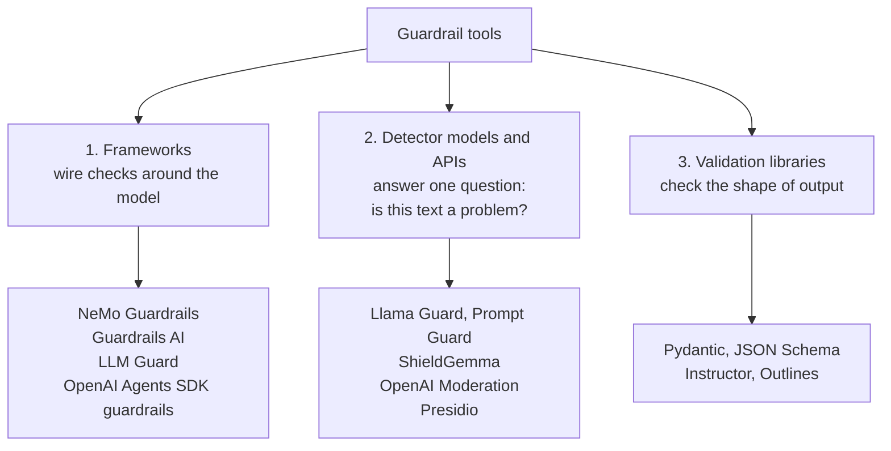

# 9. Guardrail tools and frameworks

> **In one line:** Ready-made tools give you detectors (for injection, toxicity, PII), validators (for output format) and a way to wire them around your model. They save work, but none of them makes an app safe by itself.

## Three kinds of tools

It helps to sort the many products into three groups.

A framework usually *calls* detectors from group 2 and validators from group 3. You can also call those directly from plain Python, as this handbook's code does.

## 1. Frameworks

### NeMo Guardrails (NVIDIA)

An open-source Python toolkit for adding "programmable rails" to chat apps.

- **Five rail types:** input, dialog, retrieval, execution and output. This matches the positions in [chapter 1](01-what-are-guardrails.md), plus *dialog* rails that steer the conversation.
- **Colang:** its own small language. The docs say Colang defines conversation flows, guardrail logic and event-driven behaviour. You write things like "when the user asks about politics, the bot refuses politely".
- Good when you want to control the *flow* of a conversation, not only filter single messages.

### Guardrails AI

An open-source Python framework.

- A **Guard** wraps a model call and runs checks on the input and the output.
- A **validator** is one check, for example "no PII" or "valid JSON for this schema".
- The **Guardrails Hub** is a collection of ready-made validators that you combine.
- It also helps produce structured data, with the validate and re-ask loop from [chapter 6](06-structured-output-validation.md).

### LLM Guard (Protect AI)

An open-source toolkit of **scanners**. Input scanners look at prompts (for example for injection, secrets or PII to anonymise). Output scanners look at answers. You pick the scanners you want and run them in a row.

### OpenAI Agents SDK guardrails

The OpenAI Agents SDK has guardrails built in. Its docs describe:

- **Input guardrails:** run on the user's first input.
- **Output guardrails:** run on the agent's final output.
- **Tool guardrails:** wrap a tool call, with a check before it runs and a check on its result.
- A **tripwire:** a flag a guardrail sets to say "this failed". The run then stops with an error instead of continuing.

The tripwire is a neat name for the "block" decision.

### Cloud services

Large cloud providers sell guardrails as a service, for example **Amazon Bedrock Guardrails** and **Azure AI Content Safety** (which includes **Prompt Shields** for injection and jailbreak detection). They are easy if you already use that cloud. They are paid services, so this handbook does not use them.

## 2. Detector models and APIs

| Tool | Detects | Notes |
|---|---|---|
| **Llama Guard** (Meta) | Unsafe prompts and responses, by policy category | An LLM trained for safety classification. Open weights. Needs real hardware |
| **Prompt Guard** (Meta) | Prompt injection and jailbreak text | A small classifier model, much lighter than an LLM |
| **ShieldGemma** (Google) | Harmful content of several types | Open safety models built on Gemma |
| **WildGuard** | Harmful prompts, harmful responses, and refusals | An open moderation model |
| **OpenAI Moderation API** | Harm categories in text and images | OpenAI's docs say the endpoint is free to use. Needs an account |
| **Presidio** | PII | Open source. Regex, checksums, NER and context words. Analyzer finds, Anonymizer replaces |
| **Detoxify** | Toxic comments | A small open-source Python library |
| **Constitutional Classifiers** (Anthropic) | Jailbreaks | A research approach, not a library: classifiers trained on synthetic data made from a written set of rules. In over 3,000 hours of red teaming, no universal jailbreak was found against the guarded test model |

Meta collects its safety tools (Llama Guard, Prompt Guard and others) in the **Purple Llama** project.

## 3. Validation libraries

| Tool | What it does |
|---|---|
| **Pydantic** | Checks data against a Python class. The standard choice |
| **JSON Schema** | A language-neutral standard for describing valid JSON |
| **Instructor** | Gets Pydantic-validated objects from LLMs, with automatic retries |
| **Outlines** | Constrained decoding: the model can only write text that fits a schema or pattern |

## Tools for testing guardrails

These are covered in [chapter 11](11-evaluating-guardrails.md): **garak**, **PyRIT**, **promptfoo** (red-team mode) and benchmarks such as **AgentDojo** and **JailbreakBench**.

## Which tool for which problem?

| Problem | First try | Then consider |
|---|---|---|
| Output must be valid JSON | Pydantic + re-ask loop | Instructor, Outlines, provider "structured output" |
| Personal data in prompts | Regex rules | Presidio |
| Abusive or harmful text | Word rules + a classifier | OpenAI Moderation API, Llama Guard, ShieldGemma |
| Prompt injection in input | Rule filter + marking untrusted text | Prompt Guard, Prompt Shields, and above all *design limits* (chapter 2) |
| Hallucination in RAG | Grounding check | An NLI model or LLM judge |
| Risky agent actions | Risk tiers in your own code | Tool guardrails in your agent framework |
| Conversation must stay on topic | Clear system prompt + topic check | NeMo Guardrails dialog rails |

## Build or adopt?

| | Write your own | Use a framework |
|---|---|---|
| **Good** | You understand every line. No new dependency. Easy to test. Fast | Many checks ready at once. Maintained by others. Common patterns built in |
| **Bad** | You must maintain rules and models yourself | Another thing to learn and update. Hidden model calls add cost and delay. Defaults may not fit your policy |

A sensible path for a student project or small app:

1. Start with plain Python guards, like the ones in this handbook. You will learn what you really need.
2. Add one detector at a time where rules are too weak.
3. Move to a framework when the wiring itself becomes the hard part.

## Questions to ask before you adopt a tool

1. **What exactly does it detect?** Read its category list. Does it match your policy?
2. **How well?** Look for measured results, then measure on *your* data ([chapter 11](11-evaluating-guardrails.md)).
3. **How slow and how costly is each check?** Does it call another LLM?
4. **Where does my data go?** A hosted API sees your users' text.
5. **What languages does it support?** Many detectors are much weaker outside English.
6. **Can I set thresholds and add my own rules?**
7. **What happens when it fails or times out?** Block everything (**fail closed**) or allow everything (**fail open**)? Decide this on purpose. For safety checks, fail closed is usually right.
8. **Is it still maintained?** Tools in this area change quickly. For example, the Guardrails AI project announced in 2026 that its validators were moving to separate packages. Always read the current docs.

## A warning about over-trust

A product named "guardrails" can give a false feeling of safety. Two reminders from earlier chapters:

- Simon Willison argues that detection products should not be relied on to stop prompt injection, because a filter that works 95% of the time still fails against a determined attacker.
- *The Attacker Moves Second* (Nasr et al., 2025) broke 12 published defences with adaptive attacks.

Use detectors as layers. Keep the strong controls in your design: few permissions, human approval for risky actions, limits on spend.

## Key terms

- **Framework:** software that wires several checks around the model.
- **Detector / classifier:** a model or rule set that says whether text has a given problem.
- **Validator:** one check on input or output (Guardrails AI's word).
- **Scanner:** the same idea in LLM Guard.
- **Rail:** the same idea in NeMo Guardrails.
- **Colang:** NeMo Guardrails' language for conversation flows.
- **Tripwire:** a flag that stops an agent run when a guardrail fails.
- **Fail closed / fail open:** block / allow when the guard itself breaks.

## Revision questions

1. Name the three groups of guardrail tools and give one example of each.
2. What are the five rail types in NeMo Guardrails?
3. In Guardrails AI, what is a Guard, a validator, and the Hub?
4. What is a tripwire in the OpenAI Agents SDK?
5. Explain "fail closed" and "fail open". Which is usually right for a safety check, and why?

Show answers

1. Frameworks (NeMo Guardrails, Guardrails AI, LLM Guard), detector models and APIs (Llama Guard, Prompt Guard, OpenAI Moderation, Presidio), and validation libraries (Pydantic, Instructor, Outlines).
2. Input, dialog, retrieval, execution and output rails.
3. A Guard wraps a model call and runs checks on input and output. A validator is one such check. The Hub is a collection of ready-made validators.
4. A flag set by a guardrail to signal failure. When it is triggered, the agent run stops with an error.
5. Fail closed: if the guard breaks or times out, block the request. Fail open: allow it. Fail closed is usually right for safety checks, because otherwise an attacker (or an outage) can switch off the protection.

## Sources

- Rebedea et al., [NeMo Guardrails](https://arxiv.org/abs/2310.10501) (2023) · [docs](https://docs.nvidia.com/nemo/guardrails/latest/index.html) · [code](https://github.com/NVIDIA-NeMo/Guardrails)
- [Guardrails AI](https://github.com/guardrails-ai/guardrails) · [LLM Guard](https://github.com/protectai/llm-guard)
- OpenAI Agents SDK, [Guardrails](https://openai.github.io/openai-agents-python/guardrails/)
- Inan et al., [Llama Guard](https://arxiv.org/abs/2312.06674) (2023) · [Llama Guard 4 model card](https://www.llama.com/docs/model-cards-and-prompt-formats/llama-guard-4/) · [Prompt Guard 2](https://huggingface.co/meta-llama/Llama-Prompt-Guard-2-86M) · [Purple Llama](https://github.com/meta-llama/PurpleLlama)
- Zeng et al., [ShieldGemma](https://arxiv.org/abs/2407.21772) (2024) · [docs](https://ai.google.dev/gemma/docs/shieldgemma) · Han et al., [WildGuard](https://arxiv.org/abs/2406.18495) (2024)
- Sharma et al., [Constitutional Classifiers](https://arxiv.org/abs/2501.18837) (2025)
- OpenAI, [Moderation guide](https://developers.openai.com/api/docs/guides/moderation) · [Presidio](https://presidio.dataprivacystack.org/) · [Detoxify](https://github.com/unitaryai/detoxify)
- [Amazon Bedrock Guardrails](https://docs.aws.amazon.com/bedrock/latest/userguide/guardrails.html) · [Azure AI Content Safety](https://learn.microsoft.com/en-us/azure/ai-services/content-safety/overview) · [Prompt Shields](https://learn.microsoft.com/en-us/azure/ai-services/content-safety/concepts/jailbreak-detection)
- [Pydantic](https://docs.pydantic.dev/latest/) · [Instructor](https://python.useinstructor.com/) · [Outlines](https://github.com/dottxt-ai/outlines)
- Dong et al., [Building Guardrails for Large Language Models](https://arxiv.org/abs/2402.01822) (2024)
- Simon Willison, [The lethal trifecta for AI agents](https://simonwillison.net/2025/Jun/16/the-lethal-trifecta/) (2025) · Nasr et al., [The Attacker Moves Second](https://arxiv.org/abs/2510.09023) (2025)

---
Previous: [8. Human-in-the-loop](08-human-in-the-loop.md) · Next: [10. The OWASP Top 10 for LLM applications](10-owasp-top-10-for-llm-apps.md) · [Back to contents](../README.md)
