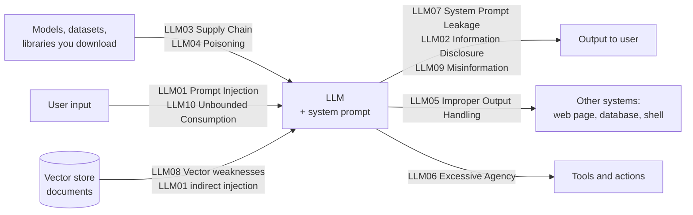

# 10. The OWASP Top 10 for LLM applications

> **In one line:** The OWASP Top 10 for LLM Applications is a widely used checklist of the ten most important security risks in apps built on LLMs. Learn the ten names, one example each, and the main defence for each.

## What OWASP is

**OWASP** (the Open Worldwide Application Security Project) is a non-profit community that publishes free security guidance. Its "Top 10" lists are known across the software industry.

The **Top 10 for LLM Applications** began in 2023. The current list on the project's site is the **2025** version. Each risk has an ID such as `LLM01:2025`.

Why learn it:

- It gives you a shared vocabulary. Security reviews and job interviews use these names.
- It is a checklist. You can go through your app risk by risk.
- Each entry on the OWASP site has examples and fixes.

## The 2025 list at a glance

| ID | Name | In plain words |
|---|---|---|
| **LLM01** | Prompt Injection | Text makes the model follow the attacker instead of you |
| **LLM02** | Sensitive Information Disclosure | The app leaks personal data, secrets or business data |
| **LLM03** | Supply Chain | A model, dataset or library you depend on is bad or tampered with |
| **LLM04** | Data and Model Poisoning | Someone corrupts training, fine-tuning or retrieval data |
| **LLM05** | Improper Output Handling | The app uses model output in another system without checking it |
| **LLM06** | Excessive Agency | The agent has too many tools, rights or freedom |
| **LLM07** | System Prompt Leakage | Secrets placed in the system prompt get out |
| **LLM08** | Vector and Embedding Weaknesses | Weak points in the RAG store: poisoned or wrongly shared data |
| **LLM09** | Misinformation | The model states false things that people believe |
| **LLM10** | Unbounded Consumption | Uncontrolled use causes outages and huge bills |

A memory aid: **two about text going in** (01, 04), **three about data getting out** (02, 07, 08), **two about what the output does** (05, 06), **one about truth** (09), **one about what you depend on** (03), **one about cost** (10).

## Where each risk lives in an app

## The ten risks, one by one

### LLM01: Prompt Injection

- **What:** Input changes the model's behaviour in ways you did not intend. Direct (typed by the user) or indirect (hidden in content the model reads).
- **Example:** A web page contains hidden text telling the assistant to send the user's data to an outside address.
- **Defences:** Least privilege, mark untrusted content, filter input and output, human approval for risky actions, regular attack testing.
- **Chapter:** [2](02-prompt-injection-and-jailbreaks.md)

### LLM02: Sensitive Information Disclosure

- **What:** Personal data, secrets or confidential business data are exposed through the app.
- **Example:** A support bot shows one customer's address to another customer.
- **Defences:** Data minimisation, PII redaction, access control in code, clean logs, output scanning.
- **Chapter:** [3](03-pii-and-sensitive-data.md)

### LLM03: Supply Chain

- **What:** You build on things made by others: base models, fine-tuned adapters, datasets, Python packages. Any of them can be faulty, outdated or deliberately tampered with.
- **Example:** A model file downloaded from an unknown account contains hidden malicious behaviour.
- **Defences:** Download from trusted sources. Pin versions. Check licences. Keep a list of what you depend on. Scan and test models before use.

### LLM04: Data and Model Poisoning

- **What:** An attacker changes training, fine-tuning or retrieval data so that the model behaves wrongly, sometimes only when a secret trigger appears (a **backdoor**).
- **Example:** Fake reviews are planted so that a RAG shopping assistant recommends one product.
- **Defences:** Know where your data comes from (**provenance**). Review data before it enters training or the document store. Test for strange behaviour.

### LLM05: Improper Output Handling

- **What:** Model output is passed to another system as if it were safe.
- **Example:** The app puts the model's answer straight into a web page, and it contains a script that runs in the user's browser.
- **Defences:** Treat output as untrusted input. Validate against a schema. Escape before display. Use parameterised database queries. Never `eval` it.
- **Chapter:** [6](06-structured-output-validation.md)

### LLM06: Excessive Agency

- **What:** The agent can do damage because it has too much functionality, too many permissions or too much autonomy.
- **Example:** An email assistant that only needs to read mail also has the right to send and delete, and an injected instruction uses it.
- **Defences:** Fewer and narrower tools, minimum rights, act with the user's own rights, human approval, audit logs.
- **Chapter:** [8](08-human-in-the-loop.md)

### LLM07: System Prompt Leakage

- **What:** The system prompt is revealed, and it contained things that should have been secret. New in the 2025 list.
- **Example:** A user gets the bot to print its instructions, which include an internal API key and the rules of a discount scheme.
- **Defences:** Assume the system prompt *will* leak. Keep keys, passwords and access rules out of it. Enforce rules in code.
- **Chapter:** [3](03-pii-and-sensitive-data.md)

### LLM08: Vector and Embedding Weaknesses

- **What:** Problems in how RAG stores and fetches data: poisoned documents, or data from one user or customer leaking to another. New in the 2025 list.
- **Example:** All customers' documents sit in one store with no filtering, so a search for customer A returns a file from customer B.
- **Defences:** Filter retrieval by the user's rights. Separate data per customer. Check documents before adding them. Log what was retrieved.
- **Chapters:** [3](03-pii-and-sensitive-data.md) and [evaluations 5](../evaluations/05-evaluating-rag.md)

### LLM09: Misinformation

- **What:** The model produces false or misleading content that looks believable, and people rely on it. Earlier versions of the list called this "Overreliance".
- **Example:** A coding assistant recommends a software package that does not exist. An attacker then publishes a harmful package under that name.
- **Defences:** Grounding in sources, citations, grounding checks, clear labels of uncertainty, human review for high-stakes use.
- **Chapter:** [5](05-hallucination-and-grounding.md)

### LLM10: Unbounded Consumption

- **What:** Users can cause excessive, uncontrolled model use: denial of service, large bills, or copying of the model through mass queries.
- **Example:** A script sends thousands of very long prompts overnight.
- **Defences:** Input size limits, rate limits, quotas, budgets, timeouts, step limits, monitoring.
- **Chapter:** [7](07-rate-limits-and-cost-limits.md)

## Risk to guardrail: a quick map

| Risk | Input guard | Retrieval guard | Tool guard | Output guard | Limits | Design and process |
|---|---|---|---|---|---|---|
| LLM01 Prompt Injection | ✔ | ✔ | ✔ | ✔ | | ✔ least privilege |
| LLM02 Information Disclosure | ✔ | ✔ | | ✔ | | ✔ minimise data |
| LLM03 Supply Chain | | | | | | ✔ trusted sources |
| LLM04 Poisoning | | ✔ | | | | ✔ data review |
| LLM05 Improper Output Handling | | | | ✔ | | ✔ escape and validate |
| LLM06 Excessive Agency | | | ✔ | | | ✔ fewer tools |
| LLM07 System Prompt Leakage | | | | ✔ | | ✔ no secrets in prompts |
| LLM08 Vector Weaknesses | | ✔ | | | | ✔ access control |
| LLM09 Misinformation | | | | ✔ | | ✔ human review |
| LLM10 Unbounded Consumption | ✔ | | | | ✔ | ✔ monitoring |

Notice the last column. Every risk needs a design or process answer. Run-time guardrails alone do not cover the list. Two risks (LLM03, LLM04) are hardly touched by run-time guardrails at all.

## How to use the list on your own project

1. Draw your app: inputs, model, data stores, tools, outputs.
2. For each of the ten risks, ask: "Can this happen here? What is the worst result?"
3. Write one line per risk: the control you have, or "not relevant because ...".
4. Turn the top risks into test cases for your evals and red teaming.
5. Repeat when you add a tool or a data source.

For a small student project, a half-page table is enough. The habit matters more than the size.

## Related lists

- **Earlier version:** the [2023/24 list](https://genai.owasp.org/llm-top-10-2023-24/) had some different entries. If you read older articles, the numbers may not match. For example, "Insecure Output Handling" was LLM02 then and is LLM05 (Improper Output Handling) now.
- **Agents:** in December 2025 the same OWASP project published a separate [Top 10 for Agentic Applications](https://genai.owasp.org/resource/owasp-top-10-for-agentic-applications-for-2026/), for systems where LLMs plan and act with tools.
- **NIST AI Risk Management Framework** and its [Generative AI Profile](https://nvlpubs.nist.gov/nistpubs/ai/NIST.AI.600-1.pdf): a broader US government framework for managing AI risks, beyond security.
- **MITRE ATLAS:** a [knowledge base](https://atlas.mitre.org/) of attack techniques against AI systems.

Lists like these are updated. Check the OWASP site for the current version.

## Key terms

- **OWASP:** a non-profit that publishes free security guidance.
- **Supply chain:** everything you depend on that others made.
- **Poisoning:** corrupting data so that a model learns or retrieves the wrong thing.
- **Backdoor:** hidden behaviour that appears only with a secret trigger.
- **Provenance:** knowing where data or a model came from.
- **Vector store:** the database that holds embeddings for RAG.

## Revision questions

1. Write the ten names of the 2025 list from memory.
2. Which two entries were new in 2025, and what does each mean?
3. What is the difference between LLM01 (Prompt Injection) and LLM05 (Improper Output Handling)?
4. Which risks are barely covered by run-time guardrails, and what protects against them instead?
5. Your RAG app serves many companies from one document store. Which risk is this, and what is the fix?

Show answers

1. Prompt Injection; Sensitive Information Disclosure; Supply Chain; Data and Model Poisoning; Improper Output Handling; Excessive Agency; System Prompt Leakage; Vector and Embedding Weaknesses; Misinformation; Unbounded Consumption.
2. System Prompt Leakage (LLM07): secrets placed in the system prompt get revealed. Vector and Embedding Weaknesses (LLM08): poisoned or wrongly shared data in the RAG store.
3. LLM01 is about what goes *into* the model and changes its behaviour. LLM05 is about what the app does with what comes *out*: passing it unchecked into a web page, database or shell.
4. Supply Chain (LLM03) and Data and Model Poisoning (LLM04). They are handled by process: trusted sources, pinned versions, data review and provenance, testing models before use.
5. LLM08, Vector and Embedding Weaknesses (it also leads to LLM02). Filter every search by the user's company in code, or keep separate stores per company.

## Sources

- OWASP, [Top 10 for LLM Applications 2025](https://genai.owasp.org/llm-top-10/) (the list and each risk page)
- OWASP, [LLM01 Prompt Injection](https://genai.owasp.org/llmrisk/llm01-prompt-injection/) · [LLM06 Excessive Agency](https://genai.owasp.org/llmrisk/llm062025-excessive-agency/) · [LLM10 Unbounded Consumption](https://genai.owasp.org/llmrisk/llm102025-unbounded-consumption/)
- OWASP, [project page](https://owasp.org/www-project-top-10-for-large-language-model-applications/) · [Top 10 for Agentic Applications](https://genai.owasp.org/resource/owasp-top-10-for-agentic-applications-for-2026/)
- NIST, [AI Risk Management Framework](https://www.nist.gov/itl/ai-risk-management-framework) · [Generative AI Profile (NIST AI 600-1)](https://nvlpubs.nist.gov/nistpubs/ai/NIST.AI.600-1.pdf)
- MITRE, [ATLAS](https://atlas.mitre.org/)

---
Previous: [9. Guardrail tools and frameworks](09-guardrail-tools-and-frameworks.md) · Next: [11. How guardrails are evaluated](11-evaluating-guardrails.md) · [Back to contents](../README.md)
