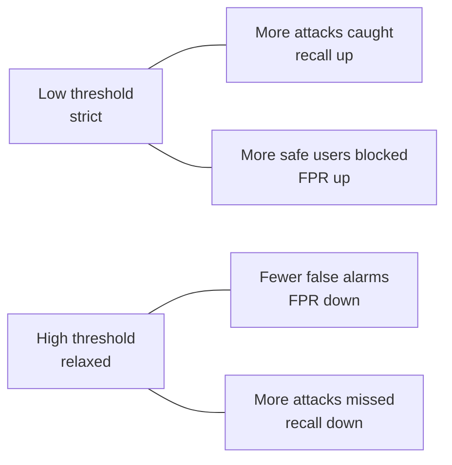
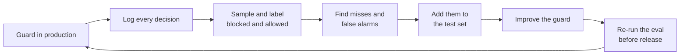

# 11. How guardrails are evaluated

> **In one line:** A guardrail is a classifier, so you test it with labelled attack and safe examples and report four things: how many attacks it catches, how many safe requests it wrongly blocks, how much delay and cost it adds, and whether it still holds against an attacker who knows it is there.

This chapter joins the two halves of the handbook. A guardrail without an eval is a guess.

## A guardrail is a classifier

For each input, a guardrail says **block** or **allow**. The truth is **attack** or **safe**. That gives the same four cases as the spam filter in [evaluations chapter 3](../evaluations/03-classic-metrics.md).

| | Really an attack | Really safe |
|---|---|---|
| **Guard blocks** | True positive (TP): good catch | False positive (FP): false alarm |
| **Guard allows** | False negative (FN): a miss | True negative (TN): correct |

| Metric | Formula | Question |
|---|---|---|
| **Recall** (detection rate, true positive rate) | TP / (TP + FN) | Of all attacks, how many did we catch? |
| **False positive rate (FPR)** | FP / (FP + TN) | Of all safe requests, how many did we wrongly block? |
| **Precision** | TP / (TP + FP) | When the guard blocks, how often is it right? |
| **Attack success rate (ASR)** | FN / (TP + FN) = 1 − recall | Of all attacks, how many got through? |

**Always report recall and FPR together.** One number alone can always be faked:

- Block everything → recall 100%, and the app is useless.
- Block nothing → FPR 0%, and there is no protection.

## The threshold trade-off

Most guards produce a score and block above a **threshold**. Moving the threshold trades misses against false alarms.

Our example tests the injection filter from chapter 2 on 10 attacks and 10 safe messages ([`code/ch11_evaluate_guardrail.py`](code/ch11_evaluate_guardrail.py)):

```text
threshold  TP  FN  FP  TN  precision  recall   FPR    F1
        1   6   4   2   8       0.75    0.60  0.20  0.67
        2   6   4   1   9       0.86    0.60  0.10  0.71
        3   5   5   0  10       1.00    0.50  0.00  0.67
```

Reading it:

- At threshold 3 there are no false alarms, but half the attacks get through.
- Lowering to 2 catches one more attack and costs one false alarm.
- Lowering to 1 only adds a false alarm. So threshold 1 is simply worse than 2 here.



Which point is right depends on the cost of each mistake. A bank agent that moves money should accept more false alarms. A homework helper should not block students all day.

The script also prints *which* examples failed. Read them. The misses are all attacks worded in a new way; the false alarms are harmless messages that contain a trigger word. That tells you what to improve.

## The base rate problem

Here is a surprise that catches many people.

Suppose a guard has **95% recall** and a **5% false positive rate**. Sounds strong. Now suppose that only **1 in 100** real messages is an attack. Take 10,000 messages:

| | Count | Blocked |
|---|---|---|
| Attacks | 100 | 95 (true positives) |
| Safe messages | 9,900 | 495 (false positives) |

- Total blocked = 95 + 495 = 590
- Precision = 95 / 590 = **16%**

So five out of every six blocked users did nothing wrong.

The share of attacks in real traffic is the **base rate**. When it is low, even a small FPR produces more false alarms than true catches. Two lessons:

1. For guards that see every message, the FPR must be *very* low.
2. A test set with 50% attacks tells you recall and FPR. It does **not** tell you the precision you will see in production. Work that out with your real base rate.

## Measure the cost

A guard runs on every request, so measure:

- **Latency:** extra time per request. Report the average and the slow cases (for example the 95th percentile: the time that 95% of requests stay under).
- **Money:** extra model calls per request.
- **Failure behaviour:** what happens when the guard itself times out?

Our rule filter needs about 0.04 milliseconds per check. An LLM-based check can take a second or more. This is why cheap rules go first and expensive checks run only on unclear cases.

## Measure the whole system

A guard can look fine alone and still hurt the product. So also measure end to end:

- **Task success with guards on and off.** Does the app still do its job? If quality falls, the guards are too strict or they damage the text.
- **Security with guards on and off.** How much does the attack success rate drop?

AgentDojo (Debenedetti et al., 2024) is built on this idea. It reports **utility** (does the agent complete the user's task?) and **security** (does the attacker's goal fail?) side by side, across 97 realistic tasks and 629 security test cases. A defence that scores well on security by breaking the agent is not a good defence. CaMeL, for example, reports both numbers: it solved 77% of tasks with security guarantees, against 84% for the undefended agent.

## Build the test set

You need two labelled piles.

**Attacks (positives):**

- Known attack styles: override, role play, hidden text, other languages ([chapter 2](02-prompt-injection-and-jailbreaks.md)).
- Attacks written by *other people*. Your own attacks match your own rules too well.
- Public sets (below).
- Every real attack you find in your logs.

**Safe messages (negatives):** these matter just as much, and are forgotten more often.

- Normal user requests from real traffic.
- **Hard negatives:** safe messages that *look* risky. "How do I kill a process?" "Explain what prompt injection is." "My teacher told me to ignore the previous chapter."

Keep a **held-out** part you never tune on. Tuning rules on the same examples you test on gives a score that is too good. Our demo script admits this openly: the first six attacks were written next to the rules, so they match by design.

## Public benchmarks

| Benchmark | Tests | Useful for |
|---|---|---|
| **JailbreakBench** | Jailbreak attacks and defences on a fixed set of harmful behaviours | Comparing jailbreak defences |
| **HarmBench** | Automated red-teaming methods against models | Robustness to many attack methods |
| **AgentDojo** | Prompt injection against tool-using agents, with utility and security scores | Agent defences |
| **InjecAgent** | Indirect prompt injection in agents with tools | Agent defences |
| **BIPIA** | Indirect prompt injection through external content | RAG-style apps |
| **XSTest**, **OR-Bench** | Safe prompts that look unsafe | Over-refusal and false alarms |
| **ToxicChat** | Toxicity in real user-to-chatbot messages | Moderation filters |

Remember the limits from [evaluations chapter 9](../evaluations/09-benchmarks-and-their-limits.md). Public attack sets get old, and guard models may have been trained on them.

## Test against an attacker who adapts

A fixed list of old attacks is the *easiest* test a guard will ever face. Real attackers look at what gets blocked and try again.

*The Attacker Moves Second* (Nasr et al., 2025) makes this point with evidence. The authors took 12 published defences, most of which had reported attack success near zero, and attacked each one with methods adapted to it. Attack success went above 90% for most.

What this means for you:

- Report results as "against these attacks", never as "secure".
- Red-team with knowledge of the guard. Try rephrasing, translation, encoding, splitting the attack across messages.
- Use tools that generate fresh attacks: **garak**, **PyRIT**, **promptfoo** red-team mode.
- Assume some attacks will pass, and check that the damage stays small ([chapter 8](08-human-in-the-loop.md)).

## Keep measuring after release



Watch these numbers over time:

- **Block rate.** A sudden jump means an attack wave, or a broken rule.
- **User complaints and appeals** about blocks. These are your false positives.
- **Samples of allowed traffic**, labelled by a person. This is the only way to find misses.
- **Latency** of each guard.

## A report template

When you describe a guardrail, give all of this:

| Item | Example |
|---|---|
| What it guards against | Direct prompt injection in user input |
| Test set | 200 attacks (3 sources), 500 safe messages incl. 100 hard negatives |
| Recall | 81% (95% interval 75–86%) |
| False positive rate | 1.2% |
| Precision at the real base rate | about 40% at 1% attacks |
| Latency | 0.04 ms average |
| Adaptive testing | 2 hours of manual red teaming: 9 bypasses found, listed |
| End-to-end effect | Task pass rate 91% → 90% with the guard on |
| Known gaps | Paraphrases, non-English text |

The numbers in this table are invented to show the format.

## Key terms

- **Recall / detection rate:** share of attacks caught.
- **False positive rate (FPR):** share of safe requests wrongly blocked.
- **Attack success rate (ASR):** share of attacks that get through.
- **Threshold:** the score above which the guard acts.
- **Base rate:** the share of real traffic that is an attack.
- **Hard negative:** a safe example that looks like an attack.
- **Utility and security:** does the app still work / does the attack fail.
- **Adaptive attack:** an attack designed with knowledge of the defence.

## Revision questions

1. Why must recall and the false positive rate be reported together?
2. A guard has 90% recall and a 2% FPR. In real traffic, 1 message in 100 is an attack. Out of 10,000 messages, how many are blocked, and what is the precision?
3. What is a hard negative? Give an example for a prompt-injection filter.
4. What do "utility" and "security" mean in AgentDojo, and why measure both?
5. Why is a low attack success rate on a public benchmark not proof that a guard is secure?

<details>
<summary>Show answers</summary>

1. Each one alone can be made perfect by a useless guard: blocking everything gives 100% recall, blocking nothing gives 0% FPR. Together they show the real trade-off.
2. Attacks: 100, of which 90 are blocked. Safe: 9,900, of which 2% = 198 are blocked. Total blocked = 288. Precision = 90 / 288 ≈ 31%.
3. A safe input that looks like an attack. Example: "What is prompt injection? I want to protect my app." or "My teacher told me to ignore the previous chapter."
4. Utility: the agent still completes the user's real task. Security: the attacker's goal fails. A defence that blocks attacks by making the agent useless is not acceptable, so both must be reported.
5. The benchmark's attacks are fixed and known, and may even be in the guard's training data. Attackers adapt to the defence. Adaptive attacks have broken most published defences that looked strong on fixed tests.

</details>

## Sources

- Debenedetti et al., [AgentDojo](https://arxiv.org/abs/2406.13352) (2024) · Debenedetti et al., [Defeating Prompt Injections by Design (CaMeL)](https://arxiv.org/abs/2503.18813) (2025)
- Nasr et al., [The Attacker Moves Second](https://arxiv.org/abs/2510.09023) (2025)
- Chao et al., [JailbreakBench](https://arxiv.org/abs/2404.01318) (2024) · Mazeika et al., [HarmBench](https://arxiv.org/abs/2402.04249) (2024)
- Zhan et al., [InjecAgent](https://arxiv.org/abs/2403.02691) (2024) · Yi et al., [Benchmarking and Defending Against Indirect Prompt Injection Attacks on Large Language Models (BIPIA)](https://arxiv.org/abs/2312.14197) (2023)
- Röttger et al., [XSTest](https://arxiv.org/abs/2308.01263) (2023) · Cui et al., [OR-Bench](https://arxiv.org/abs/2405.20947) (2024) · Lin et al., [ToxicChat](https://arxiv.org/abs/2310.17389) (2023)
- Derczynski et al., [garak](https://arxiv.org/abs/2406.11036) (2024) · Munoz et al., [PyRIT](https://arxiv.org/abs/2410.02828) (2024) · [promptfoo red teaming](https://www.promptfoo.dev/docs/red-team/)
- Hamel Husain, [Using LLM-as-a-Judge For Evaluation](https://hamel.dev/blog/posts/llm-judge/) (2024), on true positive and true negative rates

---
Previous: [10. The OWASP Top 10 for LLM applications](10-owasp-top-10-for-llm-apps.md) · Next: [12. Add guardrails to a small app](12-add-guardrails-to-a-small-app.md) · [Back to contents](../README.md)
