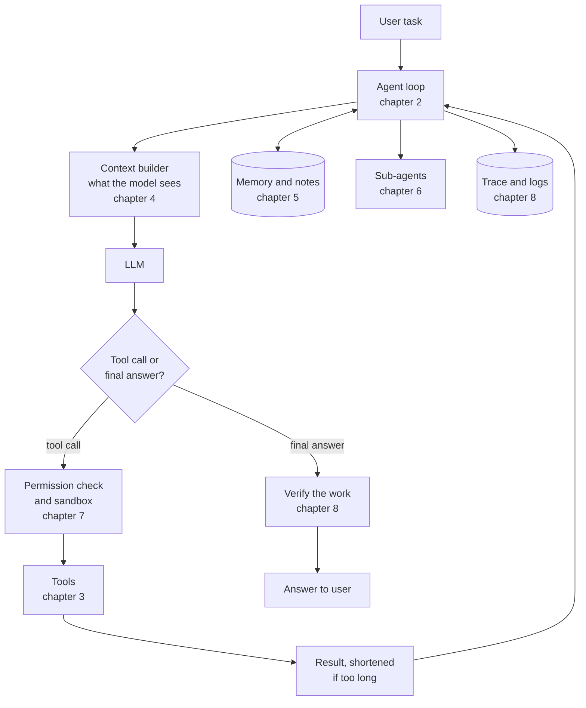

# 1. What an agent harness is

> **In one line:** An agent harness is all the code around a language model that turns it into an agent: it runs the loop, offers tools, decides what goes into the context, keeps memory, enforces permissions, and checks the work.

## The model alone cannot do much

An LLM does one thing: it reads text and writes text. By itself it cannot:

- open a file or run a command,
- remember what happened in the last call,
- try again when something fails,
- know when it is allowed to delete something,
- check if its own answer is correct.

Something else must do all of that. That "something else" is the **harness**.

A horse's harness is a good picture. The horse has the power. The harness connects that power to the cart and lets the driver steer. Without the harness the horse just runs around.

## A simple definition of "agent"

Several sources now agree on a short definition:

- Simon Willison: an LLM agent "runs tools in a loop to achieve a goal."
- Anthropic's engineering blog uses nearly the same words: LLMs autonomously using tools in a loop.
- Thorsten Ball's tutorial shows that a working coding agent is an LLM, a loop, and enough tokens, in a few hundred lines of code.

So:

**agent = model + harness**

The model decides. The harness does everything else.

Anthropic uses the word in this sense. It calls the Claude Agent SDK a general-purpose "agent harness", and in one article it notes that two different agents used the same harness and differed only in their first prompt.

## The parts of a harness

| Part | Its job | Chapter |
|---|---|---|
| **Agent loop** | Call the model, run the tool it asks for, repeat until done | [2](02-the-agent-loop.md) |
| **Tools** | Functions the model may call, with clear descriptions | [3](03-tools-and-tool-design.md) |
| **Context management** | Choose what text the model sees on each call | [4](04-context-engineering.md) |
| **Memory** | Keep useful information across many steps and sessions | [5](05-memory-and-long-tasks.md) |
| **Planning and sub-agents** | Split big work into parts | [6](06-planning-and-sub-agents.md) |
| **Permissions and sandbox** | Limit what the agent can touch | [7](07-permissions-and-sandboxing.md) |
| **Reliability** | Retries, limits, verification, logs | [8](08-reliability-and-observability.md) |

## Model work and harness work

| Question | Who answers |
|---|---|
| What should I do next? | Model |
| Which tool, with which arguments? | Model |
| Is this tool call allowed? | Harness |
| Run the tool. What did it return? | Harness |
| What from the past should the model see now? | Harness |
| The context is full. What now? | Harness |
| The API failed. Retry? | Harness |
| Have we used too many steps or too much money? | Harness |
| Is the task really done? | Harness (with tests), not the model's word |

A useful rule: **anything that must always happen belongs in harness code, not in the prompt.** A prompt is a request. Code is a guarantee.

## Why the harness matters so much

The same model can do well or badly depending on its harness.

- The SWE-agent paper (Yang et al., 2024) showed that giving a model a better *interface* to the computer, with commands designed for the model, strongly improved how many real software issues it could fix. The authors call this the **agent-computer interface (ACI)**.
- *AI Agents That Matter* (Kapoor et al., 2024) warns that agent results are often reported without their cost. A harness that calls the model many times can score higher only by spending far more. Compare both score and cost.

So when you read "model X scored 60% on a benchmark", always ask: with which harness, and at what cost?

## Harnesses you may have heard of

| Name | Kind |
|---|---|
| Claude Code, and similar coding tools | Complete coding agents you use directly |
| Claude Agent SDK, OpenAI Agents SDK, LangGraph | Libraries for building your own agent |
| SWE-agent, OpenHands, mini-swe-agent | Open-source research harnesses for coding |

More in [chapter 9](09-harnesses-in-practice.md).

## A harness is not fixed forever

As models get better, they need less help. A harness part that was needed last year may only slow things down now. Anthropic's article on long-running app development reports this: when a stronger model arrived, the team removed parts of its harness that were no longer doing useful work. Keep your harness as simple as the task allows. [Chapter 9](09-harnesses-in-practice.md) returns to this.

## How this part relates to the other two

- **Evaluations** tell you if the agent works. An *eval harness* is a different thing: software that runs test cases. This part is about *agent* harnesses.
- **Guardrails** are the safety checks. In an agent, they live inside the harness.

## Key terms

- **Agent:** a model that uses tools in a loop to reach a goal.
- **Harness (scaffold):** the code around the model that makes it an agent.
- **Tool:** a function the model may ask the harness to run.
- **Context window:** the text the model sees in one call.
- **Agent-computer interface (ACI):** the commands and feedback formats designed for the model.
- **Eval harness:** software that runs evaluations. A different thing from an agent harness.

## Revision questions

1. Complete the equation: agent = ? + ?
2. Name five jobs that the harness does, not the model.
3. Why does "must always happen" belong in code and not in the prompt?
4. A benchmark report says "Model X: 60%". What two things should you ask?
5. What is the difference between an agent harness and an eval harness?

Show answers

1. Agent = model + harness.
2. Any five of: running the loop; running tools; checking permissions; choosing what goes into the context; handling a full context; keeping memory; retrying failed calls; enforcing step and cost limits; verifying the result; logging.
3. The model follows a prompt most of the time, not every time. Code runs every time and cannot be talked out of it.
4. Which harness was used, and what did it cost (tokens, calls, money)?
5. An agent harness runs a model as an agent on real tasks. An eval harness runs test cases against a system and grades the results.

## Sources

- Simon Willison, [I think "agent" may finally have a widely enough agreed upon definition to be useful jargon now](https://simonwillison.net/2025/Sep/18/agents/) (2025)
- Thorsten Ball, [How to Build an Agent](https://ampcode.com/how-to-build-an-agent) (2025)
- Anthropic, [Building effective AI agents](https://www.anthropic.com/research/building-effective-agents) · [Effective harnesses for long-running agents](https://www.anthropic.com/engineering/effective-harnesses-for-long-running-agents) (2025) · [Harness design for long-running apps](https://www.anthropic.com/engineering/harness-design-long-running-apps) (2026)
- Yang et al., [SWE-agent: Agent-Computer Interfaces Enable Automated Software Engineering](https://arxiv.org/abs/2405.15793) (2024)
- Kapoor et al., [AI Agents That Matter](https://arxiv.org/abs/2407.01502) (2024)

---
Next: [2. The agent loop](02-the-agent-loop.md) · [Back to contents](../README.md)
