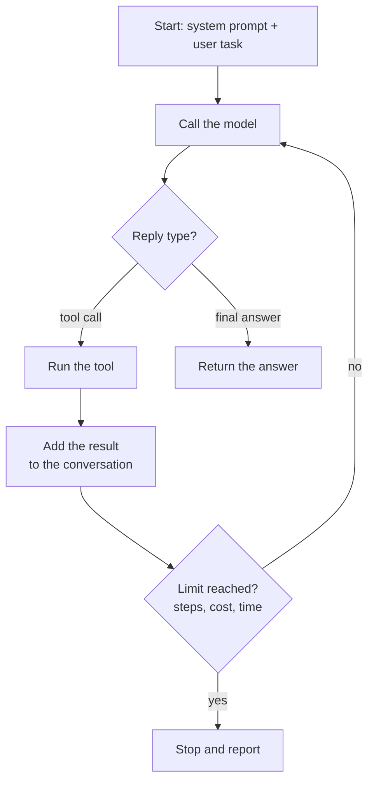

# 2. The agent loop

> **In one line:** The loop is the heart of every harness: ask the model, run the tool it requests, add the result to the conversation, and repeat until the model gives a final answer or a limit stops it.

## The loop in four lines

```text
1. Send the conversation to the model.
2. The model replies with a tool call OR a final answer.
3. Tool call  -> run it, add the result to the conversation, go to 1.
4. Final answer -> stop.
```



## Where the idea comes from

Three papers shaped this design.

- **Chain-of-thought** (Wei et al., 2022): models reason better when they write out intermediate steps before the answer.
- **ReAct** (Yao et al., 2022): combine **Re**asoning and **Act**ing. The model writes a thought, takes an action, reads the **observation** (the result), and repeats. Acting gives it real information; reasoning helps it plan and recover.
- **Toolformer** (Schick et al., 2023) and **MRKL** (Karpas et al., 2022): language models become far more useful when they can call outside tools such as a calculator or a search engine.

A ReAct-style step looks like this:

```text
Thought: I need the sum first.
Action: add(12, 30)
Observation: 42
Thought: Now multiply by 2.
Action: multiply(42, 2)
Observation: 84
Thought: I have the result.
Final answer: 84
```

## The conversation is a list of messages

The harness keeps one growing list. Each item has a **role**.

| Role | Written by | Contains |
|---|---|---|
| `system` | You (the developer) | Rules, the agent's job, how to behave |
| `user` | The user | The task and later replies |
| `assistant` | The model | Thoughts, tool calls, final answer |
| `tool` | The harness | The result of a tool call |

The model has no memory. On every call the harness sends the **whole list** again. This is why context grows with every step, and why chapters 4 and 5 exist.

## The smallest real loop

From [`code/ch02_agent_loop.py`](code/ch02_agent_loop.py):

```python
def run_agent(task, model, max_steps=5):
    messages = [
        {"role": "system", "content": "You are a careful assistant. Use tools for all maths."},
        {"role": "user", "content": task},
    ]
    for step in range(1, max_steps + 1):
        reply = model(messages)                         # 1. ask the model
        messages.append({"role": "assistant", "content": json.dumps(reply)})

        if "final" in reply:                            # 4. finished
            return reply["final"], messages

        tool = TOOLS[reply["tool"]]                     # 3. run the tool
        result = tool(**reply["args"])
        messages.append({"role": "tool", "content": str(result)})

    return "STOPPED: step limit reached", messages      # safety net
```

Output:

```text
step 1: thought: First add 12 and 30.
         tool:    add({'a': 12, 'b': 30}) -> 42
step 2: thought: Now multiply the sum by 2.
         tool:    multiply({'a': 42, 'b': 2}) -> 84
step 3: thought: I have the result.
FINAL: The answer is 84.
```

The "model" in the script is a mock, so it runs with no key. The loop is exactly the loop a real harness uses.

## How the model asks for a tool

Two common ways:

1. **Native tool calling.** Most model APIs accept a list of tool definitions (name, description, parameters as a JSON Schema). The model replies with a structured tool-call object. This is the reliable way. Anthropic, OpenAI and OpenRouter all document it.
2. **Text protocol.** You ask the model to reply in a format such as JSON and parse it yourself. This works with any model but breaks more often, so you need the validate and re-ask loop from [guardrails chapter 6](../guardrails/06-structured-output-validation.md).

Our examples use a simple JSON shape so that the idea is visible.

## When does the loop stop?

A loop needs more than one way out.

| Stop condition | Decided by | Why |
|---|---|---|
| Final answer | Model | The normal case |
| **Step limit** | Harness | The model may never decide to stop |
| Cost or token limit | Harness | Protects your budget |
| Time limit | Harness | Users will not wait forever |
| Repeated action | Harness | The agent is stuck in a loop |
| Human interrupt | User | The user sees it going wrong |
| Fatal error | Harness | For example the workspace is gone |

The script shows the step limit with a model that never finishes:

```text
A STUCK MODEL with max_steps=3
...
FINAL: STOPPED: step limit reached
```

When a limit stops the loop, say so clearly and report what was done. Do not pretend the task finished.

## Workflows and agents

Anthropic's guide *Building effective agents* separates two things:

| | Workflow | Agent |
|---|---|---|
| Who decides the steps? | Your code, in advance | The model, at run time |
| Example | "Summarise, then translate, then check" | "Fix this bug" |
| Good | Predictable, cheap, easy to test | Flexible, handles open problems |
| Bad | Cannot handle surprises | Costs more, less predictable, errors add up |

The guide's advice: use the simplest thing that works. Many tasks need one model call or a fixed workflow, not an agent. Reach for a loop when you cannot know the steps in advance.

## Things that make a loop better

- **Let the model think before acting.** A short thought before each tool call improves choices and gives you something to read when debugging.
- **Several tool calls at once.** If the calls do not depend on each other (read three files), run them in parallel to save time.
- **Feed errors back.** A failed tool call is information. Put the error message in the conversation and let the model react. Do not crash.
- **Keep the user informed.** Print or stream each step so a person can stop a bad run early.

## Key terms

- **Agent loop:** call model, run tool, add result, repeat.
- **ReAct:** the pattern of thought, action, observation.
- **Observation:** the result of an action, given back to the model.
- **Message roles:** system, user, assistant, tool.
- **Tool calling (function calling):** the API feature where a model returns a structured request to run a tool.
- **Step limit:** the maximum number of loop rounds.
- **Workflow:** steps fixed by code, as opposed to chosen by the model.

## Revision questions

1. Write the agent loop in four steps.
2. What do the letters in ReAct stand for, and what are the three things that repeat?
3. Why does the harness send the whole conversation on every call?
4. Name four ways a loop can stop other than a final answer.
5. When should you use a fixed workflow and not an agent?

<details>
<summary>Show answers</summary>

1. Send the conversation to the model; the model replies with a tool call or a final answer; for a tool call, run it, add the result and go back; for a final answer, stop.
2. Reasoning and Acting. Thought, action, observation.
3. The model has no memory between calls. Everything it should know must be in the text it receives.
4. Any four of: step limit, cost or token limit, time limit, repeated-action (loop) detection, human interrupt, fatal error.
5. When you know the steps in advance. A workflow is cheaper, more predictable and easier to test. Use an agent when the steps cannot be known beforehand.

</details>

## Sources

- Yao et al., [ReAct: Synergizing Reasoning and Acting in Language Models](https://arxiv.org/abs/2210.03629) (2022)
- Wei et al., [Chain-of-Thought Prompting Elicits Reasoning in Large Language Models](https://arxiv.org/abs/2201.11903) (2022)
- Schick et al., [Toolformer: Language Models Can Teach Themselves to Use Tools](https://arxiv.org/abs/2302.04761) (2023) · Karpas et al., [MRKL Systems](https://arxiv.org/abs/2205.00445) (2022)
- Anthropic, [Building effective AI agents](https://www.anthropic.com/research/building-effective-agents)
- Thorsten Ball, [How to Build an Agent](https://ampcode.com/how-to-build-an-agent) (2025)
- Tool calling docs: [Anthropic](https://platform.claude.com/docs/en/agents-and-tools/tool-use/overview) · [OpenAI](https://developers.openai.com/api/docs/guides/function-calling) · [OpenRouter](https://openrouter.ai/docs/guides/features/tool-calling)

---
Previous: [1. What an agent harness is](01-what-is-an-agent-harness.md) · Next: [3. Tools and tool design](03-tools-and-tool-design.md) · [Back to contents](../README.md)
