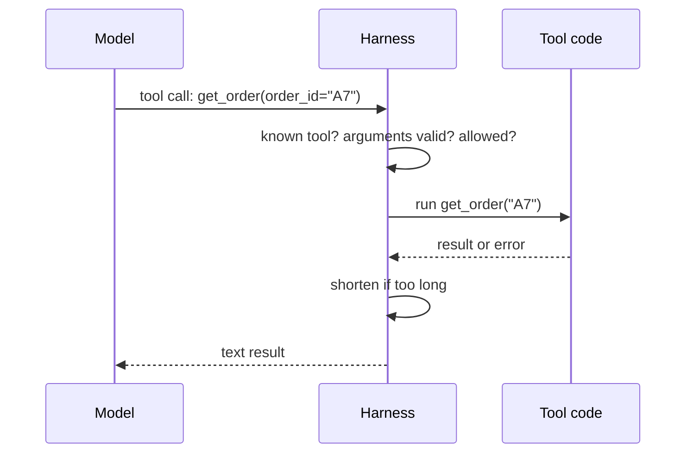

# 3. Tools and tool design

> **In one line:** A tool is a function the model can ask the harness to run. Good tools have clear names and descriptions, checked arguments, short useful results, and error messages that tell the model what to do next.

## What a tool is

A **tool** has two sides.

| Side | For whom | Contains |
|---|---|---|
| **Definition** (schema) | The model reads it | Name, description, parameters and their types |
| **Implementation** | The harness runs it | Normal code |

The model never runs anything. It writes a request. The harness decides, runs, and answers with text.



## The tool description is a prompt

The model chooses tools only from what the definitions say. So a definition is a small prompt, and deserves the same care.

Anthropic's article *Writing effective tools for AI agents* gives these principles:

1. **Choose a few good tools.** More tools is not better. Build tools for the important jobs. Combine steps that always go together into one tool.
2. **Name things clearly.** Group related tools with a shared prefix, for example `orders_search`, `orders_get`. Name parameters exactly: `user_id`, not `user`.
3. **Return meaningful context.** Give names and readable values, not internal codes. Let the model ask for a short or a detailed answer.
4. **Be careful with tokens.** Use limits, filters and pages. Cut very long results and say that you cut them.
5. **Write the description like a note to a new colleague.** Say what the tool does, when to use it, and what each parameter means. Small wording changes can change behaviour a lot.
6. **Make errors helpful.** Say what was wrong and what to try. Do not return a raw stack trace.

Then test the tools with realistic tasks and read the transcripts ([chapter 8](08-reliability-and-observability.md)).

### Bad and good

| | Bad | Good |
|---|---|---|
| Name | `data2` | `search_orders` |
| Description | "Gets data." | "Find orders of one customer. Returns the first `limit` orders and the total count. Use this first when you do not know the order id." |
| Parameter | `q` | `customer`: customer name in lower case, e.g. 'asha' |
| Error | `KeyError: '7'` | "No order with id '7'. Ids look like A1, A2 ... A40. Use search_orders to find ids for a customer." |
| Long result | 10,000 rows | First 5 rows + "showing 5 of 20. Ask for a specific order with get_order." |

## What the harness does on every tool call

[`code/ch03_tools.py`](code/ch03_tools.py) shows the four duties.

```python
def call_tool(name, args):
    """Check, run, and always return a string for the model. Never crash the loop."""
    if name not in TOOL_SPECS:
        return f"ERROR: unknown tool '{name}'. Available tools: {', '.join(TOOL_SPECS)}."
    ...
    for param, rule in spec["params"].items():
        if rule["required"] and param not in args:
            return f"ERROR: missing argument '{param}' ({rule['help']})."
    ...
    try:
        result = spec["function"](**args)
    except LookupError as error:
        return "ERROR: " + str(error)
    ...
    if len(text) > MAX_RESULT_CHARS:
        text = text[:MAX_RESULT_CHARS] + f"... [cut: result had {len(text)} characters]"
    return text
```

Output:

```text
CALL   get_order({'order_id': '7'})
RESULT ERROR: No order with id '7'. Ids look like A1, A2 ... A40. Use search_orders to find ids for a customer.

CALL   delete_order({'order_id': 'A7'})
RESULT ERROR: unknown tool 'delete_order'. Available tools: search_orders, get_order.

CALL   search_orders({'customer': 'asha', 'limit': 2})
RESULT [{"id": "A1", ...}, {"id": "A3", ...}]
(showing 2 of 20. Ask for a specific order with get_order.)
```

Three rules to remember:

- **Models invent tools and arguments.** Always check. Never pass arguments straight into code.
- **An error is a message, not a crash.** The loop must continue so the model can fix its mistake.
- **Every result costs context.** A tool that returns 50,000 characters can ruin the rest of the run.

## Common kinds of tools

| Kind | Examples | Risk |
|---|---|---|
| Read | read file, search, look up a record | Low |
| Write | edit file, create record | Medium |
| Execute | run a command, run code | High. Needs a sandbox ([chapter 7](07-permissions-and-sandboxing.md)) |
| Communicate | send email, post a message | High. Cannot be undone |
| Ask the user | "Which of these do you mean?" | Low, and often the best choice |
| Finish | "I am done, here is the summary" | Lets the harness check the result first |

"Ask the user" and "finish" as tools are a neat idea from the *12-factor agents* guide: contacting a human is just another tool call, so the loop stays simple.

## The agent-computer interface

The SWE-agent paper asked: human programmers have editors and terminals made for humans; what does a *model* need? Their answer was a set of commands made for the model:

- a file viewer that shows a limited number of lines at a time,
- a search command that returns a short summary of matches,
- an edit command that checks the code and refuses an edit that breaks its syntax, with a clear message.

With these, the same model solved many more tasks. The lesson: **design tools for how a model reads and acts, not for how a human does.** A model cannot scroll or glance. It reads everything you return, and pays for it in context.

## General tools or special tools?

| Approach | Example | Good | Bad |
|---|---|---|---|
| Few general tools | `run_command`, `read_file`, `write_file` | Can do almost anything | Powerful means dangerous; needs a sandbox |
| Many special tools | `orders_refund`, `orders_search` | Safe, easy to check and permit | Each one must be built; too many confuse the model |
| Code as action | The model writes a small program that calls tools | Loops and filtering happen in code, not in the context | Needs safe code execution |

The CodeAct paper (Wang et al., 2024) found that letting the model act by writing Python code can beat fixed JSON tool calls, because code can combine steps. Anthropic's *Code execution with MCP* article makes a related point: with thousands of tools, loading every definition and passing every result through the model wastes context. Letting the agent load only the tool files it needs, and filter data in code, cut one example from about 150,000 tokens to about 2,000.

## MCP: a standard plug for tools

The **Model Context Protocol (MCP)** is an open standard for connecting AI applications to outside systems: data sources, tools and workflows. A tool provider writes an **MCP server** once. Any harness that speaks MCP can then use it.

Without a standard, every harness needs its own code for every service. With one, tools become reusable, like USB devices.

Two cautions:

- Tool descriptions and results from a server you did not write are **untrusted text**. They can carry prompt injection ([guardrails chapter 2](../guardrails/02-prompt-injection-and-jailbreaks.md)).
- Connecting many servers loads many tool definitions into the context. Connect only what the task needs.

## Key terms

- **Tool definition (schema):** the name, description and parameters the model sees.
- **Tool call:** the model's request to run a tool.
- **Tool result:** the text the harness sends back.
- **Namespacing:** shared prefixes that group related tools.
- **Pagination:** returning results in pages.
- **Agent-computer interface (ACI):** tools and feedback designed for a model.
- **MCP:** an open standard for connecting AI apps to tools and data.

## Revision questions

1. What are the two sides of a tool, and who uses each?
2. Why must the harness check every tool call, even with a good model?
3. Rewrite this error for a model: `FileNotFoundError: cfg.yml`.
4. Why is a tool that returns a whole 10,000-row table a problem? Give two fixes.
5. What problem does MCP solve? Name one risk it brings.

<details>
<summary>Show answers</summary>

1. The definition (name, description, parameters), read by the model; and the implementation (code), run by the harness.
2. Models sometimes invent tool names, leave out arguments, or use wrong types and values. Unchecked calls crash the loop or do harm.
3. Something like: "ERROR: file 'cfg.yml' not found. Use list_files to see which files exist, then try again with a correct path."
4. It fills the context window, which costs money and makes the model worse at using the rest of its context. Fixes: return a limited number of rows with a total count; add filters or pages; cut long output and say so.
5. It gives one standard way to connect tools to any harness, so each tool is built once. Risk: tool descriptions and results from outside servers are untrusted and can carry prompt injection (also: many servers fill the context with definitions).

</details>

## Sources

- Anthropic, [Writing effective tools for AI agents](https://www.anthropic.com/engineering/writing-tools-for-agents) (2025)
- Yang et al., [SWE-agent: Agent-Computer Interfaces Enable Automated Software Engineering](https://arxiv.org/abs/2405.15793) (2024)
- Wang et al., [Executable Code Actions Elicit Better LLM Agents (CodeAct)](https://arxiv.org/abs/2402.01030) (2024)
- Anthropic, [Code execution with MCP](https://www.anthropic.com/engineering/code-execution-with-mcp) (2025)
- [What is the Model Context Protocol (MCP)?](https://modelcontextprotocol.io/docs/getting-started/intro)
- HumanLayer, [12-factor agents](https://github.com/humanlayer/12-factor-agents)
- Tool calling docs: [Anthropic](https://platform.claude.com/docs/en/agents-and-tools/tool-use/overview) · [OpenAI](https://developers.openai.com/api/docs/guides/function-calling)

---
Previous: [2. The agent loop](02-the-agent-loop.md) · Next: [4. Context engineering](04-context-engineering.md) · [Back to contents](../README.md)
