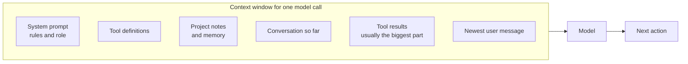
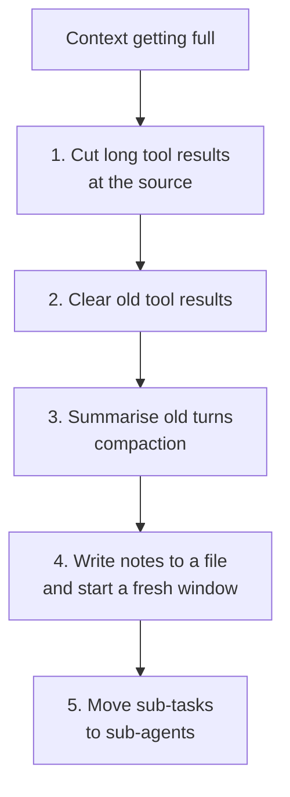

# 4. Context engineering

> **In one line:** The model only knows what is in its context window, and it gets worse when the window is full of noise. Context engineering is choosing, for every call, the smallest set of text that lets the model do the next step well.

## The context window

The **context window** is all the text sent to the model in one call. It is measured in **tokens** (pieces of words; roughly 4 characters each in English).

For an agent, the window holds:



Two hard facts:

1. **It is limited.** Every model has a maximum.
2. **It is all the model has.** Anything not in the window does not exist for the model.

## Prompt engineering and context engineering

Anthropic's article puts the difference like this:

| | Prompt engineering | Context engineering |
|---|---|---|
| Question | How do I word my instructions? | What should be in the window at all, at each step? |
| Scope | Mostly the system prompt | Everything: prompt, tools, history, tool results, memory |
| When | Once, before the run | Again and again, during the run |

In a chat, you write a prompt once. In an agent, the context is rebuilt on every loop round. So someone must decide each time what stays and what goes. That is the harness's job. As the *12-factor agents* guide says: own your context window.

## More context is not better

It is natural to think: big window, so put everything in. Research says no.

- ***Lost in the Middle*** (Liu et al., 2023): models use information best when it is at the start or the end of a long context. Facts in the middle are often missed.
- ***Context Rot*** (Chroma, 2025): across 18 models, results became less reliable as the input grew, even on very simple tasks. Text that looks relevant but is not (a **distractor**) made it worse.
- Anthropic describes context as a limited resource with falling returns. Each extra token uses up some of the model's **attention budget**.

So the goal is not "fill the window". The goal is **the smallest set of high-value tokens**.

## See what fills your window

Before you optimise, measure. From [`code/ch04_context_budget.py`](code/ch04_context_budget.py):

```text
PART 1 - what fills the window
  tool         3636 tokens  (95%)
  system         70 tokens  (2%)
  assistant      60 tokens  (2%)
  user           57 tokens  (1%)
```

This is typical. In agents, **tool results** are almost everything. That is where to save.

## Seven techniques

### 1. A system prompt at the right level

Anthropic calls this the "right altitude":

| Too low | Right | Too high |
|---|---|---|
| A long list of if-then rules for every case | Clear role, goals, a few firm rules, how to use the tools | "Be a helpful coding assistant." |
| Brittle, long, breaks on new cases | Guides without scripting | Gives the model nothing to work with |

Use sections with headings. Start small, test, and add a rule only when you see a real failure.

### 2. Few, clear tools

Every tool definition sits in the window on every call. Overlapping tools also make the model unsure which to pick. If a human engineer could not say which tool to use, the model cannot either. See [chapter 3](03-tools-and-tool-design.md).

### 3. A few good examples

A small set of varied, typical examples teaches more than a long list of edge-case rules. But see the warning under technique 7.

### 4. Just-in-time loading

Do not load whole files or databases up front. Keep **references** (file paths, links, IDs) and give the agent tools to fetch what it needs, when it needs it, in small pieces.

```text
PART 3 - just-in-time loading
  whole file: 2983 tokens.  first slice: 33 tokens
  line 1: value = 1
  ...
  [495 more lines. Call again with start=5]
```

This is how coding agents work: they list, search and read parts of files. They do not paste the whole repository. Many systems mix both: a small amount loaded up front, the rest on demand.

### 5. Clear old tool results

An old file listing from 20 steps ago is rarely needed. Replace old tool results with a one-line note:

```text
[contents of file_1.py] (old result removed to save space; read the file again if needed)
```

The script keeps the two newest tool results and clears the rest:

```text
before: 3823 tokens in 20 messages
after : 1487 tokens in 20 messages
```

The message count is the same. The model still knows it read the file and what it concluded. Only the bulk is gone. Anthropic calls tool-result clearing the lightest form of compaction.

### 6. Compaction, notes and sub-agents

When clearing is not enough: summarise the history, write notes to files, or give sub-tasks to sub-agents with their own windows. These get their own chapters: [5](05-memory-and-long-tasks.md) and [6](06-planning-and-sub-agents.md).

### 7. Lessons from a production agent

The team behind the Manus agent published what they learned. Several points are specific and useful:

| Lesson | Meaning |
|---|---|
| **Keep the start of the prompt stable** | Model providers can reuse work for an unchanged prefix (**prompt caching**), which makes calls cheaper and faster. A timestamp at the top of the system prompt breaks this on every call. Only add to the end |
| **Use files as memory** | Write large results to a file and keep only the path in the context. Nothing is lost, because the agent can read the file again |
| **Repeat the goal** | Keep a to-do list and rewrite it as work goes on. This puts the plan near the end of the context, where the model pays most attention |
| **Keep errors in** | Do not hide failed actions. Seeing the failure helps the model avoid repeating it |
| **Avoid too-uniform examples** | If the context is full of near-identical action/result pairs, the model copies the pattern even when it no longer fits |

## A simple policy you can start with

```python
def build_context(messages, budget, keep_recent_tools=2):
    # always keep: system prompt, user messages, assistant messages
    # keep in full: only the newest tool results
    # replace:      older tool results with a one-line note
    # if still over budget: summarise (chapter 5)
```

Order of actions when the window fills:



Start at the top. Each step down loses more detail or costs more.

## Project instruction files

Coding agents usually load a project file with standing instructions on every run: how to build, how to test, what style to follow. Claude Code uses `CLAUDE.md`. `AGENTS.md` is an open format for the same idea, described on its site as a README for agents.

Keep such a file short. It is loaded on every single call, so every line in it costs tokens forever.

## Key terms

- **Context window:** all the text the model sees in one call.
- **Token:** a piece of a word; the unit of context size and cost.
- **Context engineering:** deciding what goes into the window at each step.
- **Context rot:** results getting worse as the context grows.
- **Attention budget:** the idea that each token uses up some of the model's limited attention.
- **Distractor:** text that looks relevant but is not.
- **Just-in-time loading:** fetching information only when it is needed.
- **Tool-result clearing:** replacing old tool outputs with short notes.
- **Prompt caching:** reusing computation for an unchanged start of the prompt.

## Revision questions

1. How does context engineering differ from prompt engineering?
2. Give two research findings that show why a full context window is a problem.
3. In most agents, which kind of content uses the most tokens? What follows from that?
4. Explain just-in-time loading with an example.
5. Why should the start of the system prompt stay the same from call to call?

<details>
<summary>Show answers</summary>

1. Prompt engineering is about wording instructions, mostly once, in the system prompt. Context engineering is about choosing everything in the window (prompt, tools, history, tool results, memory) again at every step of the run.
2. *Lost in the Middle*: facts in the middle of a long context are often missed. *Context Rot*: results get less reliable as input grows, even on simple tasks, and distractors make it worse.
3. Tool results. So the biggest savings come from shortening tool results at the source and clearing old ones.
4. Keep only a reference (such as a file path) in the context and let the agent read the part it needs when it needs it. Example: read lines 1 to 50 of a file instead of pasting all 5,000 lines at the start.
5. Providers can cache an unchanged prefix, which makes calls cheaper and faster. Changing the beginning (for example with a timestamp) throws that away on every call.

</details>

## Sources

- Anthropic, [Effective context engineering for AI agents](https://www.anthropic.com/engineering/effective-context-engineering-for-ai-agents) (2025)
- Liu et al., [Lost in the Middle: How Language Models Use Long Contexts](https://arxiv.org/abs/2307.03172) (2023)
- Hong, Troynikov, Huber, [Context Rot: How Increasing Input Tokens Impacts LLM Performance](https://research.trychroma.com/context-rot) (Chroma, 2025)
- Yichao "Peak" Ji, [Context Engineering for AI Agents: Lessons from Building Manus](https://manus.im/blog/Context-Engineering-for-AI-Agents-Lessons-from-Building-Manus) (2025)
- Simon Willison, [Context engineering](https://simonwillison.net/2025/Jun/27/context-engineering/) (2025) · LangChain, [Context Engineering](https://blog.langchain.com/context-engineering-for-agents/)
- HumanLayer, [12-factor agents](https://github.com/humanlayer/12-factor-agents) · [AGENTS.md](https://agents.md/)

---
Previous: [3. Tools and tool design](03-tools-and-tool-design.md) · Next: [5. Memory and long tasks](05-memory-and-long-tasks.md) · [Back to contents](../README.md)
