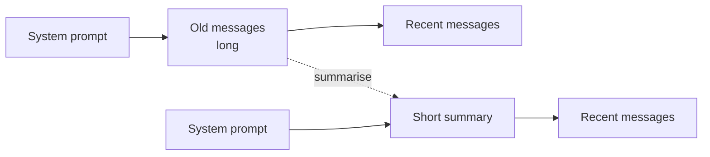
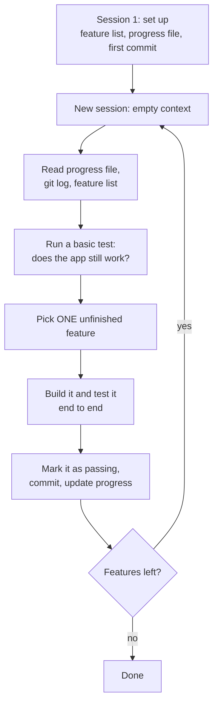

# 5. Memory and long tasks

> **In one line:** A model forgets everything between calls, so for long work the harness must keep memory outside the model: summaries of old conversation, notes in files, and a clean handover from one session to the next.

## The problem

A model has no memory of its own. What looks like memory is the harness sending old text back in.

That works until the context window is full. A long task (build an app, research a topic for hours) produces far more text than fits. Then one of two things happens:

- the harness **shrinks** the history, or
- it **starts fresh** with a new, empty window.

Either way, something must carry the important information forward.

Anthropic describes long-running agents with a picture: engineers working in shifts, where each new engineer arrives with **no memory** of the previous shift. Good handover notes are everything.

## Kinds of memory

| Kind | Where it lives | Lasts | Example |
|---|---|---|---|
| **Working memory** | The context window | This call | The current conversation |
| **Summary** | The context window, compressed | This session | "So far: parser written, bug in empty lines" |
| **Notes / scratchpad** | A file the agent writes | Across sessions | `progress.json`, `NOTES.md`, a to-do list |
| **Project instructions** | A file you write | Always | `CLAUDE.md`, `AGENTS.md` |
| **Long-term store** | A database, often searched by meaning | Across tasks | Facts about the user; past solutions |
| **The work itself** | Files, git history | Always | The code and its commit messages |

The last row is easy to forget and very powerful. For a coding agent, the repository *is* memory: the files show what exists, and `git log` shows what was done and why.

Research papers explored these ideas early:

- **MemGPT** (Packer et al., 2023) treats the context like a computer's fast memory and adds slower outside storage. The model itself moves information in and out with tool calls, like an operating system does.
- **Generative Agents** (Park et al., 2023) gave simulated characters a memory stream. They fetch memories by recency, importance and relevance, and write higher-level "reflections".
- **Reflexion** (Shinn et al., 2023): after a failed attempt, the agent writes a short lesson in words and reads it on the next attempt. It improves without any retraining.
- **Voyager** (Wang et al., 2023) stores working code as a growing library of skills that the agent reuses later.

## Technique 1: Compaction

**Compaction** means replacing the old part of the conversation with a summary, and continuing with the summary plus the newest messages.



From [`code/ch05_memory.py`](code/ch05_memory.py):

```text
before: 633 tokens, 10 messages
after : 217 tokens, 4 messages (compacted=True)
Summary of earlier work:
- Please build a CSV parser in parser.py
- We decided to use the csv module, not regex.
- Found a bug: empty lines crash the parser. TODO fix in parser.py
- Also the output must be UTF-8.
Note what was lost: the test output and the file listing.
```

What a good summary keeps:

- the goal and the user's requirements,
- decisions and the reasons for them,
- what is finished and what is left,
- open bugs,
- names of files that matter.

What it can drop: long tool outputs, repeated attempts, small talk.

**The risk:** a summary always loses something, and you cannot know in advance which detail will matter later. Anthropic's advice is to first make sure the summary captures everything important, and only then make it shorter.

## Technique 2: Notes in files

The agent writes down its progress **outside** the context. A new session reads the notes first.

```python
def work_session(path, session_name, steps_possible):
    notes = load_notes(path)                # start by reading the notes
    for _ in range(steps_possible):
        task = notes["todo"].pop(0)         # work on ONE thing at a time
        notes["done"].append(task)
        save_notes(path, notes)             # save after every step
```

```text
session 1: starts with done=[] todo=['write parser', 'write tests', 'write docs']
session 1: ends   with done=['write parser', 'write tests'] todo=['write docs']
session 2: starts with done=['write parser', 'write tests'] todo=['write docs']
session 2: ends   with done=['write parser', 'write tests', 'write docs'] todo=[]
```

Session 2 began with an empty context. The file was enough.

Two details matter:

- **Save after every step**, not only at the end. A session can stop at any moment.
- **Structured notes** (a list of items with a status) are easier to update safely than free text.

## Technique 3: A harness for many sessions

Anthropic's article *Effective harnesses for long-running agents* describes two ways such projects fail:

1. **Doing too much at once.** The agent tries to build everything in one go, runs out of context in the middle, and leaves half-finished work with no notes.
2. **Declaring victory too early.** A later session sees that a lot exists and announces that the project is done.

Their fix has clear parts:

| Part | What it does |
|---|---|
| **Initializer session** | The first session only sets things up: a start-up script, a progress file, a first commit |
| **Feature list** | A file listing every feature, each marked as not passing at the start. Later sessions may only change the pass/fail field. This stops "it's all done" claims |
| **One feature per session** | Small steps that fit in one window |
| **Leave a clean state** | End every session with a git commit and an updated progress file |
| **Start by getting oriented** | Each session first reads the progress file, the git log and the feature list, and runs a basic test |
| **Test like a user** | Agents marked features as done without really trying them. End-to-end tests through a browser fixed that |



## Compaction or a fresh start?

| | Compaction | Fresh window + notes |
|---|---|---|
| Keeps | A summary of the same conversation | Only what was written to files |
| Good | Smooth, no break in the work | A truly clean context; no leftover confusion |
| Bad | Old mistakes and clutter can survive in the summary | Needs good notes; start-up cost each time |

Anthropic's later article on harness design reports that, for one model, full resets with a structured handover worked better than compaction, because the model tended to wrap up early as its context filled. With a newer model this was less needed. Which is better depends on the model, so test it.

## What to remember, and what not

- **Remember decisions and reasons**, not only results. "We use the csv module because regex broke on quotes" prevents going back and forth.
- **Remember what failed.** Otherwise the next session tries it again.
- **Do not store what can be looked up.** File contents are in the files.
- **Keep memory true.** Old notes that are now wrong are worse than no notes. Update or delete them.
- **Be careful with personal data** in long-term memory ([guardrails chapter 3](../guardrails/03-pii-and-sensitive-data.md)).
- **Treat stored memory as untrusted** if outside text can get into it. A poisoned note is a prompt injection that comes back every session.

## Key terms

- **Working memory:** what is in the context window now.
- **Compaction:** replacing old conversation with a summary.
- **Scratchpad / notes:** files the agent writes for itself.
- **Session:** one run with one context window.
- **Handover (handoff):** the information passed from one session to the next.
- **Context reset:** starting a new, empty window on purpose.
- **Reflection:** a lesson the agent writes after an attempt, to use next time.

## Revision questions

1. Why does a long task need memory outside the model?
2. What should a compaction summary keep? What can it drop?
3. Name the two failure modes of long-running agents described by Anthropic.
4. Why should notes be saved after every step?
5. For a coding agent, why are files and git history a form of memory?

<details>
<summary>Show answers</summary>

1. The model forgets everything between calls, and the context window is too small to hold the whole history of a long task. Information must be stored elsewhere and brought back when needed.
2. Keep: the goal and requirements, decisions and reasons, what is done and what is left, open bugs, important file names. Drop: long tool outputs, repeated attempts, small talk.
3. Trying to do too much at once and running out of context mid-way; and a later session declaring the project finished too early.
4. A session can end at any moment (full context, error, limit). Work that was not written down is lost to the next session.
5. The files show the current state of the work, and the commit history records what was changed and why. A new session can read both to get up to date.

</details>

## Sources

- Anthropic, [Effective harnesses for long-running agents](https://www.anthropic.com/engineering/effective-harnesses-for-long-running-agents) (2025) · [Harness design for long-running apps](https://www.anthropic.com/engineering/harness-design-long-running-apps) (2026) · [Effective context engineering for AI agents](https://www.anthropic.com/engineering/effective-context-engineering-for-ai-agents) (2025)
- Packer et al., [MemGPT: Towards LLMs as Operating Systems](https://arxiv.org/abs/2310.08560) (2023)
- Park et al., [Generative Agents: Interactive Simulacra of Human Behavior](https://arxiv.org/abs/2304.03442) (2023)
- Shinn et al., [Reflexion: Language Agents with Verbal Reinforcement Learning](https://arxiv.org/abs/2303.11366) (2023)
- Wang et al., [Voyager: An Open-Ended Embodied Agent with Large Language Models](https://arxiv.org/abs/2305.16291) (2023)
- Sumers et al., [Cognitive Architectures for Language Agents](https://arxiv.org/abs/2309.02427) (2023)

---
Previous: [4. Context engineering](04-context-engineering.md) · Next: [6. Planning and sub-agents](06-planning-and-sub-agents.md) · [Back to contents](../README.md)
