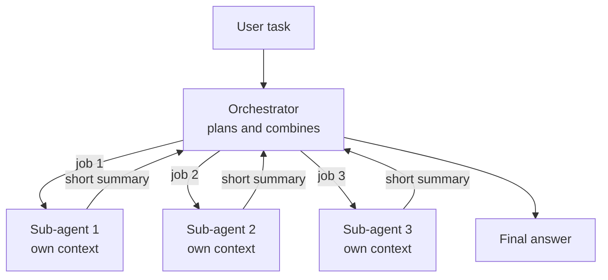

# 6. Planning and sub-agents

> **In one line:** For big tasks, the harness helps the model plan before acting, and can hand parts of the work to sub-agents with their own clean context. This keeps the main agent focused, but costs many more tokens and brings new ways to fail.

## Part 1: Planning

Without a plan, an agent takes one step, looks, takes another. For a big task it can wander.

### Ways a harness supports planning

| Method | How it works |
|---|---|
| **Plan first, then act** | The model writes a list of steps before any tool call. The Plan-and-Solve paper (Wang et al., 2023) showed that asking for a plan first reduces missed steps |
| **To-do list as a tool** | The agent keeps a list and ticks items off. The list is shown to the model again as it changes, so the goal stays in view |
| **Plan mode** | The agent may only read and think. A human approves the plan before any change is made |
| **Try several paths** | Tree of Thoughts (Yao et al., 2023): explore more than one line of reasoning, judge them, go back if needed. Powerful, and costly |
| **Reflect and retry** | Reflexion and Self-Refine: look at the result, write what was wrong, try again |

For most apps, a to-do list plus "plan first" is enough.

### Plans change

A plan is a guess. After the first tool results come back, it is often wrong. A good harness lets the agent **update** the plan, and shows the user when it does. A plan that cannot change is a workflow ([chapter 2](02-the-agent-loop.md)).

## Part 2: Sub-agents

A **sub-agent** is a second agent loop with its **own, fresh context window**. The main agent, called the **orchestrator** or lead agent, gives it one job and gets back a short result.



### Why use them

1. **Clean context.** The sub-agent reads 50 pages and returns 5 lines. The 50 pages never enter the main context. Anthropic notes that sub-agents often return a condensed summary of about 1,000 to 2,000 tokens after using far more.
2. **Speed.** Independent jobs run at the same time.
3. **Focus.** Each sub-agent has one clear job and only the tools for it.
4. **A second opinion.** A separate agent can check work without sharing the first agent's blind spots.

From [`code/ch06_subagents.py`](code/ch06_subagents.py):

```text
ONE AGENT ALONE
  tokens in its context: 1301

ORCHESTRATOR + 3 SUB-AGENTS
  got back: refunds.txt: Refunds take 5 working days.
  got back: delivery.txt: Delivery costs 40 rupees.
  got back: support.txt: Support is open 9 am to 6 pm.
  tokens in the MAIN context: 45
  tokens used in TOTAL      : 1408
```

The main context is about 29 times smaller. The total work is a little larger. That is the trade in one picture.

### What it costs

Anthropic's report on its multi-agent research system gives real numbers:

- Agents used about **4 times** the tokens of a normal chat.
- Multi-agent systems used about **15 times**.
- On their research test, the multi-agent system did much better than a single agent. But the article says this only pays off for high-value tasks where the work can be split.

In our toy the extra cost is small because the sub-agents do almost nothing. In real systems each sub-agent runs its own loop with many calls.

### Writing a good job description

A sub-agent knows **nothing** except what the orchestrator writes. This is the most common cause of failure. Anthropic found that short, vague instructions made sub-agents repeat each other's work or miss the point.

A good job description has:

| Part | Example |
|---|---|
| The goal | "Find the refund time in our policy documents." |
| Why it matters | "It will be quoted to a customer, so it must be exact." |
| What to return | "One sentence with the number of days, and the file name." |
| Limits | "Only read files in `docs/`. Do not edit anything." |
| What is already known | "Delivery policy has been checked. Skip it." |
| When to stop | "Stop after you find it, or after checking all 3 files." |

Bad: "Look into refunds."

### Scale the effort

Not every question needs a team. Anthropic gave its orchestrator explicit rules, for example: a simple fact needs one agent and a few tool calls; only complex research gets many sub-agents. Without such rules, agents over-spend on easy questions.

## The case against multi-agent systems

Cognition (the makers of the Devin coding agent) published a well-known essay titled *Don't Build Multi-Agents*. Its two principles:

1. **Share context.** Give every agent the full history of what happened, not only a short message.
2. **Actions carry hidden decisions.** When two agents work separately, each makes choices the other cannot see. The choices conflict, and the combined result is bad.

Their example: two sub-agents build two parts of a game. One picks one visual style, the other a different one. Each did its job. The parts do not fit.

So who is right? Both. The disagreement is about **what kind of task**:

| Sub-agents work well when... | Sub-agents work badly when... |
|---|---|
| Jobs are independent (search three sources) | Parts must fit together closely (two halves of one program) |
| The job is mostly **reading** | The job is mostly **writing** that others build on |
| A short summary is all that is needed back | The details of *how* it was done matter later |
| The task is valuable enough to pay for | The task is small |

A safe rule for beginners: **use sub-agents to read and research, not to write shared work in parallel.** And start with one agent. Add more only when you can point to the problem they solve.

## Roles: planner, builder, checker

Another pattern gives agents different **roles** instead of parallel jobs. Anthropic's article on harness design for long-running apps used three:

| Role | Job |
|---|---|
| **Planner** | Turns a short request into a full specification |
| **Generator** | Builds one piece at a time |
| **Evaluator** | Tests the running result and grades it against agreed criteria |

Why a separate evaluator? The article reports that agents tend to praise their own work, even when it is mediocre. A separate, deliberately strict evaluator was easier to get right than making the builder self-critical. Before each piece of work, the generator and the evaluator agreed on what "done" means.

The same article gives the price: one run of the full system took hours and cost many times more than a single-agent run. It also notes that with a stronger model, parts of this structure could be removed.

Research frameworks such as AutoGen, CAMEL and MetaGPT explore many agents talking to each other in assigned roles.

## Key terms

- **Plan:** a list of steps written before acting.
- **To-do list:** a plan the agent updates as it works.
- **Sub-agent:** an agent loop with its own context, started by another agent for one job.
- **Orchestrator (lead agent):** the agent that plans, delegates and combines.
- **Delegation:** handing a job to a sub-agent.
- **Evaluator agent:** a separate agent whose only job is to check work.

## Revision questions

1. Name three ways a harness can support planning.
2. Give two benefits and one cost of sub-agents.
3. What should a good job description for a sub-agent contain?
4. Explain the "hidden decisions" problem with an example.
5. For which kinds of tasks are sub-agents a good fit, and for which a bad fit?

<details>
<summary>Show answers</summary>

1. Any three of: ask for a plan before acting; give the agent a to-do list tool; a plan mode where a human approves the plan first; exploring several paths; reflecting on results and retrying.
2. Benefits (any two): the main context stays small and clean; jobs can run in parallel; each sub-agent is focused; a separate agent can check work. Cost: many more tokens and model calls (Anthropic reports about 15 times a chat for multi-agent systems).
3. The goal, why it matters, what to return and in what form, limits on what it may do, what is already known, and when to stop.
4. Agents working separately each make choices the others cannot see. Example: two sub-agents build two parts of a game in different visual styles; each part is fine alone, but they do not fit together.
5. Good: independent jobs, mostly reading or research, where a short summary is enough and the task is valuable. Bad: tightly connected work, parallel writing that must fit together, small tasks.

</details>

## Sources

- Anthropic, [How we built our multi-agent research system](https://www.anthropic.com/engineering/multi-agent-research-system) (2025) · [Harness design for long-running apps](https://www.anthropic.com/engineering/harness-design-long-running-apps) (2026) · [Effective context engineering for AI agents](https://www.anthropic.com/engineering/effective-context-engineering-for-ai-agents) (2025)
- Walden Yan (Cognition), [Don't Build Multi-Agents](https://cognition.ai/blog/dont-build-multi-agents) (2025)
- Wang et al., [Plan-and-Solve Prompting](https://arxiv.org/abs/2305.04091) (2023) · Yao et al., [Tree of Thoughts](https://arxiv.org/abs/2305.10601) (2023)
- Shinn et al., [Reflexion](https://arxiv.org/abs/2303.11366) (2023) · Madaan et al., [Self-Refine](https://arxiv.org/abs/2303.17651) (2023)
- Wu et al., [AutoGen](https://arxiv.org/abs/2308.08155) (2023) · Li et al., [CAMEL](https://arxiv.org/abs/2303.17760) (2023) · Hong et al., [MetaGPT](https://arxiv.org/abs/2308.00352) (2023)

---
Previous: [5. Memory and long tasks](05-memory-and-long-tasks.md) · Next: [7. Permissions and sandboxing](07-permissions-and-sandboxing.md) · [Back to contents](../README.md)
