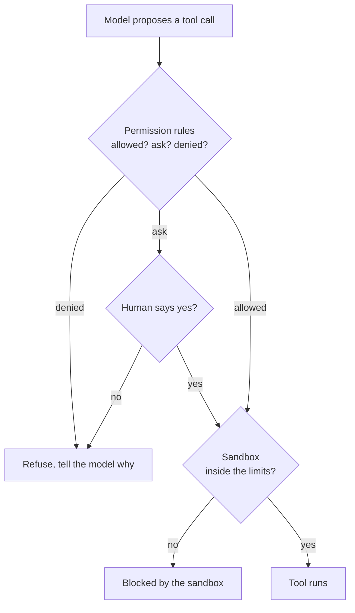

# 7. Permissions and sandboxing

> **In one line:** An agent that can run commands and edit files can also do damage, so the harness sets hard limits on what it can reach (a sandbox) and rules for when a human must approve (permissions).

## Why this is needed

An agent with a `run_command` tool can do anything you can do at a terminal. It may:

- delete the wrong folder by mistake,
- read private files such as keys and passwords,
- follow a hidden instruction in a web page it read (prompt injection, see [guardrails chapter 2](../guardrails/02-prompt-injection-and-jailbreaks.md)),
- send data to an outside server.

The model does not need to be "bad" for this to happen. A wrong guess is enough.

## Two layers



| Layer | What it is | Can it be relaxed? |
|---|---|---|
| **Permissions** | Rules about which actions run freely, which need a human's yes, and which are refused | Yes, by the user, per mode or per tool |
| **Sandbox** | A hard boundary enforced by the system: which files, which network, how much time and memory | No. It holds even when permissions say yes |

Think of a workshop. Permissions are the rules on the wall. The sandbox is the locked door.

## Permissions

### Modes

Most coding harnesses offer modes like these:

| Mode | Reading | Writing and commands | Use when |
|---|---|---|---|
| **Read-only / plan** | Runs | Refused | Exploring, planning |
| **Ask** (default) | Runs | Needs a yes each time | Normal careful work |
| **Auto-accept edits** | Runs | File edits run; commands still ask | You trust the edits and can undo them with git |
| **Full auto** | Runs | Runs | Only inside a strong sandbox |

### Rules

Finer control comes from lists:

- **Allow list:** actions that never need asking, for example "run the tests".
- **Deny list:** actions that are always refused, for example "read `.env`".
- **Ask:** everything else.

**Prefer allow lists.** A deny list tries to name everything dangerous, and there is always one more way. An allow list names what is safe and refuses the rest. This is **deny by default**.

The same idea, with risk tiers and audit logs, is in [guardrails chapter 8](../guardrails/08-human-in-the-loop.md).

### The cost of asking

Asking protects, but asking too often has a cost. Anthropic calls it **approval fatigue**: people who see constant prompts stop reading them and click yes. Then the prompts protect nothing.

The way out is the sandbox: make a safe area where the agent can work freely, and ask only when it wants to leave that area.

## Sandboxing

A **sandbox** is a restricted place to run code. What happens inside cannot affect the outside.

Anthropic's article on sandboxing Claude Code names two kinds of isolation and says both are needed:

| Isolation | Limits | Stops |
|---|---|---|
| **Filesystem** | Which folders can be read and written. Typically the project folder only | Changing system files; reading keys in your home folder |
| **Network** | Which servers can be reached. Typically an approved list | Sending your data out; downloading something harmful |

Why both? With network limits alone, the agent could still read your secret keys. With file limits alone, it could send out whatever it is allowed to read. In their internal use, sandboxing cut permission prompts by 84%.

Notice how this matches the "lethal trifecta" from the guardrails part: private data, untrusted content, and a way to send data out. File isolation removes the first. Network isolation removes the third.

### How sandboxes are built

| Method | Strength | Note |
|---|---|---|
| Path checks in your own code | Weak | Good for teaching and for simple file tools. Easy to get wrong |
| OS sandbox features | Strong | For example bubblewrap on Linux and seatbelt on macOS, which Claude Code's sandbox uses |
| Containers (such as Docker) | Strong | A separate file system and network for the agent |
| Virtual machine or cloud sandbox | Strongest | A whole separate computer; throw it away after the task |

Other limits belong here too: maximum run time for a command, maximum memory, maximum output size.

## A teaching sandbox

[`code/ch07_permissions.py`](code/ch07_permissions.py) shows the logic in plain Python. The key function turns a path from the model into a real path and refuses anything outside the workspace:

```python
def safe_path(self, relative_path):
    full = os.path.realpath(os.path.join(self.workspace, relative_path))
    if os.path.commonpath([full, self.workspace]) != self.workspace:
        raise PermissionError(f"'{relative_path}' is outside the workspace")
    return full
```

`realpath` resolves tricks such as `../..` before the check. Checking the raw text of the path would be easy to fool.

Output in the three modes (shortened):

```text
MODE: read-only
  write_file(path='notes.txt', ...)          -> DENIED: read-only mode
  read_file(path='../secret.txt')            -> BLOCKED BY SANDBOX: '../secret.txt' is outside the workspace

MODE: ask
  write_file(path='notes.txt', ...)          -> OK: wrote 20 characters to notes.txt
  write_file(path='report.txt', ...)         -> DENIED: the user said no

MODE: auto
  write_file(path='report.txt', ...)         -> OK: wrote 8 characters to report.txt
  write_file(path='../../evil.txt', ...)     -> BLOCKED BY SANDBOX: '../../evil.txt' is outside the workspace
  run_command(command='delete_everything')   -> BLOCKED BY SANDBOX: command ... is not on the allow list
```

Look at `auto` mode. Permissions said yes to everything, and the sandbox still stopped the two dangerous calls.

**This is a teaching version.** It only guards our own file functions. It would not contain a real shell command. For real command execution, use an OS-level sandbox or a container.

## More safety habits

- **Work in version control.** With git, every edit can be seen and undone. Commit before letting an agent loose.
- **Keep secrets out of reach.** Do not put API keys in the workspace. Give the agent only the access it needs for this task.
- **Use a copy.** Let the agent work on a separate branch or a copy of the data, never on production.
- **Prefer narrow tools.** `run_tests()` is safer than `run_command("...")`.
- **Treat tool results as untrusted.** A file, web page or tool output can contain instructions. Sandboxing limits what a successful injection can do.
- **Show what will happen.** For an edit, show the diff. For a command, show the exact command.
- **Hooks.** Some harnesses let you run your own script before or after a tool call, for example to block a pattern or to run a formatter. A hook is code, so it always runs.

## The trade-off

| More freedom | More control |
|---|---|
| Faster, less interruption | Slower, more prompts |
| The agent can finish long tasks alone | A human must be present |
| Needs a strong sandbox to be safe | Safe even with a weak sandbox, if the human really reads |

A good default: **strong sandbox + auto mode inside it + ask at the boundary.**

## Key terms

- **Permission:** a rule about whether an action may run.
- **Permission mode:** a preset such as read-only, ask or auto.
- **Allow list / deny list:** actions always allowed / always refused.
- **Deny by default:** refuse anything that is not clearly allowed.
- **Sandbox:** a restricted environment with hard limits.
- **Filesystem isolation / network isolation:** limits on files / on servers that can be reached.
- **Approval fatigue:** saying yes without reading because there are too many prompts.
- **Hook:** your own script that the harness runs at a set point.

## Revision questions

1. What is the difference between permissions and a sandbox?
2. Why is an allow list safer than a deny list?
3. Name the two kinds of isolation in a sandbox and say why both are needed.
4. What is approval fatigue, and how does a sandbox help?
5. In the code, why is `realpath` applied before checking that a path is inside the workspace?

<details>
<summary>Show answers</summary>

1. Permissions are rules about what may run and when to ask a human; the user can relax them. A sandbox is a hard boundary enforced by the system that holds even when permissions allow an action.
2. A deny list must name every dangerous action and will miss some. An allow list names the safe ones and refuses everything else, so unknown actions are blocked.
3. Filesystem isolation and network isolation. Without file limits the agent can read secrets; without network limits it can send out what it reads. Either gap alone is enough for data theft.
4. People who are asked too often stop reading and approve everything. A sandbox creates a safe area where the agent can act without asking, so prompts are needed only at the boundary.
5. It resolves parts like `..` and links to the true location. Checking the raw text would let a path such as `../../secret.txt` slip out of the workspace.

</details>

## Sources

- Anthropic, [Making Claude Code safer with sandboxing](https://www.anthropic.com/engineering/claude-code-sandboxing) (2025)
- Anthropic, [Best practices for Claude Code](https://www.anthropic.com/engineering/claude-code-best-practices)
- OWASP, [LLM06:2025 Excessive Agency](https://genai.owasp.org/llmrisk/llm062025-excessive-agency/)
- Simon Willison, [The lethal trifecta for AI agents](https://simonwillison.net/2025/Jun/16/the-lethal-trifecta/) (2025)
- Wang et al., [OpenHands: An Open Platform for AI Software Developers as Generalist Agents](https://arxiv.org/abs/2407.16741) (2024), which runs agent actions in a sandboxed environment

---
Previous: [6. Planning and sub-agents](06-planning-and-sub-agents.md) · Next: [8. Reliability and observability](08-reliability-and-observability.md) · [Back to contents](../README.md)
