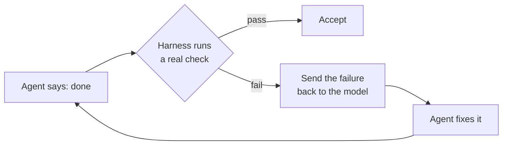

# 8. Reliability and observability

> **In one line:** Long agent runs fail in small ways all the time, so a good harness retries what can be retried, stops loops, checks the result with real tests before accepting "done", and records every step so that you can see what happened.

## Small errors add up

Suppose each step of an agent is right 95% of the time. That sounds good. Over 20 steps in a row:

0.95^20 ≈ **0.36**

So only about one run in three would go through with no mistake at all. Agents work in practice because they can **notice and repair** mistakes. The harness must make that possible.

## What goes wrong

| Problem | Example | Harness answer |
|---|---|---|
| API failure | Timeout, error 429 (too many requests) | Retry with backoff |
| Bad tool call | Unknown tool, wrong arguments | Return a helpful error ([chapter 3](03-tools-and-tool-design.md)) |
| Tool failure | File not found, command failed | Give the error text back to the model |
| Stuck in a loop | The same search again and again | Loop detection |
| Never finishes | Keeps "improving" forever | Step, time and cost limits |
| False success | "Done!" but the code does not run | Verification |
| Lost progress | Crash at step 40 | Save state; be able to resume |
| Cannot understand a failure | "It did something weird" | Traces |

## 1. Retries with backoff

Some failures go away if you wait. Retry them a few times, waiting longer each time. This is **exponential backoff**: 1 second, 2, 4 ...

```python
def call_with_retries(function, max_tries=4, first_wait=1.0):
    wait = first_wait
    for attempt in range(1, max_tries + 1):
        try:
            return function()
        except ConnectionError:
            if attempt == max_tries:
                raise
            time.sleep(wait)
            wait *= 2
```

Rules:

- **Limit the tries.** Never retry forever.
- **Retry only what can recover.** A timeout, yes. "Invalid API key", no.
- **Be careful with actions.** Retrying "send payment" may pay twice. An action that is safe to repeat is called **idempotent**. Retry only those, or check first whether the action already happened.

## 2. Loop detection

Agents get stuck repeating one action. A simple check catches most cases:

```python
def is_looping(history, window=3):
    last = history[-window:]
    return len(last) == window and all(action == last[0] for action in last)
```

When it fires, do not just stop. First tell the model: "You have repeated this action 3 times with the same result. Try a different approach." Often that is enough. Stop if it continues.

## 3. Verify before accepting "done"

This is the most important idea in the chapter.

**The model saying "done" is a claim. It is not evidence.**

Anthropic's long-running agent article reports that agents marked features as complete without properly testing them. Their harness-design article adds that agents tend to rate their own work too kindly.

So the harness checks the **outcome** itself:

| Task | Real check |
|---|---|
| Code | Run the tests. Does it build? |
| Web app | Open it and click through like a user |
| Data change | Query the database afterwards |
| Document | Does it have the required sections? Do the links work? |
| Research answer | Is every claim backed by a source that was really read? |



From [`code/ch08_reliability.py`](code/ch08_reliability.py):

```text
first attempt:  agent says: done!  harness check: FAIL on [[3, 1, 2], [5, 5, 1]]
second attempt: agent says: done!  harness check: PASS
```

The failure message is the best possible feedback: it is specific and true. Giving the agent a way to check its own work (tests, a linter, a screenshot) is one of the strongest things a harness can do.

Two cautions:

- **Protect the checks.** An agent that may edit the tests can make them pass by weakening them. Keep the checks out of its reach, or review changes to them.
- **A passing check proves only what it checks.** Three tests do not prove the code is right.

## 4. Limits

Every loop needs an upper bound on steps, time, tokens and money. See [chapter 2](02-the-agent-loop.md) and [guardrails chapter 7](../guardrails/07-rate-limits-and-cost-limits.md).

When a limit stops a run, report honestly: what was finished, what was not, and where things stand.

## 5. Save state and resume

For long tasks, save progress after every step ([chapter 5](05-memory-and-long-tasks.md)). Then a crash costs one step, not the whole run. The *12-factor agents* guide lists "launch, pause and resume" as a core property: an agent should be able to stop (for a human's answer, for example) and continue later from saved state.

## 6. Traces: see what happened

**Observability** means being able to see what your system is doing. For agents the main tool is the **trace**: a record of every step of one run.

A useful trace event has:

- step number and time,
- the kind of event (model call, tool call, check),
- inputs and outputs (shortened if huge),
- tokens in and out, and cost,
- how long it took,
- success or error.

```text
{"step": 1, "kind": "model_call", "tokens_in": 820, "tokens_out": 40}
{"step": 2, "kind": "tool_call", "tool": "read_file", "args": {"path": "sort.py"}, "ok": true, "ms": 3}
{"step": 3, "kind": "model_call", "tokens_in": 1150, "tokens_out": 95}
{"step": 4, "kind": "tool_call", "tool": "write_file", "args": {"path": "sort.py"}, "ok": true, "ms": 4}
{"step": 5, "kind": "verify", "passed": true}
```

Notice `tokens_in` growing from step 1 to step 3. A trace shows context growth directly.

What traces are for:

1. **Debugging.** Agents are not deterministic. You often cannot repeat a failure, so the record is all you have.
2. **Improving tools and prompts.** Read where the agent got confused. Anthropic's advice is to read transcripts closely, and even to let an agent read them to suggest better tool descriptions.
3. **Cost control.** See which step eats the tokens.
4. **Evals.** Real traces become test cases ([evaluations chapter 7](../evaluations/07-building-a-test-set.md)).

Remove personal data and secrets before storing traces ([guardrails chapter 3](../guardrails/03-pii-and-sensitive-data.md)).

## Measuring a harness

A harness change is a change to the product. Measure it like one ([evaluations chapter 6](../evaluations/06-evaluating-agents.md)).

| Measure | Why |
|---|---|
| Task success rate, by outcome | The main number |
| pass^k (all of k runs succeed) | Reliability, not luck |
| Steps and tokens per task | Efficiency |
| Cost per solved task | *AI Agents That Matter* warns that accuracy without cost misleads |
| Time per task | User experience |
| How often a human had to step in | Real autonomy |

Change one thing at a time, run the same tasks, and compare.

## Key terms

- **Retry with backoff:** try again after a wait that grows each time.
- **Idempotent:** safe to repeat; doing it twice has the same effect as once.
- **Loop detection:** noticing repeated identical actions.
- **Verification:** checking the real outcome instead of trusting the agent's claim.
- **Trace:** the step-by-step record of one run.
- **Observability:** the ability to see what the system does.
- **Resume:** continuing a run from saved state.

## Revision questions

1. Each step succeeds 90% of the time. What is the chance that 10 steps in a row all succeed? What does this tell you?
2. Which errors should be retried, and which should not? Give one example of each.
3. Why is "the agent said it is done" not enough? Give two examples of real checks.
4. What should one trace event record?
5. Why must an agent not be free to edit its own tests?

<details>
<summary>Show answers</summary>

1. 0.9^10 ≈ 0.35. Long runs almost always contain some error, so the harness must help the agent notice and repair mistakes instead of hoping for none.
2. Retry errors that may pass with time, such as a timeout or error 429. Do not retry errors that will not change, such as an invalid API key, or actions that are unsafe to repeat, such as sending a payment.
3. It is a claim, and agents often claim success without testing or judge their own work too kindly. Real checks: run the test suite; open the app and use it; query the database after a change.
4. Step number and time, the kind of event, inputs and outputs, tokens and cost, duration, and success or error.
5. It could make failing tests pass by weakening or deleting them, so "tests pass" would no longer mean the work is correct.

</details>

## Sources

- Anthropic, [Effective harnesses for long-running agents](https://www.anthropic.com/engineering/effective-harnesses-for-long-running-agents) (2025) · [Harness design for long-running apps](https://www.anthropic.com/engineering/harness-design-long-running-apps) (2026)
- Anthropic, [Demystifying evals for AI agents](https://www.anthropic.com/engineering/demystifying-evals-for-ai-agents) (2026) · [Writing effective tools for AI agents](https://www.anthropic.com/engineering/writing-tools-for-agents) (2025)
- Kapoor et al., [AI Agents That Matter](https://arxiv.org/abs/2407.01502) (2024)
- Yao et al., [τ-bench](https://arxiv.org/abs/2406.12045) (2024), for pass^k
- HumanLayer, [12-factor agents](https://github.com/humanlayer/12-factor-agents)
- Shinn et al., [Reflexion](https://arxiv.org/abs/2303.11366) (2023)

---
Previous: [7. Permissions and sandboxing](07-permissions-and-sandboxing.md) · Next: [9. Harnesses in practice](09-harnesses-in-practice.md) · [Back to contents](../README.md)
