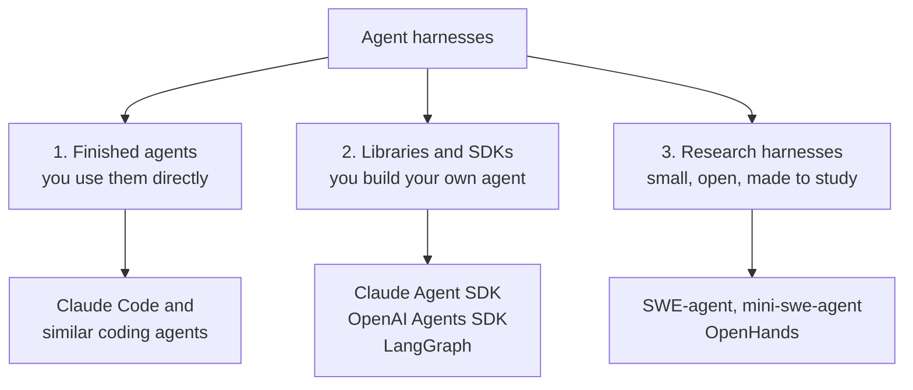

# 9. Harnesses in practice

> **In one line:** Real harnesses come as finished tools, as libraries, and as research code. They share the same parts from chapters 2 to 8. Choose the simplest one that fits, and expect to remove parts as models improve.

## Three kinds of harness

| Name | Kind | What it is |
|---|---|---|
| **Claude Code** | Finished agent | Anthropic's coding agent for the terminal and other surfaces. It has the parts this handbook describes: tools for files and commands, permission modes, a sandbox, project instruction files, compaction, sub-agents |
| **Claude Agent SDK** | Library | The harness behind Claude Code, offered as a library so you can build other agents on it |
| **OpenAI Agents SDK** | Library | An open-source framework for agents and multi-agent workflows, with tools, handoffs between agents, guardrails and tracing |
| **LangGraph** | Library | A framework where you describe the agent as a graph of steps with saved state, so runs can pause and resume |
| **SWE-agent** | Research | The harness from the agent-computer interface paper. Takes a GitHub issue and tries to fix it |
| **mini-swe-agent** | Research | A very small version by the same group, about 100 lines for the agent itself. Excellent for reading |
| **OpenHands** | Research and product | An open platform for coding agents that run in a sandboxed environment |

Reading the source of a small harness is one of the best ways to learn. Start with mini-swe-agent or with Thorsten Ball's tutorial *How to Build an Agent*.

## Every harness answers the same questions

Use this table to study any harness you meet.

| Question | Chapter |
|---|---|
| How does the loop run, and when does it stop? | [2](02-the-agent-loop.md) |
| Which tools exist? How are they described? What happens on errors? | [3](03-tools-and-tool-design.md) |
| What is in the system prompt? How are long results handled? | [4](04-context-engineering.md) |
| What happens when the context is full? Is there memory across sessions? | [5](05-memory-and-long-tasks.md) |
| Is there planning? Are there sub-agents? | [6](06-planning-and-sub-agents.md) |
| What may it do without asking? What is the sandbox? | [7](07-permissions-and-sandboxing.md) |
| How does it check its work? Can I see a trace? | [8](08-reliability-and-observability.md) |

## The 12-factor agents list

The *12-factor agents* guide collects principles from people who built production agents. The titles alone are a good summary of this whole part:

| # | Factor | In our words |
|---|---|---|
| 1 | Natural language to tool calls | The model's core job: turn a request into a structured call |
| 2 | Own your prompts | Write and version your prompts yourself. Do not hide them in a framework |
| 3 | Own your context window | Decide exactly what the model sees |
| 4 | Tools are just structured outputs | A tool call is JSON that your code chooses how to handle |
| 5 | Unify execution state and business state | Keep one clear record of where the run stands |
| 6 | Launch, pause, resume with simple APIs | Runs can stop and continue |
| 7 | Contact humans with tool calls | Asking a person is just another tool |
| 8 | Own your control flow | Your code decides what happens between model calls |
| 9 | Compact errors into the context window | Feed errors back, in short form |
| 10 | Small, focused agents | Narrow jobs work better than one giant agent |
| 11 | Trigger from anywhere | Start agents from chat, email, schedules, events |
| 12 | Make your agent a stateless reducer | Given the state so far, produce the next step |

The spirit of the list: an agent is mostly ordinary software with a model call inside. Keep control of the software.

## Use a framework or write your own?

| | Write your own loop | Use a library |
|---|---|---|
| **Good** | You understand all of it. Easy to debug. No hidden prompts | Tool calling, retries, tracing, sub-agents and state are ready |
| **Bad** | You rebuild common parts | Hidden behaviour. Harder to see the real prompt. Version changes |

Anthropic's *Building effective agents* advises starting with direct model calls, because many patterns need only a few lines. If you use a framework, make sure you understand the code underneath. Wrong guesses about what a framework does inside are a common source of bugs.

For learning: write the loop once yourself ([chapter 10](10-build-a-mini-harness.md)). After that you can use any library with open eyes.

## Giving a harness your project knowledge

A harness is general. Your project is specific. Finished harnesses give you several places to add what they cannot know.

| Mechanism | What it does |
|---|---|
| **Project instruction file** | Standing notes loaded on every run: how to build, test and format; what never to touch. `CLAUDE.md` in Claude Code. `AGENTS.md` is an open format for the same purpose |
| **Custom commands and skills** | Saved instructions for a task you repeat, loaded only when needed |
| **MCP servers** | Extra tools and data sources ([chapter 3](03-tools-and-tool-design.md)) |
| **Hooks** | Your own script that runs before or after a tool call |
| **Permission settings** | What is allowed without asking ([chapter 7](07-permissions-and-sandboxing.md)) |
| **Custom sub-agents** | Named helpers with their own prompt and tool set |

Keep the instruction file short and true. It is in the context on every call.

### Working well with a coding agent

Anthropic's best-practice guide for Claude Code gives advice that fits any coding harness:

- **Give it a way to check its work**: tests, a build command, a screenshot.
- **Explore, then plan, then code.** Do not let it start typing at once on a big change.
- **Be specific.** Name the file, the function, the expected behaviour.
- **Manage the context.** Start a fresh session for a new task. A context full of an old task makes the next one worse.
- **Correct early.** Stop a wrong direction at once instead of letting it run.

## Harnesses change as models improve

This is easy to miss, and important.

Every part of a harness exists because the model needed help with something. When the model gets better, some of that help turns into dead weight: extra cost, extra delay, and sometimes worse results.

Anthropic's harness-design article describes exactly this. With an earlier model, the team needed to split the work into small pieces, with full context resets between them and an evaluator after each piece. With a newer model, the piece-by-piece structure could be removed, and the evaluator run once at the end. Their advice: when a new model arrives, look at each harness part again and remove what no longer carries weight. An evaluator is worth its cost only for tasks beyond what the model does reliably alone.

Practical consequences:

1. **Prefer simple harnesses.** Less to remove later.
2. **Know why each part exists.** Write it down: "added because the agent kept finishing without testing".
3. **Re-test when you change models.** Turn parts off one at a time and measure.
4. **Do not copy a harness blindly.** It was tuned for one model at one time.

## Harness and benchmark scores

A benchmark score for an agent is always a score for **model + harness**.

- SWE-agent showed that a better interface raises the score of the same model.
- *AI Agents That Matter* showed that some complex agents were no better than simple ones once cost was counted, and asks for results to report cost alongside accuracy.

So when you compare models using agent benchmarks ([evaluations chapter 9](../evaluations/09-benchmarks-and-their-limits.md)), check that the harness and the budget were the same.

## Key terms

- **SDK:** a software development kit; a library for building something.
- **Handoff:** one agent passing the conversation to another.
- **Project instruction file:** standing notes for the agent (`CLAUDE.md`, `AGENTS.md`).
- **Skill / custom command:** saved instructions for a repeated task.
- **Hook:** a script the harness runs at a fixed point.
- **Load-bearing:** a part that still does necessary work.

## Revision questions

1. Name the three kinds of harness and give one example of each.
2. Which seven questions can you ask of any harness?
3. What is a project instruction file, and why should it be short?
4. Why might you remove part of a harness after switching to a better model?
5. Two teams report different scores for the same model on an agent benchmark. Give two reasons that are not about the model.

Show answers

1. Finished agents (Claude Code), libraries and SDKs (Claude Agent SDK, OpenAI Agents SDK, LangGraph), and research harnesses (SWE-agent, mini-swe-agent, OpenHands).
2. How does the loop run and stop? Which tools and how are errors handled? What is in the context and how are long results handled? What happens when the context is full, and is there memory? Is there planning or sub-agents? What may it do without asking, and what is the sandbox? How does it check its work, and is there a trace?
3. A file of standing notes (build, test, style, things to avoid) that the harness loads on every run. It uses context on every call, so every extra line costs tokens and attention each time.
4. Each part exists to cover a weakness of the model. If the new model no longer has that weakness, the part only adds cost, delay and sometimes errors.
5. They used different harnesses (tools, prompts, interface), or different budgets (steps, tokens, retries, number of attempts).

## Sources

- Anthropic, [Building effective AI agents](https://www.anthropic.com/research/building-effective-agents) · [Building agents with the Claude Agent SDK](https://www.anthropic.com/engineering/building-agents-with-the-claude-agent-sdk) · [Agent SDK overview](https://platform.claude.com/docs/en/agent-sdk/overview)
- Anthropic, [Best practices for Claude Code](https://www.anthropic.com/engineering/claude-code-best-practices) · [Claude Code repository](https://github.com/anthropics/claude-code)
- Anthropic, [Harness design for long-running apps](https://www.anthropic.com/engineering/harness-design-long-running-apps) (2026)
- [OpenAI Agents SDK](https://github.com/openai/openai-agents-python) · [LangGraph](https://github.com/langchain-ai/langgraph)
- [SWE-agent](https://github.com/SWE-agent/SWE-agent) · [mini-swe-agent](https://github.com/SWE-agent/mini-swe-agent) · [OpenHands](https://github.com/All-Hands-AI/OpenHands)
- HumanLayer, [12-factor agents](https://github.com/humanlayer/12-factor-agents) · [AGENTS.md](https://agents.md/)
- Thorsten Ball, [How to Build an Agent](https://ampcode.com/how-to-build-an-agent) (2025)
- Yang et al., [SWE-agent](https://arxiv.org/abs/2405.15793) (2024) · Wang et al., [OpenHands](https://arxiv.org/abs/2407.16741) (2024) · Kapoor et al., [AI Agents That Matter](https://arxiv.org/abs/2407.01502) (2024)

---
Previous: [8. Reliability and observability](08-reliability-and-observability.md) · Next: [10. Build a mini harness](10-build-a-mini-harness.md) · [Back to contents](../README.md)
