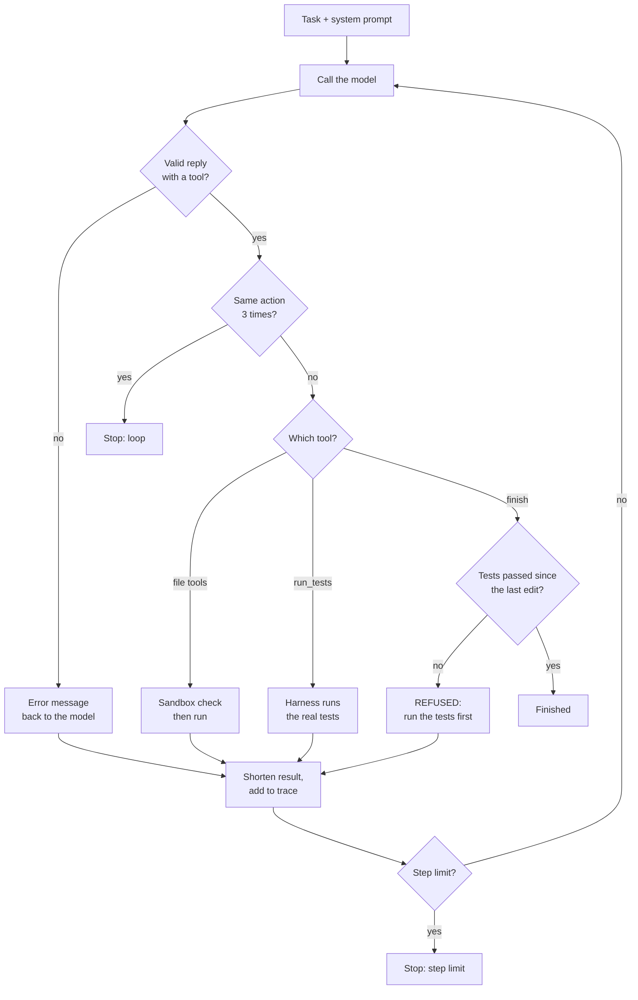

# 10. Build a mini harness (step by step)

> **In one line:** In about 200 lines of plain Python you can build a real harness: a loop, checked tools, a sandboxed workspace, limits, a "verify before done" rule and a trace. Building it once makes every other harness easy to understand.

The code is in [`code/ch10_mini_harness/`](code/ch10_mini_harness/).

```bash
cd harness/code/ch10_mini_harness
python harness.py
python test_harness.py
```

Both run with no key and write only inside a temporary folder.

## The task

A workspace holds one file, `calc.py`, with a bug:

```python
def average(numbers):
    """Return the average of a list. An empty list gives 0."""
    return sum(numbers) / 2
```

The agent must fix it so that three tests pass: `average([2, 4, 6]) == 4`, `average([5]) == 5`, `average([]) == 0`.

The model is a **mock**: plain Python that picks the next step. This keeps the run the same every time. The mock makes two mistakes on purpose, so that you can watch the harness catch them:

1. It tries to finish without running the tests.
2. Its first fix is incomplete (it crashes on an empty list).

## The design



## Step 1. The workspace and its sandbox ([chapter 7](07-permissions-and-sandboxing.md))

All files live in one temporary folder. Every path from the model goes through one check:

```python
def _safe(self, path):
    full = os.path.realpath(os.path.join(self.root, path))
    if os.path.commonpath([full, self.root]) != self.root:
        raise PermissionError(f"'{path}' is outside the workspace")
    return full
```

There is **no** general `run_command` tool. The only thing the agent can execute is `run_tests`, and the harness defines what that does. A narrow tool is the simplest sandbox.

## Step 2. The tools ([chapter 3](03-tools-and-tool-design.md))

Five tools: `list_files`, `read_file`, `write_file`, `run_tests`, `finish`.

One function handles every call. It checks the request, runs it, and **always returns text**:

```python
def call_tool(workspace, name, args):
    if name not in TOOL_ARGS:
        return f"ERROR: unknown tool '{name}'. Tools: {', '.join(TOOL_ARGS)}."
    missing = [a for a in TOOL_ARGS[name] if a not in args]
    if missing:
        return f"ERROR: missing argument(s) {missing} for {name}."
    ...
    try:
        result = str(getattr(workspace, name)(**{a: args[a] for a in TOOL_ARGS[name]}))
    except PermissionError as error:
        return "BLOCKED BY SANDBOX: " + str(error)
    except FileNotFoundError:
        return "ERROR: file not found. Call list_files to see what exists."
    if len(result) > MAX_RESULT_CHARS:
        result = result[:MAX_RESULT_CHARS] + f"... [cut: {len(result)} characters in total]"
    return result
```

Nothing the model sends can crash the loop. Long results are cut ([chapter 4](04-context-engineering.md)).

## Step 3. Verify before "done" ([chapter 8](08-reliability-and-observability.md))

`finish` is a tool, so the harness can say no:

```python
if name == "finish":
    if not workspace.tests_passed_since_last_write:
        return "REFUSED: you may only finish after run_tests passes on the current files. Call run_tests."
    return "FINISHED"
```

The flag is set only by a passing `run_tests`, and **every edit resets it**:

```python
def write_file(self, path, text):
    ...
    self.tests_passed_since_last_write = False       # any edit makes old test results worthless
```

Without that reset, an agent could pass the tests, break the code with one more edit, and still finish. This small detail is the kind of thing a harness is for.

The tests are run by the harness and are not a file in the workspace. So the agent cannot weaken them.

## Step 4. The loop ([chapter 2](02-the-agent-loop.md))

```python
for step in range(1, max_steps + 1):
    reply = model(messages)

    if not isinstance(reply, dict) or "tool" not in reply:
        result = "ERROR: reply must be JSON with a 'tool' field."
    else:
        action = json.dumps([reply["tool"], reply.get("args", {})], sort_keys=True)
        recent_actions.append(action)
        if recent_actions[-3:].count(action) == 3:
            return {"status": "loop", ...}                 # loop detection
        result = call_tool(workspace, reply["tool"], reply.get("args", {}))

    messages.append({"role": "assistant", "content": json.dumps(reply)})
    messages.append({"role": "tool", "content": result})
    trace.append({"step": step, "tool": reply["tool"], "result": result, "tokens_in": tokens_in})

    if result == "FINISHED":
        return {"status": "finished", ...}

return {"status": "step_limit", ...}                       # step limit
```

Three ways out: finished, loop detected, step limit. Each returns a different status, so the caller always knows why the run ended.

## Step 5. Run it

```text
step 1: See what files exist.
        list_files -> calc.py
step 2: Read the file with the bug.
        read_file -> def average(numbers):
step 3: It divides by 2, not by the count. Fix that.
        write_file -> wrote calc.py
step 4: That should do it. I am done.
        finish -> REFUSED: you may only finish after run_tests passes on the current files. Call run_tests.
step 5: I must run the tests first.
        run_tests -> FAIL: average raised ZeroDivisionError: division by zero
step 6: The empty list crashes. Handle that case.
        write_file -> wrote calc.py
step 7: Test the new version.
        run_tests -> PASS: 3 of 3 tests passed
step 8: Tests pass. Now I can finish.
        finish -> FINISHED

STATUS : finished
STEPS  : 8
Final check by the harness, not by the agent: PASS: 3 of 3 tests passed
```

Read steps 4 and 5 again. The model was confident and wrong. Without the harness rule, the run would have ended at step 4 with broken code and a cheerful summary. With the rule, the failure became feedback, and the agent repaired its work.

**This is the main lesson of the whole part: the harness turns a model that is often right into a system that is reliably right.**

## Step 6. Test the harness

A harness is software, so it gets tests. [`test_harness.py`](code/ch10_mini_harness/test_harness.py) uses a different mock model for each situation.

```text
[PASS] normal run finishes
[PASS] outcome: tests really pass at the end
[PASS] finish was refused before any test passed
[PASS] a failing test was reported back to the model
[PASS] every step is in the trace
[PASS] loop detection stops a repeating model
[PASS] step limit stops a model that never finishes
[PASS] a model that only claims success never finishes
[PASS] sandbox blocks reading outside the workspace
[PASS] sandbox blocks writing outside the workspace
[PASS] unknown tool gives an error message, not a crash
[PASS] missing argument gives an error message, not a crash
[PASS] an edit after a passing test makes 'finish' refused again

13/13 tests passed
```

Mock models are a strong testing tool. With a real model you cannot force "the model loops" or "the model lies about being done". With a mock you can, every time, for free. Test the harness with mocks, then measure the whole agent with evals on a real model ([evaluations chapter 6](../evaluations/06-evaluating-agents.md)).

## What is missing

| Missing | Why it matters | Chapter |
|---|---|---|
| A real model with native tool calling | The mock does not read or reason | [2](02-the-agent-loop.md) |
| Context management | Fine for 8 steps, not for 800 | [4](04-context-engineering.md) |
| Memory across sessions | A second run starts from zero | [5](05-memory-and-long-tasks.md) |
| A real OS-level sandbox | Our check guards only our own file functions | [7](07-permissions-and-sandboxing.md) |
| Permission prompts | Everything inside the workspace runs without asking | [7](07-permissions-and-sandboxing.md) |
| Retries for API errors | A mock never times out | [8](08-reliability-and-observability.md) |
| A saved trace | The trace is only in memory | [8](08-reliability-and-observability.md) |

## Using a real model

To swap the mock for a real model, write a function with the same shape: it takes the message list and returns a dict with `thought`, `tool` and `args`. Inside, call the model through its tool-calling API (see the links in [chapter 2](02-the-agent-loop.md)), or ask for JSON and validate it as in [guardrails chapter 6](../guardrails/06-structured-output-validation.md).

Things to expect:

- A real run uses one request per step. With a free account of about 50 requests a day, a few runs use up the day. Keep `max_steps` low.
- Small free models often make bad tool calls. Your error messages now matter a lot.
- The run will differ each time. That is why agent evals use several trials.
- Before giving a real model `write_file`, be sure the sandbox holds. Start with read-only tools.

The loop, the tools, the sandbox and the finish rule do not change at all. That is the point of a harness: the model is one replaceable part.

## Exercises

1. Add a `read_file` option for `start` and `count` lines, with a note about how many lines are left.
2. Add a to-do list tool, and show the list to the model on every step.
3. Save the trace to a JSON file at the end of the run.
4. Add a permission mode: in `ask` mode, `write_file` needs a yes from a scripted approver.
5. Add compaction: when the messages pass a token budget, replace old tool results with one-line notes.
6. Write a new mock model that tries to read `../../secret.txt`, and a test that it gets blocked and then recovers.

## Checklist for any harness

- [ ] The loop has a step limit, and stops on repeated actions
- [ ] Every tool call is checked; errors come back as helpful text
- [ ] Long tool results are cut, with a note
- [ ] File and command access is limited by code, not by the prompt
- [ ] "Done" is accepted only after a real check
- [ ] Edits reset earlier check results
- [ ] The agent cannot change its own checks
- [ ] Every step is recorded in a trace
- [ ] The run ends with a clear status: finished, limit, loop or error
- [ ] The harness has its own tests, using mock models
- [ ] You can say why each part exists

## Revision questions

1. Why is `finish` a tool and not just "the model stops calling tools"?
2. What does `tests_passed_since_last_write` protect against? Why is it reset on every write?
3. Name the three ways the loop can end and the status of each.
4. Why are mock models useful for testing a harness?
5. What changes in the harness when you replace the mock with a real model?

<details>
<summary>Show answers</summary>

1. As a tool call, finishing passes through the harness, which can check a condition (tests passed) and refuse. If the model simply stopped, nothing could verify the work first.
2. It stops the agent from finishing with untested code. It is reset on every write because an edit can break code that passed before, so an old pass proves nothing about the new file.
3. The model finishes after a passing test (`finished`); the same action is repeated three times (`loop`); the maximum number of steps is reached (`step_limit`).
4. They let you force exact situations (looping, lying, bad tool calls) every time, quickly and at no cost. A real model cannot be made to misbehave on demand.
5. Only the model function. The loop, tools, sandbox, limits and finish rule stay the same. You add retries for API errors and keep step limits low because every step now costs a request.

</details>

## Sources

- Thorsten Ball, [How to Build an Agent](https://ampcode.com/how-to-build-an-agent) (2025)
- [mini-swe-agent](https://github.com/SWE-agent/mini-swe-agent)
- Anthropic, [Building effective AI agents](https://www.anthropic.com/research/building-effective-agents) · [Effective harnesses for long-running agents](https://www.anthropic.com/engineering/effective-harnesses-for-long-running-agents) (2025)
- HumanLayer, [12-factor agents](https://github.com/humanlayer/12-factor-agents)
- OpenRouter, [Tool and function calling](https://openrouter.ai/docs/guides/features/tool-calling) · [API rate limits](https://openrouter.ai/docs/api-reference/limits)

---
Previous: [9. Harnesses in practice](09-harnesses-in-practice.md) · Next: [Harness reading list](papers.md) · [Back to contents](../README.md)
